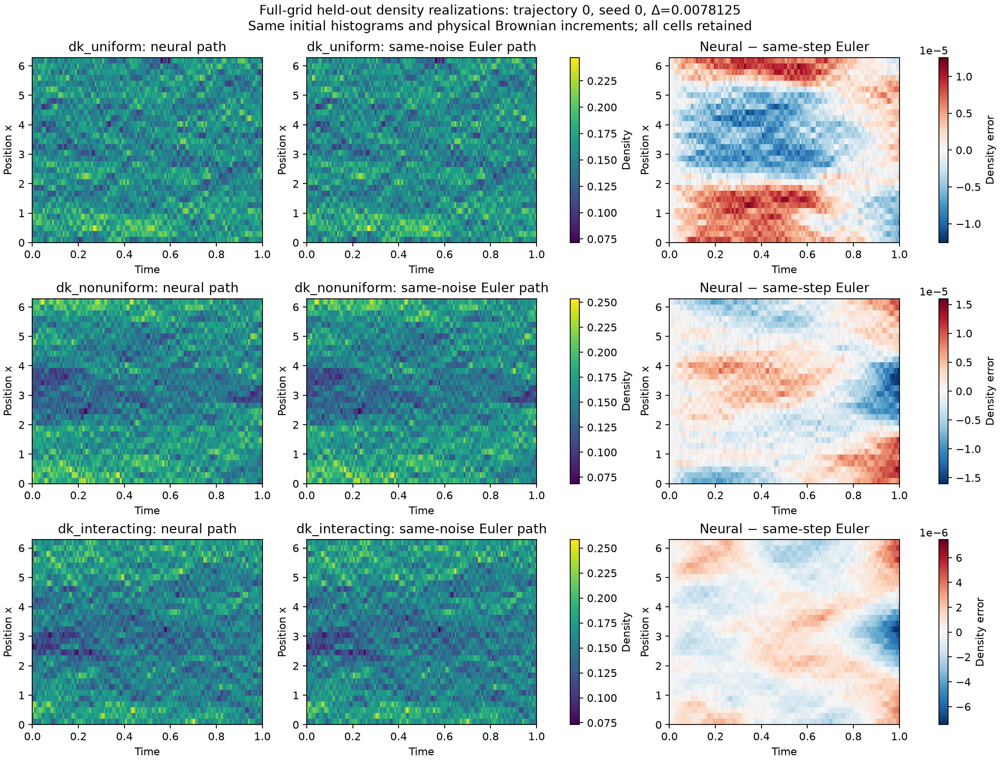

# NN-DK

[](https://github.com/xrough/nn-dk/actions/workflows/verify.yml)

Neural numerical experiments for **Dean–Kawasaki dynamics and coarse particle
systems**, by Xiaohao Ji. The project studies when neural solvers can reproduce
stochastic density paths or answer repeated statistical queries, using
conservative numerical references and explicit uncertainty diagnostics.

A causal density-path network maps an initial histogram and physical Brownian
increments to every cell mass along a realization. Separate statistics networks
predict selected conditional means and covariances. The code keeps their targets,
accuracy evidence, and timing scopes distinct.

Start with the [DK background guide](docs/DK_BACKGROUND.md), adapted from selected
chapters of my doctoral thesis, for the particle-to-field derivation and its
connection to these numerical models.



## Install and run

Requirements: **Python 3.12**, Git, and [uv](https://docs.astral.sh/uv/).
The committed `uv.lock` fixes the dependency environment. The smoke example runs
on CPU; a GPU is not required.

```bash
git clone https://github.com/xrough/nn-dk.git
cd nn-dk
uv sync --locked --group dev --python 3.12
uv run nn-dk path-solver --preset path-smoke --output runs/path-smoke
```

The smoke command calibrates the numerical setup, generates inputs, fits five
small control/DK models, evaluates them, and writes `runs/path-smoke/report/`
with Markdown/JSON results and a CSV table. It is an executable check, not the
full scientific study. Training time depends on the machine; use
`--budget-seconds 600` to limit each invocation. Exit **75** means work has been
checkpointed: repeat the identical command to resume.

For checks and additional configurations:

```bash
uv run ruff check .
uv run pytest
uv run nn-dk path-solver --config configs/path_refinement_smoke.toml \
  --output runs/path-refinement-smoke
```

Use a full Git clone. Frozen-model reproduction restores historical source
commits; a shallow checkout is insufficient. Existing environments can run
`.venv/bin/nn-dk`, `.venv/bin/pytest`, and `.venv/bin/ruff` directly. Source and
configuration hashes guard saved outputs, so choose a new output directory after
changing numerical source or configuration. See [contributing](CONTRIBUTING.md)
and the [verification guide](docs/verification.md).

## What is implemented?

| Workflow | Output and purpose | Guide |
|---|---|---|
| `path-solver` | Full stochastic finite-volume cell-mass paths from initial states and physical noise; learned causal Volterra/Picard response with known interaction and mobility | [Path solver](docs/PATH_SOLVER.md) |
| `interacting-moments` | Selected means and full same-time covariance, conditioned on the complete interacting state | [Interacting solvers](docs/INTERACTING_SOLVERS.md) |
| `generator` | Structured generator-residual moment predictions for the declared observable bank | [Generator moments](docs/GENERATOR_MOMENTS.md) |
| `bsde`, `bsde-study` | Conditional value/statistics maps and initial-state coverage studies | [BSDE statistics](docs/BSDE_STATISTICS.md) |
| `analysis/run_payoff_boundary_regimes.py` | Boundary-consistent generator-residual statistics with native short-time slopes, robust fixed-unit losses, and independent all-seed comparison | [Boundary formulation](docs/BSDE_STATISTICS.md#boundary-consistent-generator-formulation) |
| `convergence` | Autonomous native-DK coefficient learning, ablations, and refinement experiments | [Coefficient convergence](docs/PROJECT_A_CONVERGENCE.md) |
| `run` | Original particle/coarse-dynamics A/B benchmark | [Numerical methods](docs/methods.md) |

Every workflow has its own target identifiers, configuration, checkpoints, and
reference conventions. Their fitted weights and accuracy claims are not
interchangeable. The [analysis guide](analysis/README.md) describes postprocessing,
timing and the completed independent generalization study. Reproducing its
historical models requires the full local study inputs.

## Current evidence

The [29 October gradient and residual-transport diagnostics](docs/experiments/payoff_diagnostics_2026-10-29.md)
are complete on frozen validation anchors. They identify large mean-gradient and
covariance-source discrepancies in the strongest regime; unresolved time,
quadrature and stopping effects prevent treating residuals as an error
certificate. The new matched sampling/loss comparison has completed and locked
all **72 fits**, and its [stratum residual audit](docs/experiments/payoff_collocation_residuals_2026-10-30.md)
retains every variant and seed. The natural validation pools leave the closest
boundary stratum empty; reweighting occupied states does not supply evidence for
that missing region. These selection-pool residuals are descriptive.

Its [independent accuracy review](docs/experiments/artifacts/readme_research_2026-10-30/collocation_accuracy/collocation_independent_accuracy_findings.md)
now verifies **576 primary predictions** and **732 retained records**. Lower
residual MSE does not repair the strongest case: at `T=1, κ=6`, stratified
squared-loss models have worst mean discrepancies of **8.43–11.1 reference SD**
and covariance discrepancies of **3.54–6.97 reference-SD products**. The fine
Gaussian control gives **0.256 / 0.169**, respectively. Across 864 pointwise
comparison blocks, none favors the NN for all three seeds, while 377 favor
Gaussian. These counts do not establish simultaneous confidence. The
[final collocation report](docs/experiments/payoff_collocation_2026-10-30.md)
retains all variants and costs: warm supplied-state medians are **0.715–0.836 ms**,
and fresh 16,384-histogram IID estimates take **0.313–0.475 s**. No
accuracy-qualified training-cost crossover is established.

The [nonlinear-LNA correction study](docs/experiments/lna_payoff_correction_2026-10-30.md)
has completed all **18 fits**, independent accuracy, joint contrasts and isolated
timings. Every fit ran 1,000 Adam and 30 L-BFGS outer updates in each stage, but
natural-validation selection retained **step 0 for both heads in every fit**.
All 324 trained group/time point-error rows match the gated zero-correction
baseline exactly. The paid optimization therefore supplies no learned-head
improvement; any advantage over older methods belongs to the baseline.

The selected baseline's worst mean/covariance discrepancies are **24.65% / 8.87%**
of reference SD / SD products at `T=1, κ=6`. The other five cases have point
discrepancies below 5%, but uncertainty requirements still prevent a blanket
accuracy claim. One warm complete conditional call takes **13.15–54.01 ms**;
full uncached IID calls take **31.31–164.82 s**, including a separate Gaussian
ODE for every histogram. These are single observations per workload, not
latency distributions. Standalone offline charges remain **1,463–1,513 s** per
selected model, including its paid preparation and fitting. No qualified
payback is established.

Both fit sets and the joint protocol preceded **589,824 fresh reference families**.
The declared computational investigation is complete, retaining **792 primary /
948 total records**, all seeds, failures and stopped paths. The
[collocation archive](docs/experiments/artifacts/payoff_collocation_2026-10-30/README.md),
[correction archive](docs/experiments/artifacts/lna_payoff_correction_2026-10-30/README.md),
[composite research record](docs/experiments/readme_research_2026-10-30_completion.json)
and [task ledger](docs/README_TASKS.md) preserve the evidence and unresolved
finite-Euler, stopping and continuum limitations.

The historical [27 October boundary and residual-loss repair rerun](docs/experiments/payoff_boundary_regimes_2026-10-27.md)
is complete: 18 new v3 fits, 18 frozen v2 controls, and 589,824 fresh native
reference families at T=0.25/1 and κ=0.75/3/6. The moving boundary gate and exact
native short-time slopes pass their consistency audits. **Overall prediction
accuracy does not improve.** Of 216 group/time/statistic comparisons, 21 favor
v3 over v2 for all three seeds with resolved pointwise intervals; 49 favor v2.
Against fine Gaussian, none consistently favors v3 and 85 favor Gaussian.
These counts do not establish simultaneous grid-wide confidence.

At T=1, κ=6, v3's worst mean error improves to **2.47–3.05 reference SD**, versus
**5.75–5.86** for v2 and **0.260** for Gaussian. Terminal covariance error worsens
to **304–326%** of reference SD products; integral covariance error remains
**94.3–94.6%**. Rare boundary rows still dominate covariance residuals under the
robust objective. The [statistics guide](docs/BSDE_STATISTICS.md#boundary-consistent-generator-formulation)
records the common-unit residual and matched-stage diagnosis.

Each new fit takes **513–635 s**. Warm supplied-state inference takes
**0.701–0.738 ms**, versus **7.8–31.8 ms** for the cheaper Gaussian step.
Independent-IID integration takes **312–349 ms**, versus **7.9–31.8 ms** for
Gaussian; native MC takes **1.9–7.8 s** per 16,384-path estimate. No
accuracy-qualified training-cost crossover is established. All **1,181 tests**,
numerical replay audits, and the **408-workload** isolated timing benchmark
passed. Full costs, uncertainty, all seeds and the stopped finite-grid scope
remain in the [evidence archive](docs/experiments/artifacts/payoff_boundary_regimes_2026-10-27/README.md).

The preceding [longer-horizon, stronger-interaction study](docs/experiments/payoff_regimes_2026-10-27.md)
tests T=0.25/1 and κ=0.75/3/6 at G=32, N=2048. All 18 repaired statistics
fits and 589,824 independent native reference families are retained. Across
216 group/horizon/statistic comparisons, **none favors the NN for all three
optimizer seeds with resolved pointwise intervals**; 57 favor the fine Gaussian
approximation. This is not a simultaneous grid-wide confidence statement.

At T=1, κ=6, the NN's worst mean discrepancy reaches **5.85–6.30 reference
standard deviations**, versus **0.252** for Gaussian. Worst normalized
covariance discrepancies are **94.5–95.2% versus 18.2%**. Native Monte Carlo
retains all stopped paths. The audit identifies an inconsistent short-time
boundary gate and concentrated validation loss; it also finds substantial
interior fitting error. No fit was changed after reading reference outcomes.
Each NN fit recorded **481–743 seconds**. The report retains conditional and
independent-ensemble inference, cold setup, training and total prediction costs;
no accuracy-qualified NN cost crossover is established.
Warm conditional NN inference is **0.63–0.73 ms**, versus **7.9–32.6 ms** for
the cheaper Gaussian step. Initial-ensemble NN integration takes **259–296 ms**,
versus **7.9–32.6 ms** for Gaussian. Native MC takes **2–8.5 s** per independent
16,384-path estimate. These findings concern the declared stopped finite-grid
law and fixed observable bank.

The [statistics formulation repair](docs/experiments/payoff_repair_2026-10-27.md)
uses known heat moments, separate mean/covariance networks and staged training
to resolve the earlier integral-variance collapse. Ten fresh fits and another
98,304 independent reference families retain every ablation and optimizer seed.
Repaired worst mean/covariance point discrepancies are about **2.4% / 3.3%**;
sampling intervals still leave the blanket 5% criterion unresolved.

One fixed-bank conditional query takes **0.586–0.683 ms**, after **230–276 s**
of fitting per model, versus **1.83–2.00 ms** for the no-training Gaussian
approximation. Initial-ensemble NN integration takes **265–289 ms**, versus
**1.87–2.04 ms** for the Gaussian approximation. Costs refer to four means and
same-time 4×4 covariances at three horizons. The
[repair archive](docs/experiments/artifacts/payoff_repair_2026-10-27/README.md)
contains the controlled diagnosis, all seeds, cold/warm costs and uncertainty
accounting. The [completion checks](docs/experiments/payoff_repair_2026-10-27_completion.json)
record the final tests and archive verification. No accuracy-qualified training-cost
crossover is certified.

The earlier [independent broader-task comparison](docs/experiments/path_task_advantages_2026-10-27.md)
is complete: 98,304 independent reference families, six initial-state groups,
174 main evaluations, twelve literal Gaussian checks and twelve newly fitted
statistics heads, retaining all optimizer seeds. It compares full paths, new
Fourier queries, time-integrated functionals, moments and sensitivities, with
fitting, preparation and inference costs recorded separately.

**Neither neural method establishes a general advantage in this comparison.**
Compiled native Euler is faster for complete paths and derivatives. The
linear-Gaussian approximation is the inexpensive statistical control in this
short, weak-noise setting. The original statistics heads have fast conditional inference
but miss the accuracy targets, particularly for integrated observables. The
earlier fixed-bank success below therefore remains specific to that bank.
The [compact evidence archive](docs/experiments/artifacts/path_task_advantages_2026-10-27/README.md)
retains the complete tables, figures, training metadata and audits. No
accuracy-qualified neural training-cost crossover is established.

The [completed interacting follow-up](docs/experiments/interacting_followup_2026-10-25.md)
covers **24 fits**, uniform/nonuniform initial laws, and three time steps at
G=32, N=2048, D=1, T=1/16. Full-field path errors against a coupled fine Euler
reference, measured on a common time grid, decrease as follows:

| Fitted step | NN / fine-Euler strong RMS |
|---|---:|
| 2^-8 | 16.51–16.73% |
| 2^-9 | 7.719–7.734% |
| 2^-10 | 3.597–3.647% |

All 18 same-step Euler gates passed. The unscaled statistics model's conditional
mean and covariance point errors were **1.22–2.42%** and **0.73–2.58%**, with
pointwise interval endpoints below 5% relative to the finite Euler reference.
The report defines the fixed fluctuation units used by these percentages;
they are not relative errors of possibly zero means.

Warm conditional statistics queries took **0.36–0.76 ms** in that experiment.
Ensemble initialization largely removed the prepared-input cost advantage, and
the path network was slower than native Euler for the matched moment tasks.
These measurements support a specific conditional-statistics use case, not a
general neural speedup claim. Continuous-time accuracy and the stricter reference
uncertainty budget remain unresolved.

The separate **T=1, three-seed first path batch is complete**: all 15 configured
fits and same-step accuracy gates passed. Its largest same-step strong RMS was
0.1104%, while stochastic NN/fine-Euler errors remained about 44–45% at the
selected coarse step. The [compact archive](docs/experiments/artifacts/path_first_batch_2026-10-25/README.md)
contains the complete per-seed report, figures, timing scopes, checkpoint metadata,
and checksums. This complements the earlier
[short-run path report](docs/experiments/path_solver_2026-10-25.md),
[smoke archive](docs/experiments/artifacts/path_smoke_2026-10-25/README.md), and
[refinement archive](docs/experiments/artifacts/path_refinement_smoke_2026-10-25/README.md).

Earlier tracks retain their own source freezes and results:

- [Structured generator-moment study](docs/experiments/generator_accuracy_2026-10-25.md): 15 declared statistical comparisons passed for selected moments.
- [BSDE coverage study](docs/experiments/bsde_anchor_study_2026-10-24.md): 36 fits; broader initial-state coverage helped, but 5% accuracy remained unresolved.
- [Autonomous coefficient study](docs/experiments/a_first_batch_2026-10-24.md) and [first BSDE batch](docs/experiments/bsde_first_batch_2026-10-24.md): separate numerical targets and diagnostics.

## Numerical interpretation and reproducibility

The native DK model is a **stopped finite-volume Itô system**. Euler segments
freeze at their first crossing of density `0.01/(2*pi)`. States are never clipped
or renormalized; crossing proposals remain uncensored, and stopped paths remain
in the statistics. Training uses initial histograms and the physical Brownian
inputs, with optimizer randomness kept separate.

Agreement with same-step Euler measures neural approximation of that numerical
target. A finer Euler comparison measures a separate finite-reference difference.
Neither establishes continuous-time stopped-DK convergence, a continuum SPDE
limit, or rare-event accuracy. The
[operator audit](docs/PATH_OPERATOR_AUDIT.md) and
[evidence audit](docs/PATH_SOLVER_EVIDENCE_AUDIT.md) document the distinctions.

Committed archives contain compact synthetic evidence. Full binary checkpoints
and trajectory banks remain in ignored local `runs/` directories and must be
regenerated to reproduce inference from those weights. Historical results should
be reproduced at their recorded source commit, with the source guards intact.
Test counts in historical experiment reports describe those recorded revisions.

## Attribution, citation, and licenses

The [mathematical provenance](docs/provenance.md) credits the thesis material,
research papers, and earlier simulation ideas. The
[DK guide](docs/DK_BACKGROUND.md) explains the relevant theory and assumptions.
Please cite [NN-DK](CITATION.cff) and the research papers relevant to your use.

Code is available under the [MIT License](LICENSE). Project-authored documentation,
figures, and archived synthetic evidence use [CC BY 4.0](LICENSE-DOCS), with
third-party attribution preserved. See [license coverage](LICENSING.md).
