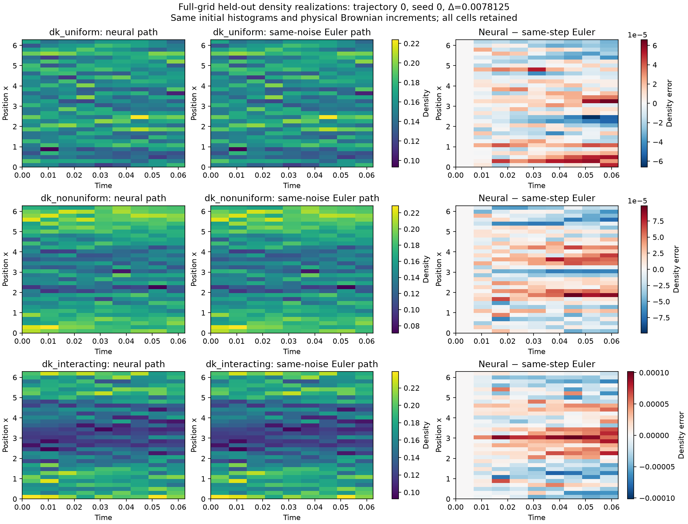

# NN-DK

Neural numerical experiments for Dean–Kawasaki dynamics and coarse particle systems.

**Project A now has a causal neural solver that generates full stochastic density paths.** It takes native initial cell masses and physical Brownian increments, and returns all 32 cell masses along each realization. A learned Volterra response kernel and fixed-depth Picard blocks retain the known interaction and multiplicative noise. Network weights remain fixed during simulation.

The [method guide](docs/PATH_SOLVER.md) explains the ansatz, Itô residual, stopping convention and sampler API. The [mathematical audit](docs/PATH_OPERATOR_AUDIT.md) separates architectural properties from claims that require experiments. The earlier neural moment predictor is a separate statistics model.

## Verified results

The completed short-horizon checks use **G=32, N=2048, D=1, T=1/16**. They cover deterministic heat, additive-noise heat, uniform DK, nonuniform DK and interacting DK. All 20 fitted-model comparisons across two completed runs passed the declared strong/weak gates against **Euler at the same step**.

An independent three-step smoke run gave:

| Step | Largest NN/Euler strong RMS | Largest NN/fine-Euler strong RMS |
|---|---:|---:|
| 2^-7 | 0.3161% | 36.53% |
| 2^-8 | 0.02392% | 15.15% |
| 2^-9 | 0.08564% | 5.702% |

These are full-field errors in fixed fluctuation units, including the maximum over stored times. Every cell and optimizer seed is retained. The fine reference is 2^-10; stored time grids differ across levels. No convergence rate is inferred from this small execution check.

**The main observed error is time discretization, rather than learning the selected Euler map.** Even the finest stochastic smoke comparisons remain above the 5% target against fine Euler. Continuous-time stopped-DK convergence and a continuum-SPDE limit remain unestablished.

All saved short-run paths replayed exactly from their physical noise. Independent numerical references, future-noise perturbations, full joint covariance, trajectory-family separation and Brownian aggregation passed the [evidence audit](docs/PATH_SOLVER_EVIDENCE_AUDIT.md). Mass error was at most 2.23e-16; no invalid paths or stops were observed. Zero observed stops does not establish rare-event accuracy.

The [experiment report](docs/experiments/path_solver_2026-10-25.md) retains uncertainty and target distinctions. A larger **T=1, three-seed, 15-fit first batch** was submitted; its final input bank stays locked until all fits finish. A one-shot continuation then evaluates, times and archives the results automatically. Runtime progress is saved under `runs/path-first-batch-2026-10-25-v2/execution/`; this note reports the completed short runs. The committed three-step `path-pilot` configuration supports the subsequent scientific refinement study.



## Reproduce

Python **3.12** and the committed `uv.lock` define the environment.

```bash
uv sync --locked --group dev
uv run pytest
uv run nn-dk path-solver --preset path-smoke --output runs/path-smoke
uv run nn-dk path-solver --config configs/path_refinement_smoke.toml \
  --output runs/path-refinement-smoke
uv run nn-dk path-solver --preset path-first-batch --output runs/path-first-batch
```

Use `.venv/bin/pytest` and `.venv/bin/nn-dk` in the provisioned environment if `uv` is unavailable. Presets `path-controls` and `path-pilot` cover three separately fitted time steps. Stages are `calibrate`, `generate`, `fit`, `evaluate`, `report` and `all`.

Rerun the identical command to resume. Exit **75** means the invocation budget expired with work checkpointed. `--budget-seconds 600` changes the invocation budget. Source/configuration checks and content hashes protect banks, checkpoints, raw proposals, saved paths and cached evaluations. Use a new output directory after changing package source or configuration.

DK paths freeze at the first crossing of density `0.01/(2π)` by their numerical Euler segment. States are never clipped or renormalized. Crossing proposals remain uncensored, and every stopped path remains in statistics. Training and validation banks contain initial states and physical noise, with no future density labels. Optimizer randomness is independent; no second physical Brownian forcing is introduced by the residual objective.

Source freeze: **`bd256de`**. Verification: **580 tests passed**, Ruff passed. Compact immutable evidence is in the [smoke archive](docs/experiments/artifacts/path_smoke_2026-10-25/README.md) and [refinement archive](docs/experiments/artifacts/path_refinement_smoke_2026-10-25/README.md). Full restorable checkpoints and full HDF5 trajectories remain under their named local `runs/` directories. The current transparent temporal convolution costs O(K²G); no neural speed advantage is assumed.

## Separate and earlier tracks

Earlier experiments retain their own targets and source freezes:

- [Structured generator-moment study](docs/experiments/generator_accuracy_2026-10-25.md): 15 statistical comparisons passed, with maximum mean/covariance bounds 0.1373%/0.180%. This predicts selected moments, not density paths. [Method](docs/GENERATOR_MOMENTS.md), source `49a6528`.
- [Initial-state coverage and structured BSDE study](docs/experiments/bsde_anchor_study_2026-10-24.md): 36 fits; wider coverage helped, but 5% accuracy remained unresolved. [BSDE implementation](docs/BSDE_STATISTICS.md).
- [Autonomous coefficient-learning experiment](docs/experiments/a_first_batch_2026-10-24.md): native DK coefficients, ablations and time refinement. [Convergence workflow](docs/PROJECT_A_CONVERGENCE.md).
- [First trajectory BSDE batch](docs/experiments/bsde_first_batch_2026-10-24.md): conditional/ensemble errors and noise diagnostics.
- Original particle A/B benchmark: `uv run nn-dk run --config configs/smoke.toml --output runs/smoke`. [Numerical methods](docs/methods.md), [provenance](docs/provenance.md), [verification](docs/verification.md).

Native DK paths, legacy spline observations, finite-lag transitions, BSDE value maps and moment maps have distinct target/model identifiers. Their checkpoints and accuracy claims are not interchangeable. Reproduce historical checkpoints at their recorded source freeze; source guards are preserved.
