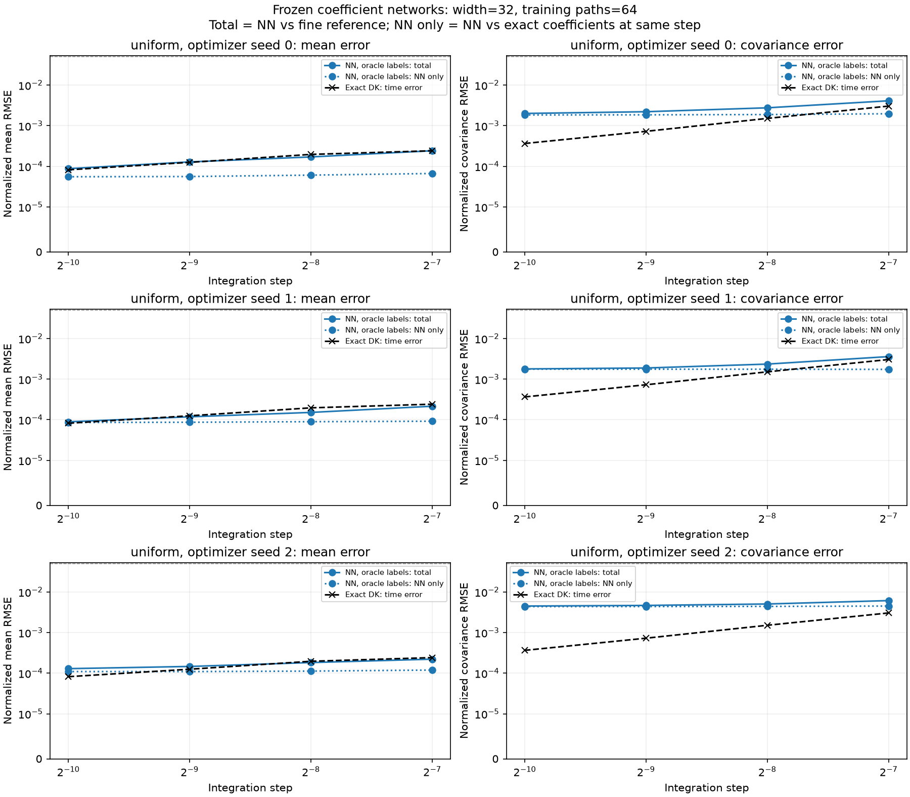
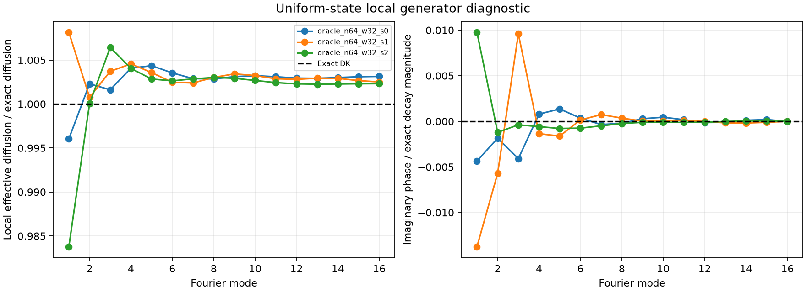

# Project A first batch — 24 October 2026

**Status: COMPLETE.** The declared first batch finished successfully with all 40 comparison records and three saved coefficient checkpoints. Recorded primary wall time was **5548.91 seconds (92.48 minutes)**. Accuracy tables were summarized without refitting or resimulation; separate post-run generator and timing diagnostics are described below.

The networks approximate held-out drift and covariance coefficients to below 0.5% relative L2 error. At the finest experiment step, their joint covariance discrepancies against the fine reference are **0.200%, 0.178%, and 0.449% for optimizer seeds 0, 1, and 2**. Timestep refinement reduces the exact-coefficient error; learned drift leaves an observable neural approximation floor. All accuracy gates remain unresolved because individual-pool precision and continuous-time reference bias are not certified. This batch does not establish learning convergence or a formal temporal rate.

## Question and target

Can an autonomous conservative coefficient network reproduce weak statistics of a stopped, spatially discrete Dean–Kawasaki system when its integration step is refined? This batch studies only the uniform, noninteracting case. It separates neural coefficient error from the Euler method's time-discretization difference.

The domain is the periodic torus \([0,2\pi)\), with 32 finite-volume cells, 2048 particles, diffusion \(D=1\), zero external potential and zero interaction, and horizon \(T=1\). Initial masses are histograms of IID uniform particles; they are not replaced by a deterministic uniform vector. Solver states are complete cell-mass vectors.

The target stops when the piecewise-constant reconstructed density first reaches \(\rho_*=0.01/(2\pi)\). Numerical paths follow each Euler segment to its first boundary crossing, then remain frozen. Initial exits stop at time zero. All stopped paths remain in the statistics. This target does not establish convergence to a continuum or unregularized density-valued DK equation.

## Provenance and execution

From the repository root:

```bash
.venv/bin/nn-dk convergence --preset a-first-batch --output runs/a-first-batch
```

The invocation had an eight-hour wall-clock budget and finished within it. Repeating the same command resumes the same source/configuration allocation. Source and numerical configuration remained fixed during execution; the post-run generator probe confirms that the current package source hash matches the recorded hash.

| Record | Value |
|---|---|
| Source commit at launch | `d0fb06b1cf18473d3b6c1184f5144613d403f525` |
| Package source hash | `865faee0d24b982db69fd1890ae2378ded36129f3c51d623232d2563eb710780` |
| Configuration hash | `cd1627a2a1ea14eb64974f0f3aec7b330ef82c4709952f955905a56fb63bd4af` |
| Master experiment seed | `20261024` |
| Optimizer seeds | `0`, `1`, `2`, reported separately |
| Device | CPU |
| Operating system / architecture | macOS 15.0.1 / arm64 |
| Logical CPUs / PyTorch threads | 8 / 1 |
| CPU brand / installed memory | Unrecorded; sandbox did not permit the system query |
| Python | 3.12.0 |
| NumPy / SciPy | 2.5.4 / 1.18.1 |
| PyTorch / h5py / Matplotlib | 2.14.1 / 3.16.0 / 3.11.2 |

## Fixed allocation

| Component | Declared allocation |
|---|---|
| Training | 64 independent parent trajectories, 32 states per trajectory |
| Validation | 64 separate parent trajectories, 32 states per trajectory |
| Held-out coefficient diagnostics | 64 separate parent trajectories, 32 states per trajectory |
| State sampling times | \(j/32\), \(j=0,\ldots,31\) |
| Evaluation | 8192 trajectory families per method and integration step |
| Reference refinement audit | 32 coupled trajectory families at three reference steps |
| Evaluation queries | \(t=1/4,1/2,1\); \(\sqrt2\cos(kx),\sqrt2\sin(kx)\), \(k=1,2\) |
| Euler step ladder | \(2^{-7},2^{-8},2^{-9},2^{-10}\) |
| Main reference step | \(2^{-13}\) |
| Reference audit steps | \(2^{-13},2^{-14},2^{-15}\) |
| Stored raw proposal step | \(2^{-7}\) |
| Bootstrap | 200 whole-family resamples; pointwise 95% intervals |
| Training / evaluation chunk size | 32 / 64 trajectories |

The 65,536-path follow-up count is present in the configuration as a later precision setting; **this invocation evaluates 8192 paths**. It does not run the nonuniform or interacting cases, additional particle numbers, a data-size ladder, a capacity sweep, or increment-supervised fitting.

The network has three periodic convolutional hidden layers, width 32, kernel width 5, and SiLU activations. Current masses, equivariant current-state Fourier fields, and physical parameters determine coefficients. Neither elapsed time nor initial-profile descriptors enter the generator. The drift is conservative, and positive diagonal face amplitudes generate a conservative covariance with no fixed covariance floor. Calculations use float64.

Oracle training fits known drift and covariance. AdamW uses learning rate \(10^{-3}\), weight decay \(10^{-5}\), batch size 128, at most 100 epochs, and validation patience 10. Each optimizer seed produces one checkpoint, frozen across the four evaluation steps. Repeated states from one trajectory are correlated observations, not additional independent training paths.

Four coefficient combinations were evaluated: exact drift/exact noise; learned drift/exact noise; exact drift/learned noise; and both learned. There are four exact-coefficient comparisons and 36 learned comparisons across three seeds, three ablations, and four steps: **40 completed comparison records**.

## Interpretation of the measurements

The physical test functions are integrated exactly against reconstructed cell densities. Their definitions stay fixed; normalization uses analytic uniform-IID histogram fluctuation units rather than held-out outcomes. Means use \(\sqrt N\) scaling and covariances use \(N\) scaling. Joint covariance diagnostics include both same-time variances and two-time correlations.

Matched evaluation families share initial histograms and fine face Brownian increments. Coarse increments are literal sums of fine increments. Bootstrap resampling retains these families together. This coupling reduces uncertainty in weak-statistic contrasts; it is not a claim of strong convergence. Optimizer-seed variability remains separate from Monte Carlo intervals.

Each learned result is decomposed into (i) learned versus exact coefficients at the same step and (ii) exact coefficients at that step versus the fine reference. Signed per-query contrasts are retained in JSON. Aggregate RMSE can conceal individual mode/time errors, so final interpretation must also inspect pointwise intervals and every covariance entry.

The statistical target is 5% normalized error, with each sampling/reference uncertainty contribution targeted below 1.25%. Ensemble counts alone do not guarantee these budgets. Finite reference refinement differences are diagnostic evidence, not a certified bound on remaining continuous-time bias; the current audit labels them uncertified. Overall certification and temporal-order claims remain unresolved without a justified bias bound. A fitted rate additionally requires at least three distinguishable, decreasing refinement errors.

The analytic A0 heat calculation is an unstopped, frozen-uniform-noise auxiliary problem. Agreement with its matrix-exponential moments checks drift/noise normalization and the numerical implementation; it is not an exact solution of the stopped DK target. Uniform initialization and cyclic-shift symmetry also force the population sine/cosine means to zero, making covariance and distribution diagnostics particularly informative in this case.

Stopping is part of the target, not a failed path. If no stops occur, report the finite count and a binomial upper bound; a zero-event bootstrap interval does not establish zero population stopping probability. Empirical scalar Wasserstein distances are descriptive because this workflow does not bootstrap their uncertainty.

Costs separate generation, training, initialization, integration, and total audit work. Shared generation/training costs repeated across rows must not be summed. Paired audit totals include fine-noise construction; separate standalone neural timings measure deployment latency and throughput. A speed advantage requires a comparison at matched, resolved accuracy.

## Numerical calibration and reference audit

| Numerical calibration | Result |
|---|---|
| Analytic heat moments and independent matrix/spectral agreement | Passed; maximum discrepancy \(4.108\times10^{-14}\) |
| Conserved mass-mode checks | Initial covariance, drift, and noise checks exactly zero; propagated covariance mass-mode residual at most \(4.981\times10^{-16}\) |
| Native reference refinement | Complete: 32 matched families at \(2^{-13},2^{-14},2^{-15}\) |
| Native path conservation | Maximum mass error over the audited saved states \(5.551\times10^{-15}\) |
| Stopping | Zero observed initial or later stops among 32 families at each refinement level |
| Reference-bias interpretation | Empirical refinements are small; remaining bias remains **uncertified** |

The unstopped auxiliary heat model's means have zero error by symmetry. Its Euler covariance errors decrease by approximately a factor of two per halving of the step:

| Step | Normalized covariance RMSE | Matrix/spectral maximum discrepancy |
|---|---:|---:|
| \(2^{-7}\) | 0.003125885 | \(6.384\times10^{-15}\) |
| \(2^{-8}\) | 0.001549609 | \(1.177\times10^{-14}\) |
| \(2^{-9}\) | 0.000771511 | \(4.108\times10^{-14}\) |
| \(2^{-10}\) | 0.000384937 | \(1.821\times10^{-14}\) |

This behavior checks the Euler implementation against known auxiliary moments. It is not a measured convergence order for stopped DK or for the neural solver.

The stopped native reference audit uses identical IID histograms and summed Brownian face increments across levels. Its paired differences are:

| Reference comparison | Normalized mean RMSE | Normalized covariance RMSE | Largest absolute mean CI endpoint | Largest absolute covariance CI endpoint |
|---|---:|---:|---:|---:|
| \(2^{-13}\) versus \(2^{-14}\) | 0.000252060 | 0.000391930 | 0.001039309 | 0.002231459 |
| \(2^{-14}\) versus \(2^{-15}\) | 0.000195031 | 0.000316568 | 0.000785230 | 0.001597308 |
| \(2^{-13}\) versus \(2^{-15}\) | 0.000395239 | 0.000472091 | 0.001507115 | 0.002269774 |

Each interval is a whole-family bootstrap pointwise 95% interval; the maxima summarize their endpoints and are not simultaneous confidence bands. The finest-pair largest endpoint is 0.001597308, or 0.160% in the declared normalized units, below the 1.25% reference contribution target. The corresponding largest absolute point estimate across mean/covariance/stopping contrasts is 0.000749974. These numbers characterize the finite \(2^{-14}\)-versus-\(2^{-15}\) difference; they do **not** bound the remaining bias of the main \(2^{-13}\) reference to the continuous-time stopped system. The saved calibration therefore reports `numerical_calibration_complete_reference_bias_uncertified` and supplies no temporal order.

All 32 audited families remained active through \(T=1\) at each level. Because the levels are coupled, they are 32 independent families rather than 96 independent stopping trials. Zero events among 32 families gives a one-sided 95% binomial upper stopping-probability bound of approximately 8.94% for a given level. The empirical zero stopping-difference intervals do not rule out rare events. At the saved query states the minimum mass across levels was 0.0186721, corresponding to density 0.0950961; the threshold is 0.00159155. This minimum describes saved states, not a separately retained continuous-path minimum.

A0 elapsed wall time was 83.65 seconds, including 83.45 seconds recorded for native refinement simulation. Its source/configuration hashes match the run provenance above. Full per-query contrasts and intervals are preserved in [the calibration JSON](../../runs/a-first-batch/calibration.json); the audit's small family count remains separate from the 8192-family evaluation pool.

At the four experiment steps, exact coefficients give the following discrepancies against the \(2^{-13}\) reference on 8192 paired families:

| Euler step | Covariance RMSE (%) | Largest absolute covariance CI endpoint (%) |
|---|---:|---:|
| \(2^{-7}\) | 0.303757 | 1.631812 |
| \(2^{-8}\) | 0.151108 | 0.815526 |
| \(2^{-9}\) | 0.072634 | 0.410554 |
| \(2^{-10}\) | 0.036457 | 0.213902 |

These decreasing finite-reference contrasts establish the integrator baseline for interpreting neural errors. They do not justify a formal weak order without resolving the reference-bias requirement.

## Coefficient fits and rollout measurements

The complete aggregate matches the fixed allocation. No optimizer seed or method is averaged; seed differences describe optimization variability on a shared data and evaluation-family pool.

Seed 0 trained for the full 100-epoch allocation. Its selected checkpoint is epoch 96, with validation objective \(2.168964\times10^{-5}\), and measured training time 53.49 seconds. On 64 separate held-out coefficient trajectories, relative drift L2 error is **0.31804%** and relative covariance L2 error is **0.32855%**. These full-grid coefficient diagnostics and the weak low-mode statistics below measure different aspects of approximation.

Seed 1 also trained for 100 epochs; its selected checkpoint is epoch 99, with validation objective \(3.879258\times10^{-5}\), and recorded training time 32.04 seconds. Its held-out relative drift/covariance L2 errors are **0.48163% / 0.36769%**. The seeds use the same data allocation and evaluation-family pool; their differences describe optimization variability, not independent Monte Carlo replication.

Seed 2's selected checkpoint is epoch 100, with validation objective \(3.513245\times10^{-5}\), training time 29.26 seconds, and held-out drift/covariance errors **0.46954% / 0.33442%**. Best epochs 96, 99, and 100 lie near the fixed allocation limit. These runs demonstrate the outcome of 100 epochs; they do not establish optimization convergence or that additional data/capacity is necessary.

With both coefficients learned, the frozen network gives:

| Seed | Integration step | Total mean RMSE (%) | Total covariance RMSE (%) | Same-step neural covariance RMSE (%) | Largest total mean CI endpoint (%) | Largest total covariance CI endpoint (%) |
|---:|---|---:|---:|---:|---:|---:|
| 0 | \(2^{-7}\) | 0.024179 | 0.410170 | 0.196487 | 0.114752 | 1.813751 |
| 0 | \(2^{-8}\) | 0.017020 | 0.275430 | 0.187989 | 0.070312 | 0.987743 |
| 0 | \(2^{-9}\) | 0.012833 | 0.220652 | 0.184921 | 0.051743 | 0.861393 |
| 0 | \(2^{-10}\) | 0.008770 | 0.199933 | 0.183620 | 0.032769 | 0.821756 |
| 1 | \(2^{-7}\) | 0.021516 | 0.358622 | 0.173733 | 0.110139 | 1.778355 |
| 1 | \(2^{-8}\) | 0.015146 | 0.234280 | 0.175071 | 0.064107 | 0.982003 |
| 1 | \(2^{-9}\) | 0.011824 | 0.187894 | 0.175475 | 0.050139 | 0.570277 |
| 1 | \(2^{-10}\) | 0.008910 | 0.178158 | 0.175678 | 0.041098 | 0.521855 |
| 2 | \(2^{-7}\) | 0.022150 | 0.611531 | 0.448803 | 0.112127 | 2.263165 |
| 2 | \(2^{-8}\) | 0.018265 | 0.504561 | 0.439867 | 0.065985 | 2.042483 |
| 2 | \(2^{-9}\) | 0.014646 | 0.465190 | 0.436483 | 0.053943 | 1.917199 |
| 2 | \(2^{-10}\) | 0.012933 | 0.448901 | 0.435076 | 0.053663 | 1.874222 |

Percentages multiply the declared dimensionless normalized errors by 100. “Total” compares the neural solver against exact coefficients at reference step \(2^{-13}\); “same-step neural” compares it against exact coefficients at the same integration step. CI columns are the largest absolute endpoints of pointwise 95% paired bootstrap intervals across all means or all joint covariance entries. They are not uncertainty intervals for the RMSE and not simultaneous confidence bands.

The covariance discrepancy against the fine reference decreases as each network's integration step is refined, while its same-step neural component changes much less. Seed 1's neural covariance RMSE increases slightly, from 0.173733% to 0.175678%, rather than approaching zero with timestep refinement. At the finest step, neural covariance RMSE is 0.183620%, 0.175678%, and 0.435076% for seeds 0, 1, and 2, versus 0.036457% for the exact-coefficient timestep discrepancy. The finest-step ablations identify the dominant component:

| Seed | Coefficients at \(2^{-10}\) | Same-step neural mean RMSE (%) | Same-step neural covariance RMSE (%) |
|---:|---|---:|---:|
| 0 | Learned drift, exact noise | 0.004824 | 0.182660 |
| 0 | Exact drift, learned noise | 0.002191 | 0.003351 |
| 0 | Both learned | 0.005541 | 0.183620 |
| 1 | Learned drift, exact noise | 0.007889 | 0.171100 |
| 1 | Exact drift, learned noise | 0.002609 | 0.017721 |
| 1 | Both learned | 0.008567 | 0.175678 |
| 2 | Learned drift, exact noise | 0.011949 | 0.428748 |
| 2 | Exact drift, learned noise | 0.002190 | 0.010045 |
| 2 | Both learned | 0.010983 | 0.435076 |

These ablations identify drift approximation as the larger contributor to low-mode covariance error for all three seeds; seed 2's drift-only error is appreciably larger than seeds 0 and 1 despite comparable full-grid coefficient errors. This is evidence of an apparent coefficient-error floor, not a measured learning-convergence rate or a proof of an asymptotic plateau. The drift-only and noise-only signed contrasts can interact, so their RMSE values are not additive.



Paired contrasts are much more precise than either ensemble's absolute statistics. Maximum individual-pool pointwise 95% halfwidths, taking the larger value across the neural and fine-reference pools, are:

| Seed | Integration step | Mean halfwidth (%) | Covariance halfwidth (%) |
|---:|---|---:|---:|
| 0 | \(2^{-7}\) | 2.419572 | 3.269152 |
| 0 | \(2^{-8}\) | 2.404617 | 3.291516 |
| 0 | \(2^{-9}\) | 2.406753 | 3.301934 |
| 0 | \(2^{-10}\) | 2.401054 | 3.295224 |
| 1 | \(2^{-7}\) | 2.414303 | 3.261023 |
| 1 | \(2^{-8}\) | 2.400619 | 3.261023 |
| 1 | \(2^{-9}\) | 2.400619 | 3.271099 |
| 1 | \(2^{-10}\) | 2.400619 | 3.264826 |
| 2 | \(2^{-7}\) | 2.422687 | 3.286592 |
| 2 | \(2^{-8}\) | 2.405978 | 3.309611 |
| 2 | \(2^{-9}\) | 2.408146 | 3.320113 |
| 2 | \(2^{-10}\) | 2.402462 | 3.313309 |

The fine-reference pool alone has maximum mean/covariance halfwidths of 2.400619% / 3.261023%. Thus the individual-pool 1.25% precision budget is not met, even though **all 40 total paired contrasts** satisfy the 5% pointwise tolerance check. All 40 overall accuracy gates remain **unresolved**, independently of the additional uncertified reference bias. Small aggregate errors therefore do not amount to final accuracy certification or a justified temporal order.

No initial or later stops were observed in any primary evaluation ensemble: zero out of 8192 families for each configuration. The empirical stopping CDF is zero at every query time, and the restricted mean \(\mathbb E[\min(\tau,T)]\) is 1; there are no events from which to estimate a conditional stopping-time distribution. For a given configuration, the one-sided 95% zero-event binomial upper bound is approximately 0.03656%. The configurations share families and must not be pooled as independent stopping trials. Across the 40 prediction ensembles, the maximum saved-state mass error is \(1.998\times10^{-15}\) and the smallest saved mass is 0.0127565, corresponding to density 0.0649681, above the stopping threshold. The fine evaluation reference has maximum saved-state mass error \(4.441\times10^{-15}\). There is no observed boundary activity here to establish accuracy for boundary-sensitive cases.

The completed [artifact summary](artifacts/a_first_batch_2026-10-24/findings_summary.json) and [comparison table](artifacts/a_first_batch_2026-10-24/findings_table.csv) preserve each seed and ablation, summarized uncertainty and coefficient diagnostics, cost fields, and source/configuration/analysis hashes. Full per-query contrasts and proposal-residual matrices remain in the local run artifacts. The summary and table were derived from the final aggregate without fitting, checkpoint execution, or trajectory simulation.

| Optimizer seed | Best epoch / validation objective | Held-out drift error | Held-out covariance error | Finest-step neural weak error |
|---:|---|---|---|---|
| 0 | Epoch 96 of 100; \(2.168964\times10^{-5}\) | 0.31804% | 0.32855% | Mean 0.005541%; covariance 0.183620% |
| 1 | Epoch 99 of 100; \(3.879258\times10^{-5}\) | 0.48163% | 0.36769% | Mean 0.008567%; covariance 0.175678% |
| 2 | Epoch 100 of 100; \(3.513245\times10^{-5}\) | 0.46954% | 0.33442% | Mean 0.010983%; covariance 0.435076% |

## Variances, correlations, distributions, and the local generator

At \(\Delta=2^{-10}\), the both-learned solver has the following discrepancies against the fine reference. Variance RMSE averages the four physical modes at the specified time. Two-time covariance RMSE averages the 48 distinct mode pairs with unequal observation times, rather than duplicating their symmetric entries.

| Seed | Variance RMSE at 1/4 (%) | At 1/2 (%) | At 1 (%) | Two-time covariance RMSE (%) | Largest scalar Wasserstein distance (%) |
|---:|---:|---:|---:|---:|---:|
| 0 | 0.322605 | 0.458967 | 0.582217 | 0.180775 | 0.324625 |
| 1 | 0.246291 | 0.308868 | 0.390633 | 0.186185 | 0.256153 |
| 2 | 0.635206 | 0.963319 | 1.283082 | 0.421926 | 0.719250 |

These use the same fixed fluctuation units as the earlier tables. Scalar Wasserstein distances are empirical, descriptive values without uncertainty certification. The largest individual joint-covariance errors are 0.7745%, 0.4745%, and 1.7976%, respectively: the aggregate joint RMSE can hide a larger individual variance error. Raw-proposal residuals under the oracle-trained models have whitened covariance-to-identity entry RMSE about 0.02195; this is a descriptive check, not an increment-training result or a Gaussianity certificate.

The post-run uniform-state Jacobian probe provides a local explanation for drift sensitivity. Decay ratios compare the real part of the learned eigenvalue to the exact negative heat eigenvalue; a ratio below one means slower decay. Phase is the learned imaginary eigenvalue divided by the exact decay magnitude. Exact values are one for decay/noise ratios and zero for phase.

| Seed | Mode-1 decay ratio | Mode-1 phase (%) | Mode-2 decay ratio | Mode-2 phase (%) | Uniform noise-power ratio |
|---:|---:|---:|---:|---:|---:|
| 0 | 0.996040 | -0.435650 | 1.002291 | -0.184750 | 1.000815 |
| 1 | 1.008144 | -1.376083 | 1.000760 | -0.569646 | 0.998314 |
| 2 | 0.983770 | 0.976329 | 1.000055 | -0.120951 | 0.999593 |

Every nonconstant Fourier mode is locally dissipative for all three fits. Seed 2 nevertheless decays mode 1 about 1.623% too slowly, while its uniform noise power is close to exact. In the hypothetical unstopped linearization with noise frozen at uniform masses, its stationary mode-1 variance ratio is 1.01608; this is not a stationary-law result for the stopped nonlinear system. Nonzero phase errors reveal an artificial odd/transport component: translation equivariance alone does not impose the reflection symmetry of this free heat problem. This motivates checking low-mode decay and reflection symmetry when improving the drift. A linearization at uniform masses is not a nonlinear rollout bound or a convergence certificate.



## Measured computational cost

The primary workflow took 92.48 minutes. Recorded training-pool generation cost was 4.37 seconds; the three distinct fits took 53.49, 32.04, and 29.26 seconds. The remaining workflow includes calibration, reference generation, all ablated rollouts, bootstrap comparisons, and reporting. Shared generation/training costs repeated in comparison rows must not be added repeatedly.

A separate post-completion timing diagnostic ran three repeats per configuration, with no discarded warmup. Medians below include histogram initialization, internal coarse-step Brownian RNG, stepping, and snapshots; checkpoint loading is excluded. No fine coupling buffer is constructed. All rows use \(\Delta=2^{-10}\):

| Solver | Single-path median (s) | 64-path median (s) | 64-path min–max (s) | Batch throughput (paths/s) |
|---|---:|---:|---:|---:|
| Exact coefficients | 0.05815 | 0.15825 | 0.13612–0.16341 | 404.43 |
| Neural, seed 0 | 0.42778 | 4.45258 | 3.63121–4.50193 | 14.37 |
| Neural, seed 1 | 0.33715 | 2.80588 | 2.48578–3.26691 | 22.81 |
| Neural, seed 2 | 0.32062 | 3.34390 | 2.64760–3.94636 | 19.14 |

Costs describe the current implementation. Its neural integration backend computes native coefficients before overriding the requested learned components, so measured neural integration time can include unused native work. Standalone timings therefore do not isolate an intrinsic cost of the neural coefficient representation. Together with unresolved accuracy gates, this prevents a matched-accuracy speedup claim.

At the same timestep the current neural implementation is slower than the simple analytic backend. These desktop measurements have visible variability; PyTorch uses one thread, while NumPy/BLAS thread limits were not separately enforced. The timing JSON preserves all repeats and conventions. Accuracy audits that construct shared fine increments have different overhead and must not be compared directly to these standalone costs.

## Follow-up decisions

The batch establishes a reproducible coefficient-fitting and error-decomposition result for this uniform fixed-grid target. It does not establish improvement with training sample size, an optimal network, a temporal convergence order, or a neural speed advantage. The evidence supports the following order of work:

1. Diagnose drift approximation in low Fourier modes and separate optimization error from representation error. Continue only from validation evidence: all three best epochs are near the 100-epoch limit. Check reflection symmetry and phase bias alongside decay rates.
2. Run the predeclared nested training-path ladder at fixed width, then a capacity comparison at fixed data. This first batch has only one data size and one width and cannot establish learning convergence.
3. Repeat selected fits for the nonuniform, noninteracting case before moving to interaction. Uniform-case means vanish by symmetry, so that case cannot test nontrivial mean dynamics.
4. Use the predeclared 65,536-path follow-up for selected precision studies if certification is required, while separately addressing the reference-bias argument. More trajectories do not remove coefficient bias or establish an asymptotic temporal rate.

Particle comparisons, additional particle counts, and continuum/spatial convergence remain outside this batch.

## Run artifacts

The following paths are relative to this note. Compact archived artifacts remain available independently of the larger local trajectory caches:

- [Findings summary](artifacts/a_first_batch_2026-10-24/findings_summary.json) and [all comparison rows](artifacts/a_first_batch_2026-10-24/findings_table.csv).
- [Per-seed refinement figure](artifacts/a_first_batch_2026-10-24/convergence_uniform.png) and [uniform-generator probe](artifacts/a_first_batch_2026-10-24/generator_probe.png).
- [Standalone oracle/neural timing](artifacts/a_first_batch_2026-10-24/native_standalone_timing.json) and [artifact checksums](artifacts/a_first_batch_2026-10-24/archive_manifest.json).

Full local run artifacts:

- [Run manifest](../../runs/a-first-batch/manifest.json), [exact configuration](../../runs/a-first-batch/config.json), and [console log](../../runs/a-first-batch/console.log).
- [A0 calibration](../../runs/a-first-batch/calibration.json) and [coupled reference paths](../../runs/a-first-batch/calibration_refinement_uniform.h5).
- [Native training/validation/diagnostic pool](../../runs/a-first-batch/pool_uniform.h5).
- [Coefficient checkpoints and diagnostics](../../runs/a-first-batch/checkpoints/uniform/).
- [Cached evaluation trajectories](../../runs/a-first-batch/evaluation/uniform/) and [comparison records](../../runs/a-first-batch/records.json).
- [Generated report](../../runs/a-first-batch/report/convergence.md), [machine-readable results](../../runs/a-first-batch/report/convergence.json), [overview figure](../../runs/a-first-batch/report/convergence_curves.png), and [per-seed refinement figure](../../runs/a-first-batch/report/convergence_uniform.png).
- [Implementation and interpretation guide](../PROJECT_A_CONVERGENCE.md).
