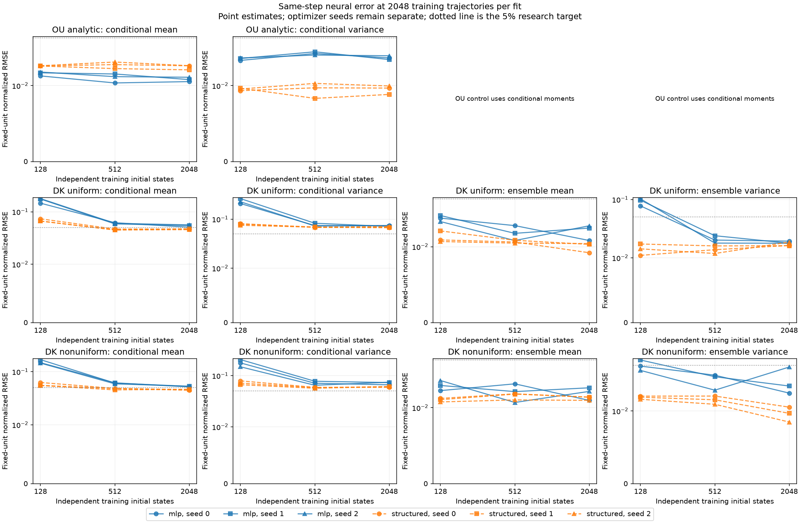

# Initial-state coverage and structured BSDE statistics

Completed **36 independently fitted models** for `bsde-anchor-study`. Every fit uses **2048 training trajectories**, with allocations **128 initial states × 16 continuations**, **512 initial states × 4 continuations**, **2048 initial states × 1 continuations**. This changes initial-state coverage and replication together; it does not test the effect of adding trajectories.

Validation is fixed at **256 independent initial states × 4 continuations**. Fresh held-out streams use master seed **20261025**: OU has 1024 analytic test states; each DK profile has 32 fixed conditional anchors × 512 reference children and 8192 independent initial-histogram/forcing families for ensemble tests. All architectures and coverage levels share these banks; optimizer seeds remain separate.

The MLP value head is compared with a learned modewise propagation backbone. The structured OU control has four fitted positive parameters (two rates and two variance scales). Structured DK adds a **0.1-scaled full-state residual**, including a Cholesky covariance head, to that learned backbone. Neither predictor is given analytic decay rates or an analytic mean forecast. The martingale network architecture and physical forward data are held fixed. Initialization supplies the exact value at horizon zero.

## Same-step learning curves

The primary comparison is against the Euler law at the training timestep. Mean errors use sqrt(N) scaling; variance and covariance errors use N scaling, with fixed uniform-histogram units. Curves show RMSE point estimates, **not accuracy certification**. Conditional errors and ensemble errors are distinct: averaging over initial histograms can cancel conditional mean errors.

## Errors, uncertainty and gates

| Problem/profile | Scope/reference | Architecture | Anchors × children | Seed | Mean RMSE | Variance RMSE | Covariance RMSE | Max mean | Max variance | Max covariance | Max sampling half-width | Max contrast CI endpoint | Gate |
|---|---|---|---:|---:|---:|---:|---:|---:|---:|---:|---:|---:|---|
| ou analytic | conditional/neural_error | mlp | 128×16 | 0 | 0.013856 | 0.023416 | 0.014874 | 0.22104 | 0.22743 | 0.22743 | 0 | 0.22743 | unresolved |
| ou analytic | conditional/total_error | mlp | 128×16 | 0 | 0.01411 | 0.027048 | 0.016342 | 0.22357 | 0.24397 | 0.24397 | 0 | 0.24397 | unresolved |
| ou analytic | conditional/time_error | mlp | 128×16 | 0 | 0.0031209 | 0.01211 | 0.0060552 | 0.018893 | 0.017809 | 0.017809 | 0 | 0.018893 | resolved_within_tolerance |
| ou analytic | conditional/neural_error | mlp | 128×16 | 1 | 0.015393 | 0.024985 | 0.016954 | 0.28062 | 0.31924 | 0.31924 | 0 | 0.31924 | unresolved |
| ou analytic | conditional/total_error | mlp | 128×16 | 1 | 0.015912 | 0.029236 | 0.018576 | 0.29459 | 0.33579 | 0.33579 | 0 | 0.33579 | unresolved |
| ou analytic | conditional/time_error | mlp | 128×16 | 1 | 0.0031209 | 0.01211 | 0.0060552 | 0.018893 | 0.017809 | 0.017809 | 0 | 0.018893 | resolved_within_tolerance |
| ou analytic | conditional/neural_error | mlp | 128×16 | 2 | 0.015791 | 0.025386 | 0.01626 | 0.35534 | 0.30457 | 0.30457 | 0 | 0.35534 | unresolved |
| ou analytic | conditional/total_error | mlp | 128×16 | 2 | 0.015848 | 0.027693 | 0.017175 | 0.35845 | 0.32112 | 0.32112 | 0 | 0.35845 | unresolved |
| ou analytic | conditional/time_error | mlp | 128×16 | 2 | 0.0031209 | 0.01211 | 0.0060552 | 0.018893 | 0.017809 | 0.017809 | 0 | 0.018893 | resolved_within_tolerance |
| ou analytic | conditional/neural_error | structured | 128×16 | 0 | 0.019413 | 0.0093392 | 0.0046696 | 0.11946 | 0.021427 | 0.021427 | 0 | 0.11946 | unresolved |
| ou analytic | conditional/total_error | structured | 128×16 | 0 | 0.016444 | 0.012081 | 0.0060406 | 0.10057 | 0.023687 | 0.023687 | 0 | 0.10057 | unresolved |
| ou analytic | conditional/time_error | structured | 128×16 | 0 | 0.0031209 | 0.01211 | 0.0060552 | 0.018893 | 0.017809 | 0.017809 | 0 | 0.018893 | resolved_within_tolerance |
| ou analytic | conditional/neural_error | structured | 128×16 | 1 | 0.019353 | 0.0096617 | 0.0048309 | 0.11912 | 0.020918 | 0.020918 | 0 | 0.11912 | unresolved |
| ou analytic | conditional/total_error | structured | 128×16 | 1 | 0.016342 | 0.012086 | 0.0060431 | 0.10023 | 0.024194 | 0.024194 | 0 | 0.10023 | unresolved |
| ou analytic | conditional/time_error | structured | 128×16 | 1 | 0.0031209 | 0.01211 | 0.0060552 | 0.018893 | 0.017809 | 0.017809 | 0 | 0.018893 | resolved_within_tolerance |
| ou analytic | conditional/neural_error | structured | 128×16 | 2 | 0.019515 | 0.0095561 | 0.004778 | 0.12012 | 0.02131 | 0.02131 | 0 | 0.12012 | unresolved |
| ou analytic | conditional/total_error | structured | 128×16 | 2 | 0.016517 | 0.012004 | 0.006002 | 0.10122 | 0.02402 | 0.02402 | 0 | 0.10122 | unresolved |
| ou analytic | conditional/time_error | structured | 128×16 | 2 | 0.0031209 | 0.01211 | 0.0060552 | 0.018893 | 0.017809 | 0.017809 | 0 | 0.018893 | resolved_within_tolerance |
| ou analytic | conditional/neural_error | mlp | 512×4 | 0 | 0.010941 | 0.029538 | 0.017389 | 0.12134 | 0.20373 | 0.20373 | 0 | 0.20373 | unresolved |
| ou analytic | conditional/total_error | mlp | 512×4 | 0 | 0.010646 | 0.028029 | 0.016752 | 0.12438 | 0.18592 | 0.18592 | 0 | 0.18592 | unresolved |
| ou analytic | conditional/time_error | mlp | 512×4 | 0 | 0.0031209 | 0.01211 | 0.0060552 | 0.018893 | 0.017809 | 0.017809 | 0 | 0.018893 | resolved_within_tolerance |
| ou analytic | conditional/neural_error | mlp | 512×4 | 1 | 0.014798 | 0.031315 | 0.018263 | 0.17684 | 0.25004 | 0.25004 | 0 | 0.25004 | unresolved |
| ou analytic | conditional/total_error | mlp | 512×4 | 1 | 0.014638 | 0.032806 | 0.018906 | 0.1765 | 0.26658 | 0.26658 | 0 | 0.26658 | unresolved |
| ou analytic | conditional/time_error | mlp | 512×4 | 1 | 0.0031209 | 0.01211 | 0.0060552 | 0.018893 | 0.017809 | 0.017809 | 0 | 0.018893 | resolved_within_tolerance |
| ou analytic | conditional/neural_error | mlp | 512×4 | 2 | 0.013524 | 0.028064 | 0.019233 | 0.1688 | 0.18745 | 0.18745 | 0 | 0.18745 | unresolved |
| ou analytic | conditional/total_error | mlp | 512×4 | 2 | 0.012844 | 0.023568 | 0.01766 | 0.18016 | 0.19748 | 0.19748 | 0 | 0.19748 | unresolved |
| ou analytic | conditional/time_error | mlp | 512×4 | 2 | 0.0031209 | 0.01211 | 0.0060552 | 0.018893 | 0.017809 | 0.017809 | 0 | 0.018893 | resolved_within_tolerance |
| ou analytic | conditional/neural_error | structured | 512×4 | 0 | 0.020292 | 0.0097154 | 0.0048577 | 0.12477 | 0.022146 | 0.022146 | 0 | 0.12477 | unresolved |
| ou analytic | conditional/total_error | structured | 512×4 | 0 | 0.017316 | 0.012483 | 0.0062416 | 0.10588 | 0.024401 | 0.024401 | 0 | 0.10588 | unresolved |
| ou analytic | conditional/time_error | structured | 512×4 | 0 | 0.0031209 | 0.01211 | 0.0060552 | 0.018893 | 0.017809 | 0.017809 | 0 | 0.018893 | resolved_within_tolerance |
| ou analytic | conditional/neural_error | structured | 512×4 | 1 | 0.017733 | 0.0083267 | 0.0041633 | 0.10936 | 0.016928 | 0.016928 | 0 | 0.10936 | unresolved |
| ou analytic | conditional/total_error | structured | 512×4 | 1 | 0.014742 | 0.013308 | 0.0066539 | 0.090466 | 0.026073 | 0.026073 | 0 | 0.090466 | unresolved |
| ou analytic | conditional/time_error | structured | 512×4 | 1 | 0.0031209 | 0.01211 | 0.0060552 | 0.018893 | 0.017809 | 0.017809 | 0 | 0.018893 | resolved_within_tolerance |
| ou analytic | conditional/neural_error | structured | 512×4 | 2 | 0.022126 | 0.010788 | 0.0053942 | 0.13579 | 0.024718 | 0.024718 | 0 | 0.13579 | unresolved |
| ou analytic | conditional/total_error | structured | 512×4 | 2 | 0.019142 | 0.012384 | 0.006192 | 0.11689 | 0.024616 | 0.024616 | 0 | 0.11689 | unresolved |
| ou analytic | conditional/time_error | structured | 512×4 | 2 | 0.0031209 | 0.01211 | 0.0060552 | 0.018893 | 0.017809 | 0.017809 | 0 | 0.018893 | resolved_within_tolerance |
| ou analytic | conditional/neural_error | mlp | 2048×1 | 0 | 0.011445 | 0.025477 | 0.016332 | 0.13603 | 0.2107 | 0.2107 | 0 | 0.2107 | unresolved |
| ou analytic | conditional/total_error | mlp | 2048×1 | 0 | 0.01133 | 0.027473 | 0.017122 | 0.13913 | 0.22851 | 0.22851 | 0 | 0.22851 | unresolved |
| ou analytic | conditional/time_error | mlp | 2048×1 | 0 | 0.0031209 | 0.01211 | 0.0060552 | 0.018893 | 0.017809 | 0.017809 | 0 | 0.018893 | resolved_within_tolerance |
| ou analytic | conditional/neural_error | mlp | 2048×1 | 1 | 0.012241 | 0.024091 | 0.01505 | 0.16899 | 0.19329 | 0.19329 | 0 | 0.19329 | unresolved |
| ou analytic | conditional/total_error | mlp | 2048×1 | 1 | 0.012492 | 0.026485 | 0.016024 | 0.18256 | 0.17548 | 0.17548 | 0 | 0.18256 | unresolved |
| ou analytic | conditional/time_error | mlp | 2048×1 | 1 | 0.0031209 | 0.01211 | 0.0060552 | 0.018893 | 0.017809 | 0.017809 | 0 | 0.018893 | resolved_within_tolerance |
| ou analytic | conditional/neural_error | mlp | 2048×1 | 2 | 0.013253 | 0.027369 | 0.017473 | 0.12429 | 0.238 | 0.238 | 0 | 0.238 | unresolved |
| ou analytic | conditional/total_error | mlp | 2048×1 | 2 | 0.013939 | 0.028035 | 0.017735 | 0.12829 | 0.2537 | 0.2537 | 0 | 0.2537 | unresolved |
| ou analytic | conditional/time_error | mlp | 2048×1 | 2 | 0.0031209 | 0.01211 | 0.0060552 | 0.018893 | 0.017809 | 0.017809 | 0 | 0.018893 | resolved_within_tolerance |
| ou analytic | conditional/neural_error | structured | 2048×1 | 0 | 0.019511 | 0.0096793 | 0.0048396 | 0.12009 | 0.022239 | 0.022239 | 0 | 0.12009 | unresolved |
| ou analytic | conditional/total_error | structured | 2048×1 | 0 | 0.016514 | 0.011473 | 0.0057364 | 0.1012 | 0.022903 | 0.022903 | 0 | 0.1012 | unresolved |
| ou analytic | conditional/time_error | structured | 2048×1 | 0 | 0.0031209 | 0.01211 | 0.0060552 | 0.018893 | 0.017809 | 0.017809 | 0 | 0.018893 | resolved_within_tolerance |
| ou analytic | conditional/neural_error | structured | 2048×1 | 1 | 0.016998 | 0.008845 | 0.0044225 | 0.10491 | 0.019879 | 0.019879 | 0 | 0.10491 | unresolved |
| ou analytic | conditional/total_error | structured | 2048×1 | 1 | 0.014016 | 0.010661 | 0.0053306 | 0.086019 | 0.021266 | 0.021266 | 0 | 0.086019 | unresolved |
| ou analytic | conditional/time_error | structured | 2048×1 | 1 | 0.0031209 | 0.01211 | 0.0060552 | 0.018893 | 0.017809 | 0.017809 | 0 | 0.018893 | resolved_within_tolerance |
| ou analytic | conditional/neural_error | structured | 2048×1 | 2 | 0.019545 | 0.0099574 | 0.0049787 | 0.12029 | 0.02288 | 0.02288 | 0 | 0.12029 | unresolved |
| ou analytic | conditional/total_error | structured | 2048×1 | 2 | 0.016562 | 0.011091 | 0.0055456 | 0.1014 | 0.022198 | 0.022198 | 0 | 0.1014 | unresolved |
| ou analytic | conditional/time_error | structured | 2048×1 | 2 | 0.0031209 | 0.01211 | 0.0060552 | 0.018893 | 0.017809 | 0.017809 | 0 | 0.018893 | resolved_within_tolerance |
| dk nonuniform | conditional/conditional_neural_error | mlp | 128×16 | 0 | 0.1482 | 0.17777 | 0.094952 | 0.72965 | 0.81642 | 0.81642 | 0.1576 | 0.94542 | unresolved |
| dk nonuniform | conditional/conditional_total_error | mlp | 128×16 | 0 | 0.14883 | 0.18086 | 0.096309 | 0.73074 | 0.83214 | 0.83214 | 0.15539 | 0.96056 | unresolved |
| dk nonuniform | ensemble/ensemble_neural_error | mlp | 128×16 | 0 | 0.017791 | 0.048522 | 0.033156 | 0.041493 | 0.086252 | 0.086252 | 0.031212 | 0.1151 | unresolved |
| dk nonuniform | ensemble/ensemble_total_error | mlp | 128×16 | 0 | 0.021219 | 0.057057 | 0.036293 | 0.050608 | 0.10123 | 0.10123 | 0.030626 | 0.12927 | unresolved |
| dk nonuniform | ensemble/ensemble_time_error | mlp | 128×16 | 0 | 0.0037737 | 0.01059 | 0.0053027 | 0.0091148 | 0.015733 | 0.015733 | 0.031212 | 0.016818 | unresolved |
| dk uniform | conditional/conditional_neural_error | mlp | 128×16 | 0 | 0.14596 | 0.20858 | 0.10947 | 0.59918 | 1.2013 | 1.2013 | 0.16693 | 1.3093 | unresolved |
| dk uniform | conditional/conditional_total_error | mlp | 128×16 | 0 | 0.14531 | 0.20903 | 0.10959 | 0.59717 | 1.2162 | 1.2162 | 0.16729 | 1.3196 | unresolved |
| dk uniform | ensemble/ensemble_neural_error | mlp | 128×16 | 0 | 0.026191 | 0.077668 | 0.041115 | 0.050049 | 0.17057 | 0.17057 | 0.032101 | 0.20134 | unresolved |
| dk uniform | ensemble/ensemble_total_error | mlp | 128×16 | 0 | 0.026165 | 0.084689 | 0.044429 | 0.049892 | 0.17398 | 0.17398 | 0.031798 | 0.2042 | unresolved |
| dk uniform | ensemble/ensemble_time_error | mlp | 128×16 | 0 | 0.0001528 | 0.010563 | 0.005286 | 0.00031427 | 0.015852 | 0.015852 | 0.032101 | 0.017062 | unresolved |
| dk nonuniform | conditional/conditional_neural_error | mlp | 128×16 | 1 | 0.16913 | 0.20619 | 0.10849 | 0.80999 | 1.0772 | 1.0772 | 0.1576 | 1.178 | unresolved |
| dk nonuniform | conditional/conditional_total_error | mlp | 128×16 | 1 | 0.16802 | 0.20688 | 0.10875 | 0.81114 | 1.0917 | 1.0917 | 0.15539 | 1.1929 | unresolved |
| dk nonuniform | ensemble/ensemble_neural_error | mlp | 128×16 | 1 | 0.021154 | 0.060145 | 0.033246 | 0.047015 | 0.11521 | 0.11521 | 0.031212 | 0.1445 | unresolved |
| dk nonuniform | ensemble/ensemble_total_error | mlp | 128×16 | 1 | 0.022082 | 0.069321 | 0.0374 | 0.046693 | 0.13019 | 0.13019 | 0.030626 | 0.15907 | unresolved |
| dk nonuniform | ensemble/ensemble_time_error | mlp | 128×16 | 1 | 0.0037737 | 0.01059 | 0.0053027 | 0.0091148 | 0.015733 | 0.015733 | 0.031212 | 0.016818 | unresolved |
| dk uniform | conditional/conditional_neural_error | mlp | 128×16 | 1 | 0.17508 | 0.26307 | 0.13541 | 0.9612 | 1.1485 | 1.1485 | 0.16693 | 1.265 | unresolved |
| dk uniform | conditional/conditional_total_error | mlp | 128×16 | 1 | 0.17444 | 0.26393 | 0.13575 | 0.96018 | 1.1629 | 1.1629 | 0.16729 | 1.2757 | unresolved |
| dk uniform | ensemble/ensemble_neural_error | mlp | 128×16 | 1 | 0.028586 | 0.097246 | 0.050492 | 0.084417 | 0.17472 | 0.17472 | 0.032101 | 0.20511 | unresolved |
| dk uniform | ensemble/ensemble_total_error | mlp | 128×16 | 1 | 0.028562 | 0.10596 | 0.054702 | 0.08426 | 0.17813 | 0.17813 | 0.031798 | 0.20843 | unresolved |
| dk uniform | ensemble/ensemble_time_error | mlp | 128×16 | 1 | 0.0001528 | 0.010563 | 0.005286 | 0.00031427 | 0.015852 | 0.015852 | 0.032101 | 0.017062 | unresolved |
| dk nonuniform | conditional/conditional_neural_error | mlp | 128×16 | 2 | 0.14563 | 0.14914 | 0.081521 | 0.67742 | 0.58653 | 0.58653 | 0.1576 | 0.74784 | unresolved |
| dk nonuniform | conditional/conditional_total_error | mlp | 128×16 | 2 | 0.14429 | 0.14905 | 0.081386 | 0.66778 | 0.60403 | 0.60403 | 0.15539 | 0.73804 | unresolved |
| dk nonuniform | ensemble/ensemble_neural_error | mlp | 128×16 | 2 | 0.02497 | 0.041725 | 0.027033 | 0.062725 | 0.072605 | 0.072605 | 0.031212 | 0.1021 | unresolved |
| dk nonuniform | ensemble/ensemble_total_error | mlp | 128×16 | 2 | 0.025752 | 0.05007 | 0.030331 | 0.062826 | 0.087579 | 0.087579 | 0.030626 | 0.11688 | unresolved |
| dk nonuniform | ensemble/ensemble_time_error | mlp | 128×16 | 2 | 0.0037737 | 0.01059 | 0.0053027 | 0.0091148 | 0.015733 | 0.015733 | 0.031212 | 0.016818 | unresolved |
| dk uniform | conditional/conditional_neural_error | mlp | 128×16 | 2 | 0.17837 | 0.22667 | 0.11818 | 0.84028 | 1.2215 | 1.2215 | 0.16693 | 1.3393 | unresolved |
| dk uniform | conditional/conditional_total_error | mlp | 128×16 | 2 | 0.17763 | 0.22894 | 0.11918 | 0.84015 | 1.2433 | 1.2433 | 0.16729 | 1.3579 | unresolved |
| dk uniform | ensemble/ensemble_neural_error | mlp | 128×16 | 2 | 0.023325 | 0.10255 | 0.05328 | 0.048273 | 0.18656 | 0.18656 | 0.032101 | 0.21383 | unresolved |
| dk uniform | ensemble/ensemble_total_error | mlp | 128×16 | 2 | 0.023325 | 0.11097 | 0.057334 | 0.048115 | 0.18997 | 0.18997 | 0.031798 | 0.21725 | unresolved |
| dk uniform | ensemble/ensemble_time_error | mlp | 128×16 | 2 | 0.0001528 | 0.010563 | 0.005286 | 0.00031427 | 0.015852 | 0.015852 | 0.032101 | 0.017062 | unresolved |
| dk nonuniform | conditional/conditional_neural_error | structured | 128×16 | 0 | 0.062715 | 0.079187 | 0.048446 | 0.33987 | 0.44855 | 0.44855 | 0.1576 | 0.5428 | unresolved |
| dk nonuniform | conditional/conditional_total_error | structured | 128×16 | 0 | 0.062275 | 0.080402 | 0.048795 | 0.34174 | 0.4655 | 0.4655 | 0.15539 | 0.55626 | unresolved |
| dk nonuniform | ensemble/ensemble_neural_error | structured | 128×16 | 0 | 0.013691 | 0.01687 | 0.014237 | 0.022745 | 0.041699 | 0.041699 | 0.031212 | 0.068591 | unresolved |
| dk nonuniform | ensemble/ensemble_total_error | structured | 128×16 | 0 | 0.01538 | 0.026276 | 0.017321 | 0.02424 | 0.056673 | 0.056673 | 0.030626 | 0.083302 | unresolved |
| dk nonuniform | ensemble/ensemble_time_error | structured | 128×16 | 0 | 0.0037737 | 0.01059 | 0.0053027 | 0.0091148 | 0.015733 | 0.015733 | 0.031212 | 0.016818 | unresolved |
| dk uniform | conditional/conditional_neural_error | structured | 128×16 | 0 | 0.073423 | 0.081078 | 0.051561 | 0.5365 | 0.47927 | 0.47927 | 0.16693 | 0.6282 | unresolved |
| dk uniform | conditional/conditional_total_error | structured | 128×16 | 0 | 0.073519 | 0.081378 | 0.051479 | 0.53909 | 0.4941 | 0.4941 | 0.16729 | 0.62969 | unresolved |
| dk uniform | ensemble/ensemble_neural_error | structured | 128×16 | 0 | 0.012565 | 0.011015 | 0.013629 | 0.02995 | 0.019993 | 0.024284 | 0.032101 | 0.050093 | unresolved |
| dk uniform | ensemble/ensemble_total_error | structured | 128×16 | 0 | 0.012592 | 0.018502 | 0.015532 | 0.030003 | 0.029344 | 0.029344 | 0.031798 | 0.060221 | unresolved |
| dk uniform | ensemble/ensemble_time_error | structured | 128×16 | 0 | 0.0001528 | 0.010563 | 0.005286 | 0.00031427 | 0.015852 | 0.015852 | 0.032101 | 0.017062 | unresolved |
| dk nonuniform | conditional/conditional_neural_error | structured | 128×16 | 1 | 0.055101 | 0.066504 | 0.043897 | 0.22842 | 0.32055 | 0.32055 | 0.1576 | 0.42897 | unresolved |
| dk nonuniform | conditional/conditional_total_error | structured | 128×16 | 1 | 0.054927 | 0.067063 | 0.043924 | 0.23435 | 0.33689 | 0.33689 | 0.15539 | 0.44226 | unresolved |
| dk nonuniform | ensemble/ensemble_neural_error | structured | 128×16 | 1 | 0.013123 | 0.016242 | 0.015021 | 0.024179 | 0.037093 | 0.037093 | 0.031212 | 0.06458 | unresolved |
| dk nonuniform | ensemble/ensemble_total_error | structured | 128×16 | 1 | 0.01548 | 0.024671 | 0.017521 | 0.027831 | 0.052067 | 0.052067 | 0.030626 | 0.079291 | unresolved |
| dk nonuniform | ensemble/ensemble_time_error | structured | 128×16 | 1 | 0.0037737 | 0.01059 | 0.0053027 | 0.0091148 | 0.015733 | 0.015733 | 0.031212 | 0.016818 | unresolved |
| dk uniform | conditional/conditional_neural_error | structured | 128×16 | 1 | 0.066554 | 0.078901 | 0.051059 | 0.51163 | 0.37063 | 0.37063 | 0.16693 | 0.60638 | unresolved |
| dk uniform | conditional/conditional_total_error | structured | 128×16 | 1 | 0.066915 | 0.079267 | 0.050998 | 0.5146 | 0.38546 | 0.38546 | 0.16729 | 0.60998 | unresolved |
| dk uniform | ensemble/ensemble_neural_error | structured | 128×16 | 1 | 0.017019 | 0.017247 | 0.015837 | 0.040608 | 0.03604 | 0.03604 | 0.032101 | 0.06675 | unresolved |
| dk uniform | ensemble/ensemble_total_error | structured | 128×16 | 1 | 0.017035 | 0.024265 | 0.017993 | 0.040661 | 0.051892 | 0.051892 | 0.031798 | 0.082219 | unresolved |
| dk uniform | ensemble/ensemble_time_error | structured | 128×16 | 1 | 0.0001528 | 0.010563 | 0.005286 | 0.00031427 | 0.015852 | 0.015852 | 0.032101 | 0.017062 | unresolved |
| dk nonuniform | conditional/conditional_neural_error | structured | 128×16 | 2 | 0.055254 | 0.0715 | 0.046059 | 0.1859 | 0.29436 | 0.29436 | 0.1576 | 0.38861 | unresolved |
| dk nonuniform | conditional/conditional_total_error | structured | 128×16 | 2 | 0.053904 | 0.072278 | 0.046205 | 0.18715 | 0.31131 | 0.31131 | 0.15539 | 0.40206 | unresolved |
| dk nonuniform | ensemble/ensemble_neural_error | structured | 128×16 | 2 | 0.012151 | 0.015093 | 0.015128 | 0.020888 | 0.039618 | 0.039618 | 0.031212 | 0.066639 | unresolved |
| dk nonuniform | ensemble/ensemble_total_error | structured | 128×16 | 2 | 0.013773 | 0.024192 | 0.017697 | 0.022411 | 0.054592 | 0.054592 | 0.030626 | 0.08135 | unresolved |
| dk nonuniform | ensemble/ensemble_time_error | structured | 128×16 | 2 | 0.0037737 | 0.01059 | 0.0053027 | 0.0091148 | 0.015733 | 0.015733 | 0.031212 | 0.016818 | unresolved |
| dk uniform | conditional/conditional_neural_error | structured | 128×16 | 2 | 0.066622 | 0.075063 | 0.049373 | 0.43613 | 0.27617 | 0.27617 | 0.16693 | 0.53088 | unresolved |
| dk uniform | conditional/conditional_total_error | structured | 128×16 | 2 | 0.066459 | 0.076083 | 0.049563 | 0.4391 | 0.28963 | 0.28963 | 0.16729 | 0.53447 | unresolved |
| dk uniform | ensemble/ensemble_neural_error | structured | 128×16 | 2 | 0.0119 | 0.014246 | 0.01423 | 0.027998 | 0.024278 | 0.028208 | 0.032101 | 0.052535 | unresolved |
| dk uniform | ensemble/ensemble_total_error | structured | 128×16 | 2 | 0.011927 | 0.020701 | 0.01607 | 0.028051 | 0.038858 | 0.038858 | 0.031798 | 0.066998 | unresolved |
| dk uniform | ensemble/ensemble_time_error | structured | 128×16 | 2 | 0.0001528 | 0.010563 | 0.005286 | 0.00031427 | 0.015852 | 0.015852 | 0.032101 | 0.017062 | unresolved |
| dk nonuniform | conditional/conditional_neural_error | mlp | 512×4 | 0 | 0.061699 | 0.071109 | 0.0479 | 0.26811 | 0.24441 | 0.24441 | 0.1576 | 0.36333 | unresolved |
| dk nonuniform | conditional/conditional_total_error | mlp | 512×4 | 0 | 0.060641 | 0.068269 | 0.046684 | 0.26863 | 0.25567 | 0.25567 | 0.15539 | 0.37306 | unresolved |
| dk nonuniform | ensemble/ensemble_neural_error | mlp | 512×4 | 0 | 0.022336 | 0.035223 | 0.022191 | 0.054637 | 0.084364 | 0.084364 | 0.031212 | 0.11657 | unresolved |
| dk nonuniform | ensemble/ensemble_total_error | mlp | 512×4 | 0 | 0.02191 | 0.032176 | 0.020921 | 0.054315 | 0.068631 | 0.068631 | 0.030626 | 0.10014 | unresolved |
| dk nonuniform | ensemble/ensemble_time_error | mlp | 512×4 | 0 | 0.0037737 | 0.01059 | 0.0053027 | 0.0091148 | 0.015733 | 0.015733 | 0.031212 | 0.016818 | unresolved |
| dk uniform | conditional/conditional_neural_error | mlp | 512×4 | 0 | 0.061827 | 0.074028 | 0.048725 | 0.2504 | 0.30043 | 0.30043 | 0.16693 | 0.42797 | unresolved |
| dk uniform | conditional/conditional_total_error | mlp | 512×4 | 0 | 0.06107 | 0.072159 | 0.047811 | 0.24839 | 0.28148 | 0.28148 | 0.16729 | 0.40491 | unresolved |
| dk uniform | ensemble/ensemble_neural_error | mlp | 512×4 | 0 | 0.020353 | 0.020152 | 0.014314 | 0.0499 | 0.040047 | 0.040047 | 0.032101 | 0.074155 | unresolved |
| dk uniform | ensemble/ensemble_total_error | mlp | 512×4 | 0 | 0.020304 | 0.020957 | 0.014603 | 0.049742 | 0.041345 | 0.041345 | 0.031798 | 0.073703 | unresolved |
| dk uniform | ensemble/ensemble_time_error | mlp | 512×4 | 0 | 0.0001528 | 0.010563 | 0.005286 | 0.00031427 | 0.015852 | 0.015852 | 0.032101 | 0.017062 | unresolved |
| dk nonuniform | conditional/conditional_neural_error | mlp | 512×4 | 1 | 0.061094 | 0.077816 | 0.050529 | 0.18897 | 0.32659 | 0.32659 | 0.1576 | 0.44567 | unresolved |
| dk nonuniform | conditional/conditional_total_error | mlp | 512×4 | 1 | 0.06025 | 0.07806 | 0.050508 | 0.18601 | 0.33967 | 0.33967 | 0.15539 | 0.4564 | unresolved |
| dk nonuniform | ensemble/ensemble_neural_error | mlp | 512×4 | 1 | 0.017201 | 0.033391 | 0.023331 | 0.027896 | 0.073552 | 0.073552 | 0.031212 | 0.099701 | unresolved |
| dk nonuniform | ensemble/ensemble_total_error | mlp | 512×4 | 1 | 0.016732 | 0.034831 | 0.023797 | 0.027574 | 0.088526 | 0.088526 | 0.030626 | 0.11495 | unresolved |
| dk nonuniform | ensemble/ensemble_time_error | mlp | 512×4 | 1 | 0.0037737 | 0.01059 | 0.0053027 | 0.0091148 | 0.015733 | 0.015733 | 0.031212 | 0.016818 | unresolved |
| dk uniform | conditional/conditional_neural_error | mlp | 512×4 | 1 | 0.058817 | 0.082547 | 0.051626 | 0.22491 | 0.29626 | 0.29626 | 0.16693 | 0.45077 | unresolved |
| dk uniform | conditional/conditional_total_error | mlp | 512×4 | 1 | 0.058847 | 0.078398 | 0.049774 | 0.22751 | 0.27878 | 0.27878 | 0.16729 | 0.43075 | unresolved |
| dk uniform | ensemble/ensemble_neural_error | mlp | 512×4 | 1 | 0.015686 | 0.023926 | 0.016972 | 0.041804 | 0.050178 | 0.050178 | 0.032101 | 0.080443 | unresolved |
| dk uniform | ensemble/ensemble_total_error | mlp | 512×4 | 1 | 0.015695 | 0.018745 | 0.015292 | 0.041647 | 0.03484 | 0.03484 | 0.031798 | 0.064628 | unresolved |
| dk uniform | ensemble/ensemble_time_error | mlp | 512×4 | 1 | 0.0001528 | 0.010563 | 0.005286 | 0.00031427 | 0.015852 | 0.015852 | 0.032101 | 0.017062 | unresolved |
| dk nonuniform | conditional/conditional_neural_error | mlp | 512×4 | 2 | 0.059114 | 0.064979 | 0.044776 | 0.20581 | 0.25938 | 0.25938 | 0.1576 | 0.37723 | unresolved |
| dk nonuniform | conditional/conditional_total_error | mlp | 512×4 | 2 | 0.058298 | 0.063588 | 0.044099 | 0.20633 | 0.24571 | 0.24571 | 0.15539 | 0.36183 | unresolved |
| dk nonuniform | ensemble/ensemble_neural_error | mlp | 512×4 | 2 | 0.011934 | 0.020797 | 0.014795 | 0.01863 | 0.037224 | 0.037224 | 0.031212 | 0.069281 | unresolved |
| dk nonuniform | ensemble/ensemble_total_error | mlp | 512×4 | 2 | 0.014559 | 0.022531 | 0.015353 | 0.02481 | 0.037731 | 0.037731 | 0.030626 | 0.065996 | unresolved |
| dk nonuniform | ensemble/ensemble_time_error | mlp | 512×4 | 2 | 0.0037737 | 0.01059 | 0.0053027 | 0.0091148 | 0.015733 | 0.015733 | 0.031212 | 0.016818 | unresolved |
| dk uniform | conditional/conditional_neural_error | mlp | 512×4 | 2 | 0.060321 | 0.072672 | 0.048466 | 0.22116 | 0.27538 | 0.27538 | 0.16693 | 0.40293 | unresolved |
| dk uniform | conditional/conditional_total_error | mlp | 512×4 | 2 | 0.060015 | 0.06906 | 0.046903 | 0.22413 | 0.25643 | 0.25643 | 0.16729 | 0.37986 | unresolved |
| dk uniform | ensemble/ensemble_neural_error | mlp | 512×4 | 2 | 0.012307 | 0.017884 | 0.015518 | 0.029957 | 0.032122 | 0.032122 | 0.032101 | 0.059143 | unresolved |
| dk uniform | ensemble/ensemble_total_error | mlp | 512×4 | 2 | 0.012306 | 0.018757 | 0.015769 | 0.0298 | 0.032998 | 0.032998 | 0.031798 | 0.05854 | unresolved |
| dk uniform | ensemble/ensemble_time_error | mlp | 512×4 | 2 | 0.0001528 | 0.010563 | 0.005286 | 0.00031427 | 0.015852 | 0.015852 | 0.032101 | 0.017062 | unresolved |
| dk nonuniform | conditional/conditional_neural_error | structured | 512×4 | 0 | 0.048437 | 0.059103 | 0.041911 | 0.1642 | 0.19669 | 0.19669 | 0.1576 | 0.31577 | unresolved |
| dk nonuniform | conditional/conditional_total_error | structured | 512×4 | 0 | 0.047917 | 0.06237 | 0.042927 | 0.16064 | 0.21197 | 0.21197 | 0.15539 | 0.3265 | unresolved |
| dk nonuniform | ensemble/ensemble_neural_error | structured | 512×4 | 0 | 0.015964 | 0.016908 | 0.013211 | 0.033333 | 0.038076 | 0.038076 | 0.031212 | 0.067981 | unresolved |
| dk nonuniform | ensemble/ensemble_total_error | structured | 512×4 | 0 | 0.017191 | 0.025733 | 0.016305 | 0.033012 | 0.051232 | 0.051232 | 0.030626 | 0.080462 | unresolved |
| dk nonuniform | ensemble/ensemble_time_error | structured | 512×4 | 0 | 0.0037737 | 0.01059 | 0.0053027 | 0.0091148 | 0.015733 | 0.015733 | 0.031212 | 0.016818 | unresolved |
| dk uniform | conditional/conditional_neural_error | structured | 512×4 | 0 | 0.04691 | 0.067883 | 0.046304 | 0.17825 | 0.26862 | 0.26862 | 0.16693 | 0.391 | unresolved |
| dk uniform | conditional/conditional_total_error | structured | 512×4 | 0 | 0.04681 | 0.067274 | 0.04586 | 0.17839 | 0.28343 | 0.28343 | 0.16729 | 0.40004 | unresolved |
| dk uniform | ensemble/ensemble_neural_error | structured | 512×4 | 0 | 0.011713 | 0.013781 | 0.012515 | 0.026883 | 0.031804 | 0.031804 | 0.032101 | 0.062231 | unresolved |
| dk uniform | ensemble/ensemble_total_error | structured | 512×4 | 0 | 0.011675 | 0.014915 | 0.012863 | 0.026726 | 0.029452 | 0.029452 | 0.031798 | 0.058209 | unresolved |
| dk uniform | ensemble/ensemble_time_error | structured | 512×4 | 0 | 0.0001528 | 0.010563 | 0.005286 | 0.00031427 | 0.015852 | 0.015852 | 0.032101 | 0.017062 | unresolved |
| dk nonuniform | conditional/conditional_neural_error | structured | 512×4 | 1 | 0.045495 | 0.056829 | 0.040171 | 0.15424 | 0.18588 | 0.18588 | 0.1576 | 0.28946 | unresolved |
| dk nonuniform | conditional/conditional_total_error | structured | 512×4 | 1 | 0.045254 | 0.058002 | 0.040417 | 0.15056 | 0.2038 | 0.2038 | 0.15539 | 0.29729 | unresolved |
| dk nonuniform | ensemble/ensemble_neural_error | structured | 512×4 | 1 | 0.015821 | 0.014829 | 0.012644 | 0.025588 | 0.031051 | 0.031051 | 0.031212 | 0.06052 | unresolved |
| dk nonuniform | ensemble/ensemble_total_error | structured | 512×4 | 1 | 0.017867 | 0.02175 | 0.014836 | 0.028915 | 0.044207 | 0.044207 | 0.030626 | 0.073001 | unresolved |
| dk nonuniform | ensemble/ensemble_time_error | structured | 512×4 | 1 | 0.0037737 | 0.01059 | 0.0053027 | 0.0091148 | 0.015733 | 0.015733 | 0.031212 | 0.016818 | unresolved |
| dk uniform | conditional/conditional_neural_error | structured | 512×4 | 1 | 0.04517 | 0.069141 | 0.046629 | 0.17113 | 0.29927 | 0.29927 | 0.16693 | 0.42682 | unresolved |
| dk uniform | conditional/conditional_total_error | structured | 512×4 | 1 | 0.044708 | 0.067199 | 0.045693 | 0.16537 | 0.28032 | 0.28032 | 0.16729 | 0.40375 | unresolved |
| dk uniform | ensemble/ensemble_neural_error | structured | 512×4 | 1 | 0.012409 | 0.016 | 0.014649 | 0.02544 | 0.0402 | 0.0402 | 0.032101 | 0.070509 | unresolved |
| dk uniform | ensemble/ensemble_total_error | structured | 512×4 | 1 | 0.012358 | 0.014998 | 0.014409 | 0.025282 | 0.024861 | 0.024861 | 0.031798 | 0.054406 | unresolved |
| dk uniform | ensemble/ensemble_time_error | structured | 512×4 | 1 | 0.0001528 | 0.010563 | 0.005286 | 0.00031427 | 0.015852 | 0.015852 | 0.032101 | 0.017062 | unresolved |
| dk nonuniform | conditional/conditional_neural_error | structured | 512×4 | 2 | 0.04837 | 0.058343 | 0.040922 | 0.17301 | 0.21702 | 0.21702 | 0.1576 | 0.31984 | unresolved |
| dk nonuniform | conditional/conditional_total_error | structured | 512×4 | 2 | 0.047555 | 0.058274 | 0.040715 | 0.17894 | 0.20097 | 0.20097 | 0.15539 | 0.30529 | unresolved |
| dk nonuniform | ensemble/ensemble_neural_error | structured | 512×4 | 2 | 0.013006 | 0.012663 | 0.013793 | 0.022822 | 0.025056 | 0.030389 | 0.031212 | 0.052719 | unresolved |
| dk nonuniform | ensemble/ensemble_total_error | structured | 512×4 | 2 | 0.014441 | 0.017893 | 0.015038 | 0.022923 | 0.04003 | 0.04003 | 0.030626 | 0.066962 | unresolved |
| dk nonuniform | ensemble/ensemble_time_error | structured | 512×4 | 2 | 0.0037737 | 0.01059 | 0.0053027 | 0.0091148 | 0.015733 | 0.015733 | 0.031212 | 0.016818 | unresolved |
| dk uniform | conditional/conditional_neural_error | structured | 512×4 | 2 | 0.044976 | 0.068595 | 0.046697 | 0.18143 | 0.26275 | 0.26275 | 0.16693 | 0.39029 | unresolved |
| dk uniform | conditional/conditional_total_error | structured | 512×4 | 2 | 0.044695 | 0.06941 | 0.04679 | 0.18413 | 0.25844 | 0.25844 | 0.16729 | 0.36722 | unresolved |
| dk uniform | ensemble/ensemble_neural_error | structured | 512×4 | 2 | 0.011277 | 0.011862 | 0.014617 | 0.028595 | 0.023246 | 0.028939 | 0.032101 | 0.053679 | unresolved |
| dk uniform | ensemble/ensemble_total_error | structured | 512×4 | 2 | 0.011255 | 0.016408 | 0.015682 | 0.028438 | 0.03776 | 0.03776 | 0.031798 | 0.066239 | unresolved |
| dk uniform | ensemble/ensemble_time_error | structured | 512×4 | 2 | 0.0001528 | 0.010563 | 0.005286 | 0.00031427 | 0.015852 | 0.015852 | 0.032101 | 0.017062 | unresolved |
| dk nonuniform | conditional/conditional_neural_error | mlp | 2048×1 | 0 | 0.05188 | 0.06629 | 0.04538 | 0.15306 | 0.20954 | 0.20954 | 0.1576 | 0.32607 | unresolved |
| dk nonuniform | conditional/conditional_total_error | mlp | 2048×1 | 0 | 0.051013 | 0.066888 | 0.045419 | 0.15272 | 0.21677 | 0.21677 | 0.15539 | 0.31957 | unresolved |
| dk nonuniform | ensemble/ensemble_neural_error | mlp | 2048×1 | 0 | 0.012798 | 0.018762 | 0.017797 | 0.019959 | 0.038251 | 0.038251 | 0.031212 | 0.065898 | unresolved |
| dk nonuniform | ensemble/ensemble_total_error | mlp | 2048×1 | 0 | 0.014225 | 0.024876 | 0.019463 | 0.019946 | 0.036869 | 0.036869 | 0.030626 | 0.066022 | unresolved |
| dk nonuniform | ensemble/ensemble_time_error | mlp | 2048×1 | 0 | 0.0037737 | 0.01059 | 0.0053027 | 0.0091148 | 0.015733 | 0.015733 | 0.031212 | 0.016818 | unresolved |
| dk uniform | conditional/conditional_neural_error | mlp | 2048×1 | 0 | 0.050859 | 0.073748 | 0.04888 | 0.21165 | 0.28524 | 0.28524 | 0.16693 | 0.41278 | unresolved |
| dk uniform | conditional/conditional_total_error | mlp | 2048×1 | 0 | 0.050323 | 0.072706 | 0.048269 | 0.19709 | 0.27362 | 0.27362 | 0.16729 | 0.38971 | unresolved |
| dk uniform | ensemble/ensemble_neural_error | mlp | 2048×1 | 0 | 0.012325 | 0.019309 | 0.015778 | 0.032799 | 0.030881 | 0.030881 | 0.032101 | 0.060634 | unresolved |
| dk uniform | ensemble/ensemble_total_error | mlp | 2048×1 | 0 | 0.012301 | 0.018718 | 0.015631 | 0.032642 | 0.035816 | 0.035816 | 0.031798 | 0.064853 | unresolved |
| dk uniform | ensemble/ensemble_time_error | mlp | 2048×1 | 0 | 0.0001528 | 0.010563 | 0.005286 | 0.00031427 | 0.015852 | 0.015852 | 0.032101 | 0.017062 | unresolved |
| dk nonuniform | conditional/conditional_neural_error | mlp | 2048×1 | 1 | 0.0529 | 0.073276 | 0.047205 | 0.17245 | 0.34702 | 0.34702 | 0.1576 | 0.4661 | unresolved |
| dk nonuniform | conditional/conditional_total_error | mlp | 2048×1 | 1 | 0.053022 | 0.076436 | 0.048306 | 0.18339 | 0.3601 | 0.3601 | 0.15539 | 0.47682 | unresolved |
| dk nonuniform | ensemble/ensemble_neural_error | mlp | 2048×1 | 1 | 0.019551 | 0.024082 | 0.020082 | 0.037829 | 0.043339 | 0.043339 | 0.031212 | 0.070512 | unresolved |
| dk nonuniform | ensemble/ensemble_total_error | mlp | 2048×1 | 1 | 0.021526 | 0.032441 | 0.02275 | 0.03793 | 0.058313 | 0.058313 | 0.030626 | 0.085223 | unresolved |
| dk nonuniform | ensemble/ensemble_time_error | mlp | 2048×1 | 1 | 0.0037737 | 0.01059 | 0.0053027 | 0.0091148 | 0.015733 | 0.015733 | 0.031212 | 0.016818 | unresolved |
| dk uniform | conditional/conditional_neural_error | mlp | 2048×1 | 1 | 0.054682 | 0.071121 | 0.048535 | 0.28529 | 0.25848 | 0.25848 | 0.16693 | 0.38603 | unresolved |
| dk uniform | conditional/conditional_total_error | mlp | 2048×1 | 1 | 0.054299 | 0.070734 | 0.04817 | 0.27073 | 0.24739 | 0.24739 | 0.16729 | 0.36296 | unresolved |
| dk uniform | ensemble/ensemble_neural_error | mlp | 2048×1 | 1 | 0.018731 | 0.017807 | 0.016987 | 0.042269 | 0.032998 | 0.032998 | 0.032101 | 0.06595 | unresolved |
| dk uniform | ensemble/ensemble_total_error | mlp | 2048×1 | 1 | 0.018748 | 0.020687 | 0.017841 | 0.042112 | 0.033219 | 0.033219 | 0.031798 | 0.065562 | unresolved |
| dk uniform | ensemble/ensemble_time_error | mlp | 2048×1 | 1 | 0.0001528 | 0.010563 | 0.005286 | 0.00031427 | 0.015852 | 0.015852 | 0.032101 | 0.017062 | unresolved |
| dk nonuniform | conditional/conditional_neural_error | mlp | 2048×1 | 2 | 0.053341 | 0.074577 | 0.048589 | 0.25579 | 0.28758 | 0.28758 | 0.1576 | 0.4157 | unresolved |
| dk nonuniform | conditional/conditional_total_error | mlp | 2048×1 | 2 | 0.052597 | 0.074041 | 0.048244 | 0.2563 | 0.30086 | 0.30086 | 0.15539 | 0.42223 | unresolved |
| dk nonuniform | ensemble/ensemble_neural_error | mlp | 2048×1 | 2 | 0.017324 | 0.046981 | 0.028039 | 0.026599 | 0.086295 | 0.086295 | 0.031212 | 0.11833 | unresolved |
| dk nonuniform | ensemble/ensemble_total_error | mlp | 2048×1 | 2 | 0.018653 | 0.048046 | 0.028412 | 0.026994 | 0.093092 | 0.093092 | 0.030626 | 0.12283 | unresolved |
| dk nonuniform | ensemble/ensemble_time_error | mlp | 2048×1 | 2 | 0.0037737 | 0.01059 | 0.0053027 | 0.0091148 | 0.015733 | 0.015733 | 0.031212 | 0.016818 | unresolved |
| dk uniform | conditional/conditional_neural_error | mlp | 2048×1 | 2 | 0.056275 | 0.074029 | 0.05029 | 0.22694 | 0.29955 | 0.29955 | 0.16693 | 0.4271 | unresolved |
| dk uniform | conditional/conditional_total_error | mlp | 2048×1 | 2 | 0.056078 | 0.07478 | 0.050363 | 0.22992 | 0.2806 | 0.2806 | 0.16729 | 0.40403 | unresolved |
| dk uniform | ensemble/ensemble_neural_error | mlp | 2048×1 | 2 | 0.020229 | 0.017775 | 0.017588 | 0.043451 | 0.031604 | 0.036615 | 0.032101 | 0.067706 | unresolved |
| dk uniform | ensemble/ensemble_total_error | mlp | 2048×1 | 2 | 0.02022 | 0.023979 | 0.019394 | 0.043293 | 0.045897 | 0.045897 | 0.031798 | 0.074615 | unresolved |
| dk uniform | ensemble/ensemble_time_error | mlp | 2048×1 | 2 | 0.0001528 | 0.010563 | 0.005286 | 0.00031427 | 0.015852 | 0.015852 | 0.032101 | 0.017062 | unresolved |
| dk nonuniform | conditional/conditional_neural_error | structured | 2048×1 | 0 | 0.044717 | 0.059108 | 0.04154 | 0.14502 | 0.22105 | 0.22105 | 0.1576 | 0.31531 | unresolved |
| dk nonuniform | conditional/conditional_total_error | structured | 2048×1 | 0 | 0.044436 | 0.059195 | 0.041394 | 0.14709 | 0.23801 | 0.23801 | 0.15539 | 0.32876 | unresolved |
| dk nonuniform | ensemble/ensemble_neural_error | structured | 2048×1 | 0 | 0.01427 | 0.01145 | 0.011771 | 0.022519 | 0.022137 | 0.024913 | 0.031212 | 0.052732 | unresolved |
| dk nonuniform | ensemble/ensemble_total_error | structured | 2048×1 | 0 | 0.016174 | 0.014112 | 0.012303 | 0.024637 | 0.02551 | 0.02551 | 0.030626 | 0.054501 | unresolved |
| dk nonuniform | ensemble/ensemble_time_error | structured | 2048×1 | 0 | 0.0037737 | 0.01059 | 0.0053027 | 0.0091148 | 0.015733 | 0.015733 | 0.031212 | 0.016818 | unresolved |
| dk uniform | conditional/conditional_neural_error | structured | 2048×1 | 0 | 0.046834 | 0.067666 | 0.046299 | 0.21932 | 0.21509 | 0.21509 | 0.16693 | 0.33023 | unresolved |
| dk uniform | conditional/conditional_total_error | structured | 2048×1 | 0 | 0.047541 | 0.0677 | 0.046093 | 0.23107 | 0.20912 | 0.20912 | 0.16729 | 0.31218 | unresolved |
| dk uniform | ensemble/ensemble_neural_error | structured | 2048×1 | 0 | 0.0092056 | 0.01628 | 0.012748 | 0.020005 | 0.030092 | 0.030092 | 0.032101 | 0.060519 | unresolved |
| dk uniform | ensemble/ensemble_total_error | structured | 2048×1 | 0 | 0.0091886 | 0.012553 | 0.01167 | 0.019848 | 0.030135 | 0.030135 | 0.031798 | 0.059483 | unresolved |
| dk uniform | ensemble/ensemble_time_error | structured | 2048×1 | 0 | 0.0001528 | 0.010563 | 0.005286 | 0.00031427 | 0.015852 | 0.015852 | 0.032101 | 0.017062 | unresolved |
| dk nonuniform | conditional/conditional_neural_error | structured | 2048×1 | 1 | 0.04667 | 0.061254 | 0.042177 | 0.17577 | 0.18846 | 0.18846 | 0.1576 | 0.30972 | unresolved |
| dk nonuniform | conditional/conditional_total_error | structured | 2048×1 | 1 | 0.045576 | 0.060195 | 0.041628 | 0.16276 | 0.17498 | 0.17498 | 0.15539 | 0.29073 | unresolved |
| dk nonuniform | ensemble/ensemble_neural_error | structured | 2048×1 | 1 | 0.014278 | 0.0096783 | 0.01317 | 0.022691 | 0.020322 | 0.030704 | 0.031212 | 0.0515 | unresolved |
| dk nonuniform | ensemble/ensemble_total_error | structured | 2048×1 | 1 | 0.016046 | 0.013399 | 0.013788 | 0.025941 | 0.035297 | 0.035297 | 0.030626 | 0.062133 | unresolved |
| dk nonuniform | ensemble/ensemble_time_error | structured | 2048×1 | 1 | 0.0037737 | 0.01059 | 0.0053027 | 0.0091148 | 0.015733 | 0.015733 | 0.031212 | 0.016818 | unresolved |
| dk uniform | conditional/conditional_neural_error | structured | 2048×1 | 1 | 0.047464 | 0.066948 | 0.046229 | 0.19268 | 0.21381 | 0.21381 | 0.16693 | 0.33432 | unresolved |
| dk uniform | conditional/conditional_total_error | structured | 2048×1 | 1 | 0.047681 | 0.067021 | 0.046026 | 0.20124 | 0.22825 | 0.22825 | 0.16729 | 0.33629 | unresolved |
| dk uniform | ensemble/ensemble_neural_error | structured | 2048×1 | 1 | 0.010819 | 0.016131 | 0.012597 | 0.020862 | 0.033207 | 0.033207 | 0.032101 | 0.062428 | unresolved |
| dk uniform | ensemble/ensemble_total_error | structured | 2048×1 | 1 | 0.010823 | 0.017788 | 0.013155 | 0.020705 | 0.047787 | 0.047787 | 0.031798 | 0.076764 | unresolved |
| dk uniform | ensemble/ensemble_time_error | structured | 2048×1 | 1 | 0.0001528 | 0.010563 | 0.005286 | 0.00031427 | 0.015852 | 0.015852 | 0.032101 | 0.017062 | unresolved |
| dk nonuniform | conditional/conditional_neural_error | structured | 2048×1 | 2 | 0.045949 | 0.061074 | 0.041413 | 0.14227 | 0.17778 | 0.17778 | 0.1576 | 0.27803 | unresolved |
| dk nonuniform | conditional/conditional_total_error | structured | 2048×1 | 2 | 0.045284 | 0.060277 | 0.040934 | 0.13369 | 0.19692 | 0.19692 | 0.15539 | 0.28911 | unresolved |
| dk nonuniform | ensemble/ensemble_neural_error | structured | 2048×1 | 2 | 0.012796 | 0.0084806 | 0.013417 | 0.024556 | 0.018038 | 0.031379 | 0.031212 | 0.052147 | unresolved |
| dk nonuniform | ensemble/ensemble_total_error | structured | 2048×1 | 2 | 0.014689 | 0.014617 | 0.014503 | 0.024657 | 0.033013 | 0.033013 | 0.030626 | 0.059784 | unresolved |
| dk nonuniform | ensemble/ensemble_time_error | structured | 2048×1 | 2 | 0.0037737 | 0.01059 | 0.0053027 | 0.0091148 | 0.015733 | 0.015733 | 0.031212 | 0.016818 | unresolved |
| dk uniform | conditional/conditional_neural_error | structured | 2048×1 | 2 | 0.045699 | 0.070632 | 0.047688 | 0.2022 | 0.25584 | 0.25584 | 0.16693 | 0.34995 | unresolved |
| dk uniform | conditional/conditional_total_error | structured | 2048×1 | 2 | 0.045999 | 0.072939 | 0.048343 | 0.20479 | 0.27206 | 0.27206 | 0.16729 | 0.3641 | unresolved |
| dk uniform | ensemble/ensemble_neural_error | structured | 2048×1 | 2 | 0.011102 | 0.018625 | 0.014831 | 0.029497 | 0.04409 | 0.04409 | 0.032101 | 0.073119 | unresolved |
| dk uniform | ensemble/ensemble_total_error | structured | 2048×1 | 2 | 0.011085 | 0.024179 | 0.016716 | 0.029339 | 0.05867 | 0.05867 | 0.031798 | 0.087407 | unresolved |
| dk uniform | ensemble/ensemble_time_error | structured | 2048×1 | 2 | 0.0001528 | 0.010563 | 0.005286 | 0.00031427 | 0.015852 | 0.015852 | 0.032101 | 0.017062 | unresolved |

The requested statistical target is **5.00%**, with each uncertainty contribution targeted below **1.25%**. Gates use maximum pointwise errors and intervals, not RMSE alone. Fine-reference DK bias remains uncertified by finite timestep audits. A small same-step error, or a successful analytic OU control, does not demonstrate convergence to a continuum DK equation.

Same-step neural, fine-total and coarse/fine time contrasts are all retained in the table and JSON. Their RMSEs are not additive. Only same-time 4×4 covariance matrices are predicted; positivity does not certify accuracy or joint temporal consistency.

## Paired coverage and architecture contrasts

Negative candidate-minus-baseline values favor the candidate. Intervals use common reference draws; conditional bootstraps resample whole children within each fixed test anchor, and ensemble bootstraps resample whole matched initial-histogram/forcing families. These intervals do not include optimizer uncertainty or certify generalization over all possible conditional initial states.

| Problem/profile | Scope | Factor | Baseline → candidate | Seed | Mean RMSE change [95% interval] | Variance RMSE change [95% interval] |
|---|---|---|---|---:|---:|---:|
| ou analytic | conditional | architecture | mlp 128 → structured 128 | 0 | 0.0055568 [0.0055568, 0.0055568] | -0.014076 [-0.014076, -0.014076] |
| ou analytic | conditional | independent_initial_states | mlp 128 → mlp 2048 | 0 | -0.0024106 [-0.0024106, -0.0024106] | 0.0020611 [0.0020611, 0.0020611] |
| ou analytic | conditional | architecture | mlp 128 → structured 128 | 1 | 0.0039602 [0.0039602, 0.0039602] | -0.015324 [-0.015324, -0.015324] |
| ou analytic | conditional | independent_initial_states | mlp 128 → mlp 2048 | 1 | -0.0031516 [-0.0031516, -0.0031516] | -0.00089411 [-0.00089411, -0.00089411] |
| ou analytic | conditional | architecture | mlp 128 → structured 128 | 2 | 0.0037242 [0.0037242, 0.0037242] | -0.01583 [-0.01583, -0.01583] |
| ou analytic | conditional | independent_initial_states | mlp 128 → mlp 2048 | 2 | -0.0025382 [-0.0025382, -0.0025382] | 0.0019823 [0.0019823, 0.0019823] |
| ou analytic | conditional | independent_initial_states | structured 128 → structured 2048 | 0 | 9.8085e-05 [9.8085e-05, 9.8085e-05] | 0.00034006 [0.00034006, 0.00034006] |
| ou analytic | conditional | independent_initial_states | structured 128 → structured 2048 | 1 | -0.0023548 [-0.0023548, -0.0023548] | -0.00081677 [-0.00081677, -0.00081677] |
| ou analytic | conditional | independent_initial_states | structured 128 → structured 2048 | 2 | 3.0157e-05 [3.0157e-05, 3.0157e-05] | 0.00040133 [0.00040133, 0.00040133] |
| ou analytic | conditional | architecture | mlp 512 → structured 512 | 0 | 0.0093506 [0.0093506, 0.0093506] | -0.019823 [-0.019823, -0.019823] |
| ou analytic | conditional | architecture | mlp 512 → structured 512 | 1 | 0.0029349 [0.0029349, 0.0029349] | -0.022988 [-0.022988, -0.022988] |
| ou analytic | conditional | architecture | mlp 512 → structured 512 | 2 | 0.0086021 [0.0086021, 0.0086021] | -0.017276 [-0.017276, -0.017276] |
| ou analytic | conditional | architecture | mlp 2048 → structured 2048 | 0 | 0.0080655 [0.0080655, 0.0080655] | -0.015798 [-0.015798, -0.015798] |
| ou analytic | conditional | architecture | mlp 2048 → structured 2048 | 1 | 0.004757 [0.004757, 0.004757] | -0.015246 [-0.015246, -0.015246] |
| ou analytic | conditional | architecture | mlp 2048 → structured 2048 | 2 | 0.0062926 [0.0062926, 0.0062926] | -0.017411 [-0.017411, -0.017411] |
| dk uniform | conditional | architecture | mlp 128 → structured 128 | 0 | -0.07254 [-0.073356, -0.062913] | -0.1275 [-0.12331, -0.11496] |
| dk uniform | conditional | independent_initial_states | mlp 128 → mlp 2048 | 0 | -0.095104 [-0.091251, -0.081015] | -0.13483 [-0.13204, -0.11933] |
| dk uniform | ensemble | architecture | mlp 128 → structured 128 | 0 | -0.013625 [-0.018171, -0.0054612] | -0.066653 [-0.067758, -0.051934] |
| dk uniform | ensemble | independent_initial_states | mlp 128 → mlp 2048 | 0 | -0.013866 [-0.018103, -0.005981] | -0.05836 [-0.066173, -0.040039] |
| dk nonuniform | conditional | architecture | mlp 128 → structured 128 | 0 | -0.085488 [-0.084675, -0.074973] | -0.09858 [-0.097043, -0.085031] |
| dk nonuniform | conditional | independent_initial_states | mlp 128 → mlp 2048 | 0 | -0.096323 [-0.093137, -0.083399] | -0.11148 [-0.10955, -0.093352] |
| dk nonuniform | ensemble | architecture | mlp 128 → structured 128 | 0 | -0.0041003 [-0.0081367, 0.0024617] | -0.031652 [-0.033289, -0.022773] |
| dk nonuniform | ensemble | independent_initial_states | mlp 128 → mlp 2048 | 0 | -0.0049934 [-0.0090777, 0.0021885] | -0.029759 [-0.034896, -0.01883] |
| dk uniform | conditional | architecture | mlp 128 → structured 128 | 1 | -0.10853 [-0.10785, -0.096653] | -0.18417 [-0.17925, -0.16894] |
| dk uniform | conditional | independent_initial_states | mlp 128 → mlp 2048 | 1 | -0.1204 [-0.116, -0.10693] | -0.19195 [-0.18814, -0.17374] |
| dk uniform | ensemble | architecture | mlp 128 → structured 128 | 1 | -0.011567 [-0.015713, -0.0053218] | -0.079999 [-0.084901, -0.065414] |
| dk uniform | ensemble | independent_initial_states | mlp 128 → mlp 2048 | 1 | -0.0098547 [-0.013034, -0.0049578] | -0.079439 [-0.08744, -0.062777] |
| dk nonuniform | conditional | architecture | mlp 128 → structured 128 | 1 | -0.11403 [-0.11081, -0.10135] | -0.13968 [-0.13435, -0.12297] |
| dk nonuniform | conditional | independent_initial_states | mlp 128 → mlp 2048 | 1 | -0.11624 [-0.11263, -0.10218] | -0.13291 [-0.12963, -0.11646] |
| dk nonuniform | ensemble | architecture | mlp 128 → structured 128 | 1 | -0.0080308 [-0.012439, -0.0020685] | -0.043902 [-0.046304, -0.032895] |
| dk nonuniform | ensemble | independent_initial_states | mlp 128 → mlp 2048 | 1 | -0.0016032 [-0.0060718, 0.002787] | -0.036063 [-0.038662, -0.027466] |
| dk uniform | conditional | architecture | mlp 128 → structured 128 | 2 | -0.11175 [-0.11013, -0.099994] | -0.15161 [-0.14732, -0.13615] |
| dk uniform | conditional | independent_initial_states | mlp 128 → mlp 2048 | 2 | -0.1221 [-0.11832, -0.1086] | -0.15265 [-0.14868, -0.13592] |
| dk uniform | ensemble | architecture | mlp 128 → structured 128 | 2 | -0.011425 [-0.014197, -0.0053666] | -0.088303 [-0.091668, -0.073291] |
| dk uniform | ensemble | independent_initial_states | mlp 128 → mlp 2048 | 2 | -0.0030955 [-0.0077752, 0.0024248] | -0.084774 [-0.088564, -0.07119] |
| dk nonuniform | conditional | architecture | mlp 128 → structured 128 | 2 | -0.090373 [-0.087902, -0.077761] | -0.07764 [-0.075027, -0.064641] |
| dk nonuniform | conditional | independent_initial_states | mlp 128 → mlp 2048 | 2 | -0.092286 [-0.088675, -0.079459] | -0.074563 [-0.074046, -0.060211] |
| dk nonuniform | ensemble | architecture | mlp 128 → structured 128 | 2 | -0.012819 [-0.0142, -0.0070164] | -0.026632 [-0.029041, -0.015118] |
| dk nonuniform | ensemble | independent_initial_states | mlp 128 → mlp 2048 | 2 | -0.0076456 [-0.010712, -0.0023337] | 0.0052558 [-0.0077648, 0.018989] |
| dk uniform | conditional | independent_initial_states | structured 128 → structured 2048 | 0 | -0.026589 [-0.025488, -0.018194] | -0.013411 [-0.015645, -0.0067229] |
| dk uniform | ensemble | independent_initial_states | structured 128 → structured 2048 | 0 | -0.0033598 [-0.0062553, 0.0026239] | 0.0052641 [-0.0041274, 0.010765] |
| dk nonuniform | conditional | independent_initial_states | structured 128 → structured 2048 | 0 | -0.017998 [-0.017842, -0.010128] | -0.020079 [-0.020812, -0.010842] |
| dk nonuniform | ensemble | independent_initial_states | structured 128 → structured 2048 | 0 | 0.00057948 [-0.0035777, 0.0044727] | -0.0054195 [-0.01249, 0.0047597] |
| dk uniform | conditional | independent_initial_states | structured 128 → structured 2048 | 1 | -0.01909 [-0.018718, -0.012468] | -0.011953 [-0.014368, -0.0061053] |
| dk uniform | ensemble | independent_initial_states | structured 128 → structured 2048 | 1 | -0.0062001 [-0.009221, 0.00029565] | -0.0011158 [-0.011386, 0.0080345] |
| dk nonuniform | conditional | independent_initial_states | structured 128 → structured 2048 | 1 | -0.0084309 [-0.0097811, -0.0030576] | -0.0052508 [-0.0088953, 0.00018434] |
| dk nonuniform | ensemble | independent_initial_states | structured 128 → structured 2048 | 1 | 0.0011554 [-0.0013265, 0.0031286] | -0.0065641 [-0.010187, 0.003494] |
| dk uniform | conditional | independent_initial_states | structured 128 → structured 2048 | 2 | -0.020922 [-0.020186, -0.014337] | -0.0044313 [-0.0068442, -0.00058629] |
| dk uniform | ensemble | independent_initial_states | structured 128 → structured 2048 | 2 | -0.00079799 [-0.0034673, 0.0023288] | 0.0043791 [-0.0041354, 0.0098441] |
| dk nonuniform | conditional | independent_initial_states | structured 128 → structured 2048 | 2 | -0.0093051 [-0.010344, -0.0042203] | -0.010425 [-0.012837, -0.0037588] |
| dk nonuniform | ensemble | independent_initial_states | structured 128 → structured 2048 | 2 | 0.00064474 [-0.0027175, 0.0046508] | -0.0066122 [-0.0090431, 0.0018602] |
| dk uniform | conditional | architecture | mlp 512 → structured 512 | 0 | -0.014917 [-0.015093, -0.0087062] | -0.0061455 [-0.0080762, -0.0016009] |
| dk uniform | ensemble | architecture | mlp 512 → structured 512 | 0 | -0.0086408 [-0.0097156, -0.0034362] | -0.0063718 [-0.01023, 0.0018152] |
| dk nonuniform | conditional | architecture | mlp 512 → structured 512 | 0 | -0.013262 [-0.014304, -0.007643] | -0.012006 [-0.012634, -0.0049971] |
| dk nonuniform | ensemble | architecture | mlp 512 → structured 512 | 0 | -0.006372 [-0.0089382, -0.0019245] | -0.018315 [-0.026131, -0.0041915] |
| dk uniform | conditional | architecture | mlp 512 → structured 512 | 1 | -0.013648 [-0.014429, -0.0072006] | -0.013406 [-0.014424, -0.0076717] |
| dk uniform | ensemble | architecture | mlp 512 → structured 512 | 1 | -0.0032769 [-0.0059842, 0.00066531] | -0.007926 [-0.011145, -0.00011991] |
| dk nonuniform | conditional | architecture | mlp 512 → structured 512 | 1 | -0.015599 [-0.016721, -0.009412] | -0.020987 [-0.020316, -0.012231] |
| dk nonuniform | ensemble | architecture | mlp 512 → structured 512 | 1 | -0.0013806 [-0.007241, 0.0046007] | -0.018562 [-0.024465, -0.0028364] |
| dk uniform | conditional | architecture | mlp 512 → structured 512 | 2 | -0.015345 [-0.01536, -0.0089497] | -0.004077 [-0.0056692, 0.00038427] |
| dk uniform | ensemble | architecture | mlp 512 → structured 512 | 2 | -0.00103 [-0.0037196, 0.0018542] | -0.0060214 [-0.0096071, 0.00099059] |
| dk nonuniform | conditional | architecture | mlp 512 → structured 512 | 2 | -0.010744 [-0.012074, -0.0052711] | -0.006636 [-0.0082508, -0.0015659] |
| dk nonuniform | ensemble | architecture | mlp 512 → structured 512 | 2 | 0.001072 [-0.0025029, 0.0038899] | -0.0081337 [-0.010916, -8.0208e-05] |
| dk uniform | conditional | architecture | mlp 2048 → structured 2048 | 0 | -0.0040247 [-0.0061212, 0.00037912] | -0.0060817 [-0.0072882, -0.0016844] |
| dk uniform | ensemble | architecture | mlp 2048 → structured 2048 | 0 | -0.0031193 [-0.0057073, 0.0014189] | -0.0030289 [-0.0077895, 0.003459] |
| dk nonuniform | conditional | architecture | mlp 2048 → structured 2048 | 0 | -0.0071635 [-0.0080028, -0.0030722] | -0.0071824 [-0.0081791, -0.0023177] |
| dk nonuniform | ensemble | architecture | mlp 2048 → structured 2048 | 0 | 0.0014725 [-0.0024056, 0.005166] | -0.007312 [-0.013213, 0.0046808] |
| dk uniform | conditional | architecture | mlp 2048 → structured 2048 | 1 | -0.007218 [-0.0088348, -0.0024431] | -0.0041736 [-0.0053265, -0.0010915] |
| dk uniform | ensemble | architecture | mlp 2048 → structured 2048 | 1 | -0.0079125 [-0.010214, -0.0016543] | -0.0016756 [-0.0074079, 0.0045449] |
| dk nonuniform | conditional | architecture | mlp 2048 → structured 2048 | 1 | -0.0062293 [-0.0076284, -0.0018882] | -0.012023 [-0.01336, -0.006041] |
| dk nonuniform | ensemble | architecture | mlp 2048 → structured 2048 | 1 | -0.0052722 [-0.0084245, -4.314e-05] | -0.014403 [-0.017869, -0.001467] |
| dk uniform | conditional | architecture | mlp 2048 → structured 2048 | 2 | -0.010576 [-0.011058, -0.0056624] | -0.0033971 [-0.0058447, 2.6675e-05] |
| dk uniform | ensemble | architecture | mlp 2048 → structured 2048 | 2 | -0.0091272 [-0.010675, -0.0034084] | 0.00085046 [-0.0038982, 0.0042491] |
| dk nonuniform | conditional | architecture | mlp 2048 → structured 2048 | 2 | -0.0073926 [-0.0086505, -0.0029007] | -0.013502 [-0.01462, -0.0064311] |
| dk nonuniform | ensemble | architecture | mlp 2048 → structured 2048 | 2 | -0.0045282 [-0.0081523, 0.00067961] | -0.0385 [-0.040688, -0.022013] |

## Stopping and numerical diagnostics

Numerical calibration: **numerical_calibration_complete_reference_bias_uncertified**. Physical forward and BSDE martingale terms share the same full Brownian increments. The mask is active-at-start, including the full crossing-step increment; the physical state freezes at its first Euler-polygon crossing. Every stopped path remains in statistics. Reference rows below are shared across all fitted models.

| Profile | Scope | Reference | Paths | Stopped | Probability | Zero-stop upper 95% | Max mass error | Min mass |
|---|---|---|---:|---:|---:|---:|---:|---:|
| uniform | conditional | coarse | 16384 | 0 | 0 | 0.00018283 | 4.885e-15 | 0.011544 |
| uniform | conditional | fine | 16384 | 0 | 0 | 0.00018283 | 4.885e-15 | 0.011544 |
| uniform | ensemble | coarse | 8192 | 0 | 0 | 0.00036562 | 4.996e-15 | 0.011612 |
| uniform | ensemble | fine | 8192 | 0 | 0 | 0.00036562 | 4.996e-15 | 0.011612 |
| nonuniform | conditional | coarse | 16384 | 0 | 0 | 0.00018283 | 4.6629e-15 | 0.0092969 |
| nonuniform | conditional | fine | 16384 | 0 | 0 | 0.00018283 | 4.6629e-15 | 0.0092969 |
| nonuniform | ensemble | coarse | 8192 | 0 | 0 | 0.00036562 | 4.2188e-15 | 0.0093272 |
| nonuniform | ensemble | fine | 8192 | 0 | 0 | 0.00036562 | 4.2188e-15 | 0.0093272 |

## Training and cost

| Problem | Architecture | Anchors × children | Seed | Epochs | Training seconds | Best validation loss |
|---|---|---:|---:|---:|---:|---:|
| ou | mlp | 128×16 | 0 | 100 | 136.33 | 0.038148 |
| ou | mlp | 128×16 | 1 | 73 | 102.51 | 0.038992 |
| ou | mlp | 128×16 | 2 | 71 | 98.941 | 0.038986 |
| ou | structured | 128×16 | 0 | 100 | 133.77 | 0.037726 |
| ou | structured | 128×16 | 1 | 100 | 134.59 | 0.037923 |
| ou | structured | 128×16 | 2 | 100 | 133.37 | 0.038042 |
| ou | mlp | 512×4 | 0 | 100 | 138.44 | 0.038103 |
| ou | mlp | 512×4 | 1 | 61 | 85.126 | 0.039695 |
| ou | mlp | 512×4 | 2 | 71 | 97.829 | 0.038855 |
| ou | structured | 512×4 | 0 | 100 | 133.26 | 0.037976 |
| ou | structured | 512×4 | 1 | 100 | 132.92 | 0.038159 |
| ou | structured | 512×4 | 2 | 100 | 133.01 | 0.038473 |
| ou | mlp | 2048×1 | 0 | 99 | 138.59 | 0.038166 |
| ou | mlp | 2048×1 | 1 | 90 | 152.38 | 0.038328 |
| ou | mlp | 2048×1 | 2 | 91 | 135.2 | 0.038492 |
| ou | structured | 2048×1 | 0 | 100 | 143.41 | 0.038088 |
| ou | structured | 2048×1 | 1 | 100 | 143.02 | 0.037771 |
| ou | structured | 2048×1 | 2 | 100 | 145.09 | 0.037853 |
| dk | mlp | 128×16 | 0 | 100 | 364.82 | 0.12251 |
| dk | mlp | 128×16 | 1 | 64 | 247.67 | 0.1294 |
| dk | mlp | 128×16 | 2 | 100 | 364.3 | 0.10962 |
| dk | structured | 128×16 | 0 | 58 | 213.18 | 0.070552 |
| dk | structured | 128×16 | 1 | 86 | 310.69 | 0.06722 |
| dk | structured | 128×16 | 2 | 76 | 265.35 | 0.06783 |
| dk | mlp | 512×4 | 0 | 94 | 346.62 | 0.068733 |
| dk | mlp | 512×4 | 1 | 100 | 342.22 | 0.067893 |
| dk | mlp | 512×4 | 2 | 100 | 340.89 | 0.069561 |
| dk | structured | 512×4 | 0 | 83 | 294.36 | 0.064257 |
| dk | structured | 512×4 | 1 | 82 | 277.18 | 0.063536 |
| dk | structured | 512×4 | 2 | 74 | 242.16 | 0.064854 |
| dk | mlp | 2048×1 | 0 | 100 | 328.69 | 0.067105 |
| dk | mlp | 2048×1 | 1 | 97 | 321.45 | 0.066302 |
| dk | mlp | 2048×1 | 2 | 93 | 306.93 | 0.068688 |
| dk | structured | 2048×1 | 0 | 85 | 285.27 | 0.063947 |
| dk | structured | 2048×1 | 1 | 77 | 263.84 | 0.063019 |
| dk | structured | 2048×1 | 2 | 55 | 196.16 | 0.065926 |

Training terminal residuals include stochastic-integral discretization error and are not value-head prediction errors. The JSON retains every fit's residual diagnostics and online latency/throughput measurements. Training costs concern distinct fits; reference-generation costs and forward training pools are shared and must not be summed across architecture, seed or coverage rows. Coarse and fine reference rows describe one coupled audit, not two independent generation bills. Value-only inference does not simulate forward trajectories. No speedup is claimed without a matched-accuracy comparison.

## Reproduction

Study hash: `5891960f24e26323cd941fe9e7ef59207a5e7a193c93778b11d8b9f927f6eae9`. Base configuration hash: `67f48de45807604ba295a7c1d1fee05cda5c8f5b1c9335973a218cdb7502c0f0`. Source hash: `033b1f54597f4fd5adc9b90e82c39b29b73c9aa99857424928dfc3cfac89aa47`. Forward step: `0.0078125`. Fine reference step: `0.00012207`.

The JSON preserves the complete common-bank identities, checkpoint SHA-256 values, data fingerprints, individual optimizer seeds, pointwise intervals and costs. The CSV uses one row per model/profile/scope/reference comparison. This report rejects missing models, changed checkpoints and incompatible provenance.
