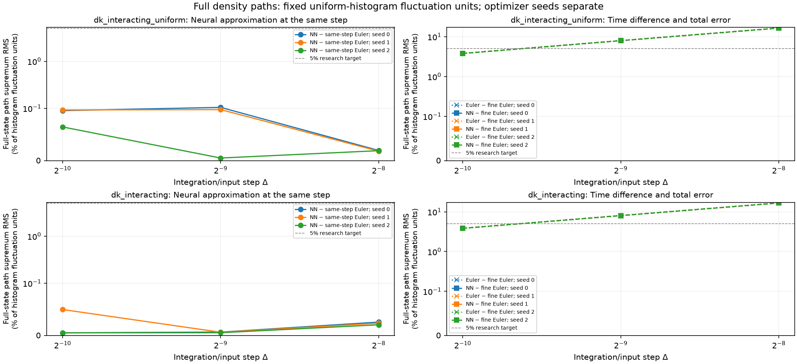
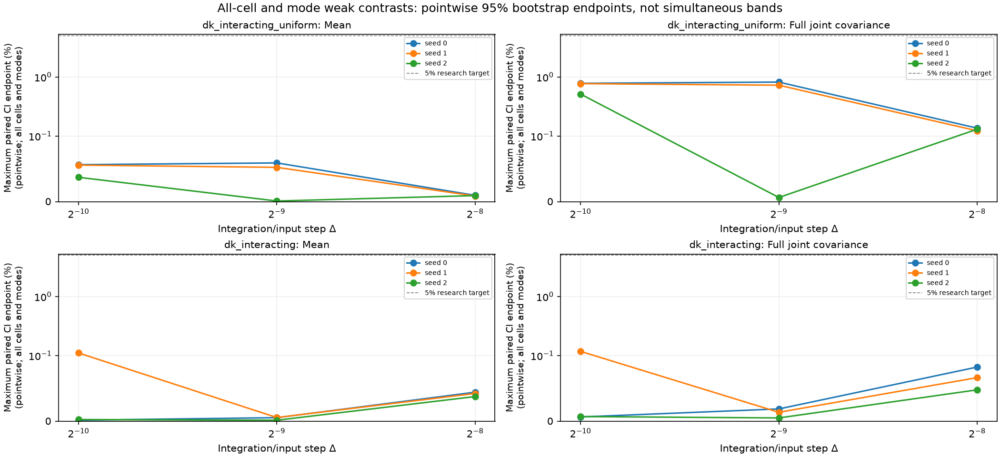

# Causal neural density-path experiments

Reported **18 configured fitted models**, with **18/18 same-step comparisons within the declared accuracy gate**.

The network generates full finite-volume density trajectories from initial cell masses and the physical Brownian path. Its weights remain fixed during each realization. All real spatial modes, including Nyquist, are retained; this is not a moments-only predictor.

The known finite-volume drift and face-noise mobility enter a causal Volterra/Picard ansatz. Training minimizes integrated and local left-endpoint Itô residuals. Optimizer/minibatch randomness is separate from the supplied physical forcing. The learned kernel depends on its input timestep; different resolutions are fitted separately.

The target has G=32, N=2048, D=1, T=0.0625; the fine diagnostic step is δ=0.00012207. DK paths stop at the first boundary crossing of their piecewise-linear numerical polygon and freeze. Every stopped path is retained, and an ensemble with any failed path produces no survivor average.

Same-step reference bias is zero only relative to the declared Euler numerical target. The Euler-to-fine-Euler difference is shown separately; it is not a bound on continuous-time boundary-hitting bias. **Continuous-time stopped-DK convergence and continuum-SPDE convergence remain uncertified.** No temporal order is fitted here.

Strong errors use all cells and the maximum over all stored times, normalized by the exact uniform IID histogram density-L2 fluctuation energy (1−1/G)/(N h). The 5% default is a research accuracy target. Weak gates include all-cell means/full joint same-time and two-time covariances, plus cell-integrated sine/cosine modes 1 and 2. Confidence intervals are pointwise paired whole-trajectory bootstrap intervals, not simultaneous bands or certificates of each marginal-law Monte Carlo precision. Optimizer seeds stay separate; no best seed is selected.

| Case | Δ | Seed | Strong RMS (%) | 95% interval (%) | Max mean CI (%) | Max joint-cov CI (%) | Euler/fine RMS (%) | NN/fine RMS (%) | Stops NN/Euler | Invalid NN/Euler | Same-step gate |
|---|---:|---:|---:|---|---:|---:|---:|---:|---:|---:|---|
| dk_interacting_uniform | 0.00390625 | 0 | 0.01942 | [0.01878, 0.02005] | 0.009602 | 0.1358 | 16.51 | 16.51 | 0/0 | 0/0 | resolved_within_tolerance |
| dk_interacting_uniform | 0.00390625 | 1 | 0.01806 | [0.01748, 0.01865] | 0.008641 | 0.1224 | 16.51 | 16.51 | 0/0 | 0/0 | resolved_within_tolerance |
| dk_interacting_uniform | 0.00390625 | 2 | 0.019 | [0.01841, 0.01956] | 0.009211 | 0.1303 | 16.51 | 16.51 | 0/0 | 0/0 | resolved_within_tolerance |
| dk_interacting_uniform | 0.00195312 | 0 | 0.1048 | [0.1007, 0.1091] | 0.059 | 0.8182 | 7.973 | 7.973 | 0/0 | 0/0 | resolved_within_tolerance |
| dk_interacting_uniform | 0.00195312 | 1 | 0.09759 | [0.09388, 0.1013] | 0.05225 | 0.7246 | 7.973 | 7.973 | 0/0 | 0/0 | resolved_within_tolerance |
| dk_interacting_uniform | 0.00195312 | 2 | 0.00495 | [0.004723, 0.005149] | 0.0009545 | 0.006342 | 7.973 | 7.973 | 0/0 | 0/0 | resolved_within_tolerance |
| dk_interacting_uniform | 0.000976562 | 0 | 0.09563 | [0.09157, 0.0997] | 0.05634 | 0.7793 | 3.802 | 3.802 | 0/0 | 0/0 | resolved_within_tolerance |
| dk_interacting_uniform | 0.000976562 | 1 | 0.09687 | [0.09291, 0.101] | 0.05568 | 0.7702 | 3.802 | 3.802 | 0/0 | 0/0 | resolved_within_tolerance |
| dk_interacting_uniform | 0.000976562 | 2 | 0.06443 | [0.06177, 0.06715] | 0.03709 | 0.5131 | 3.802 | 3.802 | 0/0 | 0/0 | resolved_within_tolerance |
| dk_interacting | 0.00390625 | 0 | 0.02566 | [0.02499, 0.02634] | 0.04422 | 0.08251 | 16.73 | 16.73 | 0/0 | 0/0 | resolved_within_tolerance |
| dk_interacting | 0.00390625 | 1 | 0.02355 | [0.02293, 0.02417] | 0.04229 | 0.06641 | 16.73 | 16.73 | 0/0 | 0/0 | resolved_within_tolerance |
| dk_interacting | 0.00390625 | 2 | 0.02047 | [0.01995, 0.02102] | 0.03756 | 0.04781 | 16.73 | 16.73 | 0/0 | 0/0 | resolved_within_tolerance |
| dk_interacting | 0.00195312 | 0 | 0.00653 | [0.006228, 0.00688] | 0.005388 | 0.01871 | 8.041 | 8.041 | 0/0 | 0/0 | resolved_within_tolerance |
| dk_interacting | 0.00195312 | 1 | 0.006223 | [0.005912, 0.006584] | 0.005596 | 0.01358 | 8.041 | 8.041 | 0/0 | 0/0 | resolved_within_tolerance |
| dk_interacting | 0.00195312 | 2 | 0.005325 | [0.004989, 0.005737] | 0.001508 | 0.004982 | 8.041 | 8.041 | 0/0 | 0/0 | resolved_within_tolerance |
| dk_interacting | 0.000976562 | 0 | 0.005097 | [0.004755, 0.005499] | 0.00159 | 0.006487 | 3.844 | 3.844 | 0/0 | 0/0 | resolved_within_tolerance |
| dk_interacting | 0.000976562 | 1 | 0.04968 | [0.04833, 0.05103] | 0.1108 | 0.1179 | 3.844 | 3.844 | 0/0 | 0/0 | resolved_within_tolerance |
| dk_interacting | 0.000976562 | 2 | 0.005174 | [0.00484, 0.005582] | 0.002562 | 0.007095 | 3.844 | 3.844 | 0/0 | 0/0 | resolved_within_tolerance |

Zero observed stops does not certify a zero stopping probability. Finite-mesh realized quadratic variation is descriptive; noise-normalization checks use uncensored active-at-start proposals, including exit proposals, rather than fractional absorbed increments.

Recorded training cost: **724.531 s** across distinct models. Recorded evaluation cost: **37.1694 s**. These sums do not replace separate data-generation, initialization or latency/throughput measurements.

Source hash: `7737c53f50a112f64a781d6a4ca1c59180160e0d860c93a02c0478b1a0051832`. Configuration hash: `d306708441197134c9be90bb772b47320fe850f42eea5b689af51e4734d18670`. Checkpoint content hashes and locked-final provenance are retained in the JSON and CSV.
