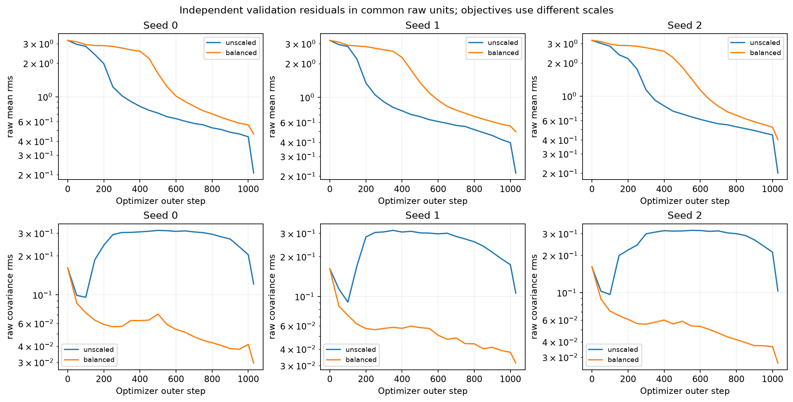
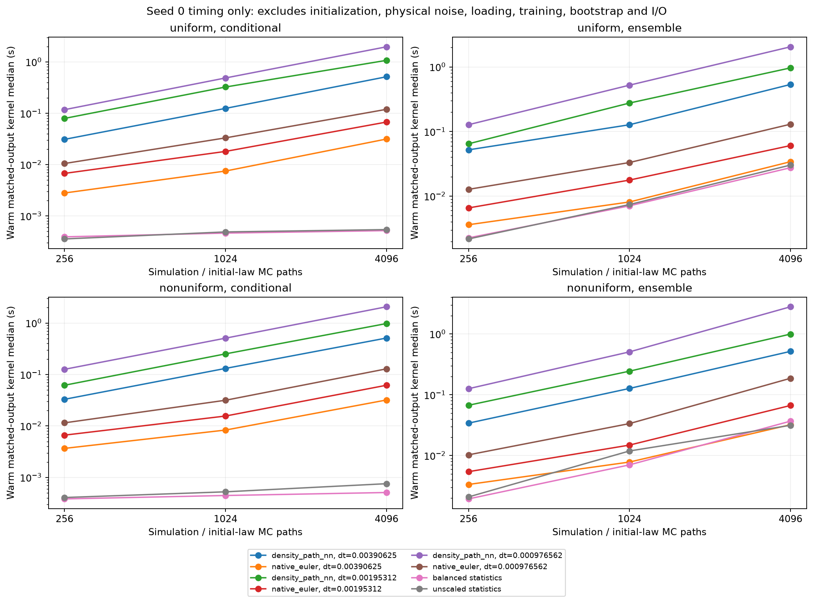

# Interacting solver follow-up

Saved experiment: G=32, N=2048, D=1.0, kappa=0.75, a2=0.1, T=0.0625.

Both solvers use the known interacting native DK generator. Optimizer seeds remain separate. The path solver is fitted independently at each integration step. Statistics heads return four fixed means and the full same-time 4x4 N-scaled covariance at three query times; they do not supply paths or cross-time laws.

## Path refinement

The ranges below are explicit minimum–maximum values across optimizer seeds, without pooling. Primary strong errors use the normalized full-state supremum on the identical physical-time grid of step 0.00390625. Whole-family paired bootstrap intervals are saved in `common_grid_refinement.csv`. Native Euler is deterministically replayed from the existing initial histograms and Brownian increments; no new physical paths are drawn. The original per-solver stored-time metrics remain secondary in `path_refinement.csv`. Fine Euler is a finite reference; these differences are not certified continuous-time errors and no temporal rate is claimed.

| Profile | Step | NN / same-step Euler | NN / fine Euler | Euler / fine Euler |
|---|---:|---:|---:|---:|
| uniform | 0.00390625 | 0.01806–0.01942% | 16.51–16.51% | 16.51–16.51% |
| uniform | 0.001953125 | 0.004758–0.1048% | 7.719–7.719% | 7.719–7.719% |
| uniform | 0.0009765625 | 0.06443–0.09687% | 3.597–3.597% | 3.597–3.597% |
| nonuniform | 0.00390625 | 0.02047–0.02566% | 16.73–16.73% | 16.73–16.73% |
| nonuniform | 0.001953125 | 0.005136–0.006401% | 7.734–7.734% | 7.734–7.734% |
| nonuniform | 0.0009765625 | 0.004808–0.04967% | 3.647–3.647% | 3.647–3.647% |

## Statistics loss balancing

Each frozen residual scale was computed from the initial network on training states only. The objective sums use different scales across candidates and cannot be compared directly. Raw independent-validation RMS values below use common units; each row is the checkpoint selected by its own declared validation sum.

| Candidate | Seed | Initial mean RMS | Selected mean RMS | Initial covariance RMS | Selected covariance RMS | Training s |
|---|---:|---:|---:|---:|---:|---:|
| unscaled | 0 | 3.2143 | 0.2067 | 0.16159 | 0.12124 | 131.67 |
| unscaled | 1 | 3.2143 | 0.21259 | 0.16159 | 0.10579 | 130.86 |
| unscaled | 2 | 3.2143 | 0.20008 | 0.16159 | 0.10319 | 127.96 |
| balanced | 0 | 3.2143 | 0.46423 | 0.16159 | 0.029643 | 136.18 |
| balanced | 1 | 3.2143 | 0.49515 | 0.16159 | 0.031353 | 128.13 |
| balanced | 2 | 3.2143 | 0.40365 | 0.16159 | 0.026945 | 131.21 |

## Matched statistical tasks

All three methods return the same three-time query bank of four means and full same-time covariance. Conditional tasks compare a direct head call at a fixed initial histogram with Monte Carlo trajectories. Ensemble tasks use equal declared initial-law integration/simulation counts. All stopped paths are retained. Means use sqrt(N) scaling; covariance uses N scaling and fixed uniform-particle observable units. A smaller covariance-generator residual cannot substitute for held-out covariance accuracy.

Conditional error ranges below span the fixed initial histograms and both profiles within each optimizer seed. Each task error is the maximum over its three query times and four means/full covariance entries. The endpoint column is the largest absolute pointwise interval endpoint, not a simultaneous bound.

| Candidate | Seed | Conditional mean point error range | Covariance point error range | Largest mean / covariance interval endpoint |
|---|---:|---:|---:|---:|
| unscaled | 0 | 1.24–1.87% | 0.879–2.58% | 3.39% / 4.18% |
| unscaled | 1 | 1.51–2.42% | 0.73–1.48% | 4.12% / 3.09% |
| unscaled | 2 | 1.22–1.79% | 1.01–1.54% | 3.56% / 3.1% |
| balanced | 0 | 1.73–4.11% | 1.06–1.88% | 5.53% / 3.38% |
| balanced | 1 | 1.01–6.69% | 1.36–3.23% | 8.11% / 4.73% |
| balanced | 2 | 0.816–3.7% | 1.04–2.47% | 5.12% / 3.97% |

`task_accuracy_cost.csv` retains every profile, conditional anchor, optimizer seed, count and time step. It separates candidate sampling/initial-law integration uncertainty from independent reference uncertainty. Plot maxima and pointwise percentile intervals are diagnostic summaries, not simultaneous confidence bounds. The finite-reference stopping/discretization bias remains unresolved; no 5% continuous-DK accuracy or solver winner is certified.

## Cost and task suitability

The fixed-count table uses the finest candidate step and largest preregistered count. Ratios compare measured costs at that count, not certified speedups at equal physical accuracy. Component totals sum separately measured medians. All values use prespecified optimizer seed 0.

| Candidate | Profile / task | Path / native / statistics kernels (s) | Native / statistics kernel cost ratio | Native / statistics component cost ratio |
|---|---|---:|---:|---:|
| balanced | uniform / conditional | 1.968 / 0.1194 / 0.0005189 | 230 | 313.4 |
| unscaled | uniform / conditional | 1.95 / 0.1325 / 0.0005431 | 244 | 323.6 |
| balanced | uniform / ensemble | 2.047 / 0.1298 / 0.02756 | 4.712 | 1.08 |
| unscaled | uniform / ensemble | 2.011 / 0.135 / 0.03028 | 4.459 | 1.081 |
| balanced | nonuniform / conditional | 2.069 / 0.1287 / 0.0005094 | 252.7 | 352.1 |
| unscaled | nonuniform / conditional | 2.069 / 0.1464 / 0.0007559 | 193.6 | 260.7 |
| balanced | nonuniform / ensemble | 2.799 / 0.1868 / 0.03685 | 5.068 | 1.086 |
| unscaled | nonuniform / ensemble | 2.612 / 0.2654 / 0.03147 | 8.433 | 1.123 |

Warm timings use prespecified optimizer seed 0, not the most accurate seed. The kernel measurement excludes training, model restoration, histogram initialization, physical noise generation, bootstrap and I/O. The task CSV adds separately measured initialization/noise medians; their sum is an estimated component total, not a measured end-to-end latency. Statistics heads need no physical Brownian draws; direct conditional queries need no histogram Monte Carlo. Warm restoration and training are retained in separate CSV files. Deterministic native replay for this report took 0.20649 s and is excluded from inference benchmarks. Training-time sums across concurrent fits are not batch wall time. The saved timing packets retain implementation batch sizes: path inference uses bounded chunks, while native Euler is vectorized over its declared ensemble. These timings assess the current CPU implementations, not an architecture-independent lower bound. The benchmark measures matched moment outputs: native Euler returns only queried states and the path network internally constructs its full trajectory. A separate experiment is needed to compare full-trajectory export. Break-even query counts remain undefined until matched accuracy is resolved and online savings are positive.

| Task | Density-path NN | Native Euler | Fixed statistics NN |
|---|---|---|---|
| Full-grid density trajectories | Supported | Supported | Not supplied |
| Four declared means and same-time covariance | Monte Carlo | Monte Carlo | Direct conditional head; initial-law MC for ensembles |
| New observables after simulation | Can evaluate saved paths; accuracy requires checking | Can evaluate saved paths; accuracy requires checking | Requires a new output/training study |
| Path-dependent or cross-time queries | Path samples available; task accuracy unbenchmarked | Path samples available; task accuracy unbenchmarked | Not supplied by this head |
| Rare stopping events / new physics | Not certified by this experiment | Not certified by this experiment | Not certified by this experiment |

The task representation suggests where each solver can be useful. Advantage at a requested accuracy remains an empirical question; fixed-count speed and lower point error alone do not settle it.
