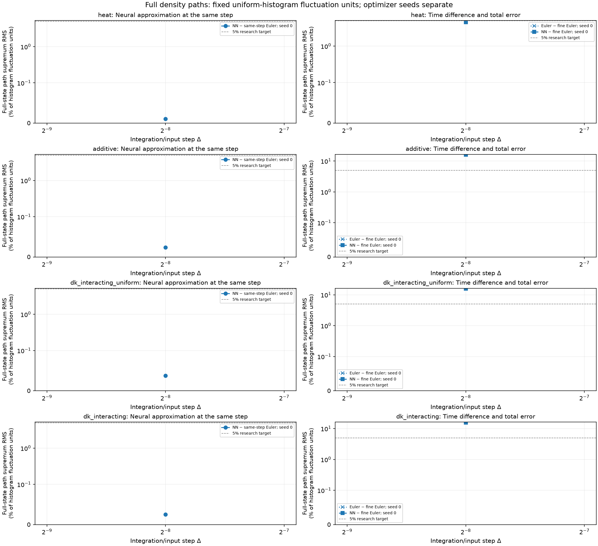
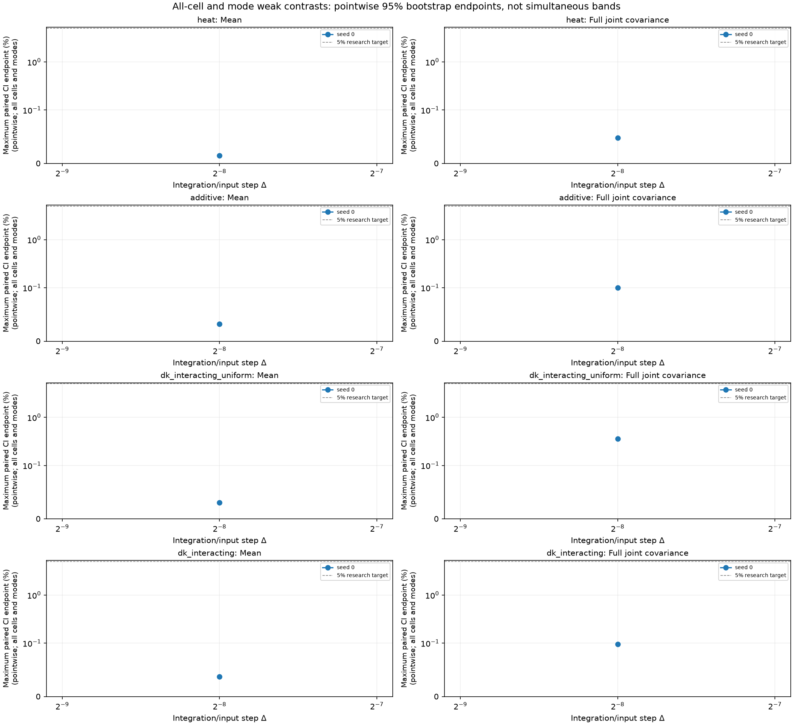

# Causal neural density-path experiments

Reported **4 configured fitted models**, with **4/4 same-step comparisons within the declared accuracy gate**.

The network generates full finite-volume density trajectories from initial cell masses and the physical Brownian path. Its weights remain fixed during each realization. All real spatial modes, including Nyquist, are retained; this is not a moments-only predictor.

The known finite-volume drift and face-noise mobility enter a causal Volterra/Picard ansatz. Training minimizes integrated and local left-endpoint Itô residuals. Optimizer/minibatch randomness is separate from the supplied physical forcing. The learned kernel depends on its input timestep; different resolutions are fitted separately.

The target has G=32, N=2048, D=1, T=0.0625; the fine diagnostic step is δ=0.000488281. DK paths stop at the first boundary crossing of their piecewise-linear numerical polygon and freeze. Every stopped path is retained, and an ensemble with any failed path produces no survivor average.

Same-step reference bias is zero only relative to the declared Euler numerical target. The Euler-to-fine-Euler difference is shown separately; it is not a bound on continuous-time boundary-hitting bias. **Continuous-time stopped-DK convergence and continuum-SPDE convergence remain uncertified.** No temporal order is fitted here.

Strong errors use all cells and the maximum over all stored times, normalized by the exact uniform IID histogram density-L2 fluctuation energy (1−1/G)/(N h). The 5% default is a research accuracy target. Weak gates include all-cell means/full joint same-time and two-time covariances, plus cell-integrated sine/cosine modes 1 and 2. Confidence intervals are pointwise paired whole-trajectory bootstrap intervals, not simultaneous bands or certificates of each marginal-law Monte Carlo precision. Optimizer seeds stay separate; no best seed is selected.

| Case | Δ | Seed | Strong RMS (%) | 95% interval (%) | Max mean CI (%) | Max joint-cov CI (%) | Euler/fine RMS (%) | NN/fine RMS (%) | Stops NN/Euler | Invalid NN/Euler | Same-step gate |
|---|---:|---:|---:|---|---:|---:|---:|---:|---:|---:|---|
| heat | 0.00390625 | 0 | 0.01058 | [0.009966, 0.01119] | 0.01477 | 0.04782 | 4.523 | 4.523 | 0/0 | 0/0 | resolved_within_tolerance |
| additive | 0.00390625 | 0 | 0.02396 | [0.02263, 0.02496] | 0.03186 | 0.1003 | 15.93 | 15.93 | 0/0 | 0/0 | resolved_within_tolerance |
| dk_interacting_uniform | 0.00390625 | 0 | 0.03723 | [0.03509, 0.03967] | 0.0305 | 0.3589 | 15.81 | 15.81 | 0/0 | 0/0 | resolved_within_tolerance |
| dk_interacting | 0.00390625 | 0 | 0.02504 | [0.02366, 0.02675] | 0.03705 | 0.09783 | 15.76 | 15.76 | 0/0 | 0/0 | resolved_within_tolerance |

Zero observed stops does not certify a zero stopping probability. Finite-mesh realized quadratic variation is descriptive; noise-normalization checks use uncensored active-at-start proposals, including exit proposals, rather than fractional absorbed increments.

Recorded training cost: **34.4076 s** across distinct models. Recorded evaluation cost: **2.84951 s**. These sums do not replace separate data-generation, initialization or latency/throughput measurements.

Source hash: `c2718aa7eb7e6c221ef3453439b99649b0e2b114b559a8a248556b57c8b0304f`. Configuration hash: `41b74ce33f978291f31d1bc892a9f220ede31b48d02e7529d986225b0f55747b`. Checkpoint content hashes and locked-final provenance are retained in the JSON and CSV.
