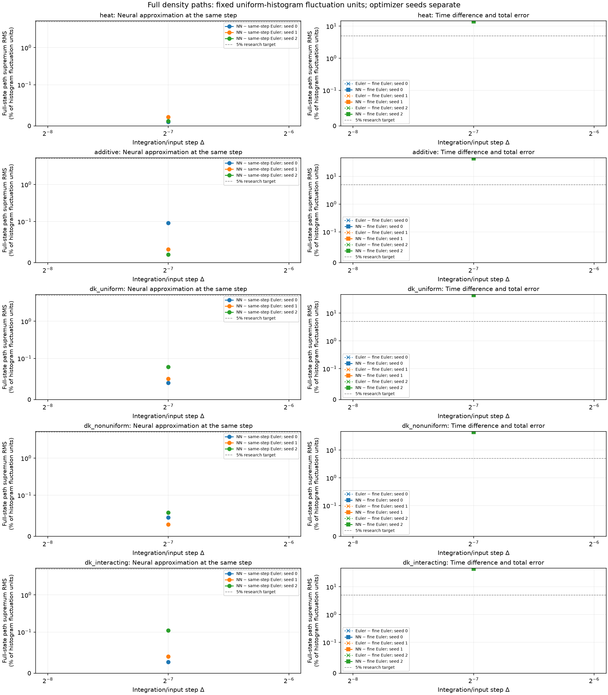
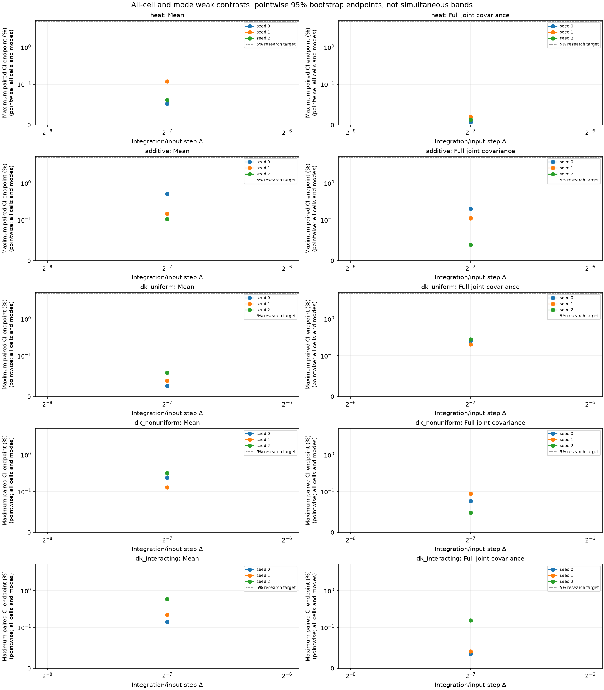

# Causal neural density-path experiments

Reported **15 configured fitted models**, with **15/15 same-step comparisons within the declared accuracy gate**.

The network generates full finite-volume density trajectories from initial cell masses and the physical Brownian path. Its weights remain fixed during each realization. All real spatial modes, including Nyquist, are retained; this is not a moments-only predictor.

The known finite-volume drift and face-noise mobility enter a causal Volterra/Picard ansatz. Training minimizes integrated and local left-endpoint Itô residuals. Optimizer/minibatch randomness is separate from the supplied physical forcing. The learned kernel depends on its input timestep; different resolutions are fitted separately.

The target has G=32, N=2048, D=1, T=1; the fine diagnostic step is δ=0.00012207. DK paths stop at the first boundary crossing of their piecewise-linear numerical polygon and freeze. Every stopped path is retained, and an ensemble with any failed path produces no survivor average.

Same-step reference bias is zero only relative to the declared Euler numerical target. The Euler-to-fine-Euler difference is shown separately; it is not a bound on continuous-time boundary-hitting bias. **Continuous-time stopped-DK convergence and continuum-SPDE convergence remain uncertified.** No temporal order is fitted here.

Strong errors use all cells and the maximum over all stored times, normalized by the exact uniform IID histogram density-L2 fluctuation energy (1−1/G)/(N h). The 5% default is a research accuracy target. Weak gates include all-cell means/full joint same-time and two-time covariances, plus cell-integrated sine/cosine modes 1 and 2. Confidence intervals are pointwise paired whole-trajectory bootstrap intervals, not simultaneous bands or certificates of each marginal-law Monte Carlo precision. Optimizer seeds stay separate; no best seed is selected.

| Case | Δ | Seed | Strong RMS (%) | 95% interval (%) | Max mean CI (%) | Max joint-cov CI (%) | Euler/fine RMS (%) | NN/fine RMS (%) | Stops NN/Euler | Invalid NN/Euler | Same-step gate |
|---|---:|---:|---:|---|---:|---:|---:|---:|---:|---:|---|
| heat | 0.0078125 | 0 | 0.009477 | [0.009332, 0.009612] | 0.05239 | 0.006814 | 14.12 | 14.12 | 0/0 | 0/0 | resolved_within_tolerance |
| heat | 0.0078125 | 1 | 0.02169 | [0.02138, 0.02199] | 0.1185 | 0.01992 | 14.12 | 14.12 | 0/0 | 0/0 | resolved_within_tolerance |
| heat | 0.0078125 | 2 | 0.01193 | [0.01171, 0.01216] | 0.0608 | 0.01328 | 14.12 | 14.12 | 0/0 | 0/0 | resolved_within_tolerance |
| additive | 0.0078125 | 0 | 0.09653 | [0.09491, 0.09834] | 0.5129 | 0.2001 | 44.46 | 44.46 | 0/0 | 0/0 | resolved_within_tolerance |
| additive | 0.0078125 | 1 | 0.03237 | [0.03179, 0.03295] | 0.1493 | 0.1118 | 44.46 | 44.46 | 0/0 | 0/0 | resolved_within_tolerance |
| additive | 0.0078125 | 2 | 0.02017 | [0.01981, 0.02055] | 0.1058 | 0.03943 | 44.46 | 44.46 | 0/0 | 0/0 | resolved_within_tolerance |
| dk_uniform | 0.0078125 | 0 | 0.04098 | [0.03952, 0.04238] | 0.02632 | 0.253 | 44.46 | 44.46 | 0/0 | 0/0 | resolved_within_tolerance |
| dk_uniform | 0.0078125 | 1 | 0.05076 | [0.04773, 0.05325] | 0.03893 | 0.2031 | 44.46 | 44.46 | 0/0 | 0/0 | resolved_within_tolerance |
| dk_uniform | 0.0078125 | 2 | 0.07953 | [0.07458, 0.08367] | 0.05858 | 0.2796 | 44.46 | 44.46 | 0/0 | 0/0 | resolved_within_tolerance |
| dk_nonuniform | 0.0078125 | 0 | 0.0461 | [0.0453, 0.04682] | 0.2411 | 0.07664 | 44.99 | 44.99 | 0/0 | 0/0 | resolved_within_tolerance |
| dk_nonuniform | 0.0078125 | 1 | 0.02923 | [0.02866, 0.02972] | 0.1312 | 0.095 | 44.99 | 44.99 | 0/0 | 0/0 | resolved_within_tolerance |
| dk_nonuniform | 0.0078125 | 2 | 0.05783 | [0.0568, 0.05882] | 0.3164 | 0.04903 | 44.99 | 44.99 | 0/0 | 0/0 | resolved_within_tolerance |
| dk_interacting | 0.0078125 | 0 | 0.02713 | [0.02656, 0.02771] | 0.1419 | 0.03595 | 44.6 | 44.6 | 0/0 | 0/0 | resolved_within_tolerance |
| dk_interacting | 0.0078125 | 1 | 0.04072 | [0.03982, 0.04155] | 0.221 | 0.04139 | 44.6 | 44.6 | 0/0 | 0/0 | resolved_within_tolerance |
| dk_interacting | 0.0078125 | 2 | 0.1104 | [0.1079, 0.1125] | 0.586 | 0.1551 | 44.6 | 44.6 | 0/0 | 0/0 | resolved_within_tolerance |

Zero observed stops does not certify a zero stopping probability. Finite-mesh realized quadratic variation is descriptive; noise-normalization checks use uncensored active-at-start proposals, including exit proposals, rather than fractional absorbed increments.

Recorded training cost: **20745.3 s** across distinct models. Recorded evaluation cost: **76.9549 s**. These sums do not replace separate data-generation, initialization or latency/throughput measurements.

Source hash: `a37ebd4fa82c8c590922417004d47150b1ea71d75be635a316b670506053223a`. Configuration hash: `c97dc2f1b9882f5ae1c4b3e644bf9981c8812eda0e341f80939f65ec956407bf`. Checkpoint content hashes and locked-final provenance are retained in the JSON and CSV.
