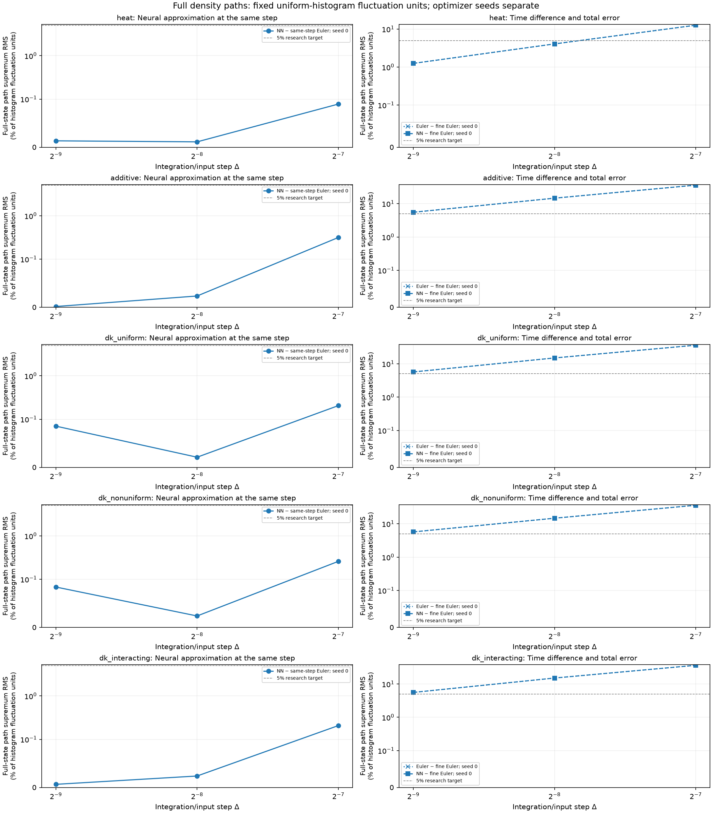
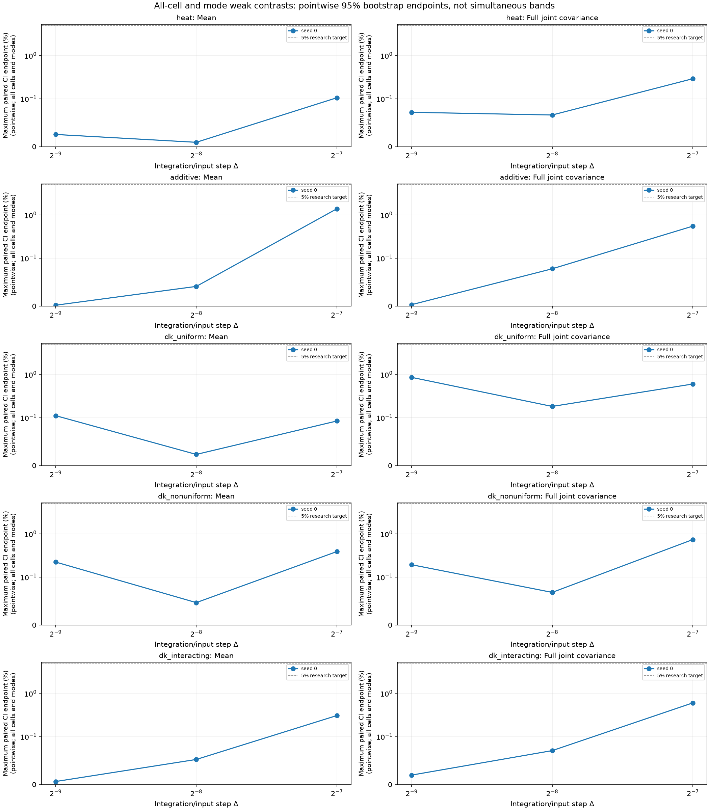

# Causal neural density-path experiments

Reported **15 configured fitted models**, with **15/15 same-step comparisons within the declared accuracy gate**.

The network generates full finite-volume density trajectories from initial cell masses and the physical Brownian path. Its weights remain fixed during each realization. All real spatial modes, including Nyquist, are retained; this is not a moments-only predictor.

The known finite-volume drift and face-noise mobility enter a causal Volterra/Picard ansatz. Training minimizes integrated and local left-endpoint Itô residuals. Optimizer/minibatch randomness is separate from the supplied physical forcing. The learned kernel depends on its input timestep; different resolutions are fitted separately.

The target has G=32, N=2048, D=1, T=0.0625; the fine diagnostic step is δ=0.000976562. DK paths stop at the first boundary crossing of their piecewise-linear numerical polygon and freeze. Every stopped path is retained, and an ensemble with any failed path produces no survivor average.

Same-step reference bias is zero only relative to the declared Euler numerical target. The Euler-to-fine-Euler difference is shown separately; it is not a bound on continuous-time boundary-hitting bias. **Continuous-time stopped-DK convergence and continuum-SPDE convergence remain uncertified.** No temporal order is fitted here.

Strong errors use all cells and the maximum over all stored times, normalized by the exact uniform IID histogram density-L2 fluctuation energy (1−1/G)/(N h). The 5% default is a research accuracy target. Weak gates include all-cell means/full joint same-time and two-time covariances, plus cell-integrated sine/cosine modes 1 and 2. Confidence intervals are pointwise paired whole-trajectory bootstrap intervals, not simultaneous bands or certificates of each marginal-law Monte Carlo precision. Optimizer seeds stay separate; no best seed is selected.

| Case | Δ | Seed | Strong RMS (%) | 95% interval (%) | Max mean CI (%) | Max joint-cov CI (%) | Euler/fine RMS (%) | NN/fine RMS (%) | Stops NN/Euler | Invalid NN/Euler | Same-step gate |
|---|---:|---:|---:|---|---:|---:|---:|---:|---:|---:|---|
| heat | 0.0078125 | 0 | 0.08967 | [0.08679, 0.09312] | 0.1053 | 0.2905 | 12.64 | 12.63 | 0/0 | 0/0 | resolved_within_tolerance |
| heat | 0.00390625 | 0 | 0.01129 | [0.01063, 0.01193] | 0.009273 | 0.06613 | 4.07 | 4.07 | 0/0 | 0/0 | resolved_within_tolerance |
| heat | 0.00195312 | 0 | 0.01343 | [0.01267, 0.01421] | 0.02559 | 0.07176 | 1.251 | 1.251 | 0/0 | 0/0 | resolved_within_tolerance |
| additive | 0.0078125 | 0 | 0.316 | [0.3072, 0.3234] | 1.393 | 0.552 | 35.89 | 35.89 | 0/0 | 0/0 | resolved_within_tolerance |
| additive | 0.00390625 | 0 | 0.02357 | [0.02214, 0.02458] | 0.04125 | 0.07794 | 14.59 | 14.59 | 0/0 | 0/0 | resolved_within_tolerance |
| additive | 0.00195312 | 0 | 0.001766 | [0.001684, 0.001839] | 0.002106 | 0.003225 | 5.512 | 5.512 | 0/0 | 0/0 | resolved_within_tolerance |
| dk_uniform | 0.0078125 | 0 | 0.2056 | [0.1962, 0.2168] | 0.09308 | 0.6003 | 36.15 | 36.14 | 0/0 | 0/0 | resolved_within_tolerance |
| dk_uniform | 0.00390625 | 0 | 0.02119 | [0.01992, 0.02247] | 0.02346 | 0.1819 | 14.97 | 14.97 | 0/0 | 0/0 | resolved_within_tolerance |
| dk_uniform | 0.00195312 | 0 | 0.08564 | [0.07961, 0.0933] | 0.1113 | 0.8557 | 5.692 | 5.693 | 0/0 | 0/0 | resolved_within_tolerance |
| dk_nonuniform | 0.0078125 | 0 | 0.2587 | [0.2497, 0.269] | 0.3907 | 0.7396 | 35.95 | 35.94 | 0/0 | 0/0 | resolved_within_tolerance |
| dk_nonuniform | 0.00390625 | 0 | 0.02387 | [0.02291, 0.0249] | 0.04695 | 0.06823 | 14.69 | 14.69 | 0/0 | 0/0 | resolved_within_tolerance |
| dk_nonuniform | 0.00195312 | 0 | 0.08392 | [0.08073, 0.08694] | 0.2234 | 0.1937 | 5.701 | 5.701 | 0/0 | 0/0 | resolved_within_tolerance |
| dk_interacting | 0.0078125 | 0 | 0.2074 | [0.1994, 0.2167] | 0.3072 | 0.6031 | 36.52 | 36.53 | 0/0 | 0/0 | resolved_within_tolerance |
| dk_interacting | 0.00390625 | 0 | 0.02392 | [0.02299, 0.02514] | 0.0524 | 0.07082 | 15.15 | 15.15 | 0/0 | 0/0 | resolved_within_tolerance |
| dk_interacting | 0.00195312 | 0 | 0.006652 | [0.006182, 0.00715] | 0.006478 | 0.01985 | 5.594 | 5.594 | 0/0 | 0/0 | resolved_within_tolerance |

Zero observed stops does not certify a zero stopping probability. Finite-mesh realized quadratic variation is descriptive; noise-normalization checks use uncensored active-at-start proposals, including exit proposals, rather than fractional absorbed increments.

Recorded training cost: **90.207 s** across distinct models. Recorded evaluation cost: **11.4008 s**. These sums do not replace separate data-generation, initialization or latency/throughput measurements.

Source hash: `a37ebd4fa82c8c590922417004d47150b1ea71d75be635a316b670506053223a`. Configuration hash: `00fa885ecbb10ca1e7d8483db01a722d1e6d78030f21524c669335ecd148ba08`. Checkpoint content hashes and locked-final provenance are retained in the JSON and CSV.
