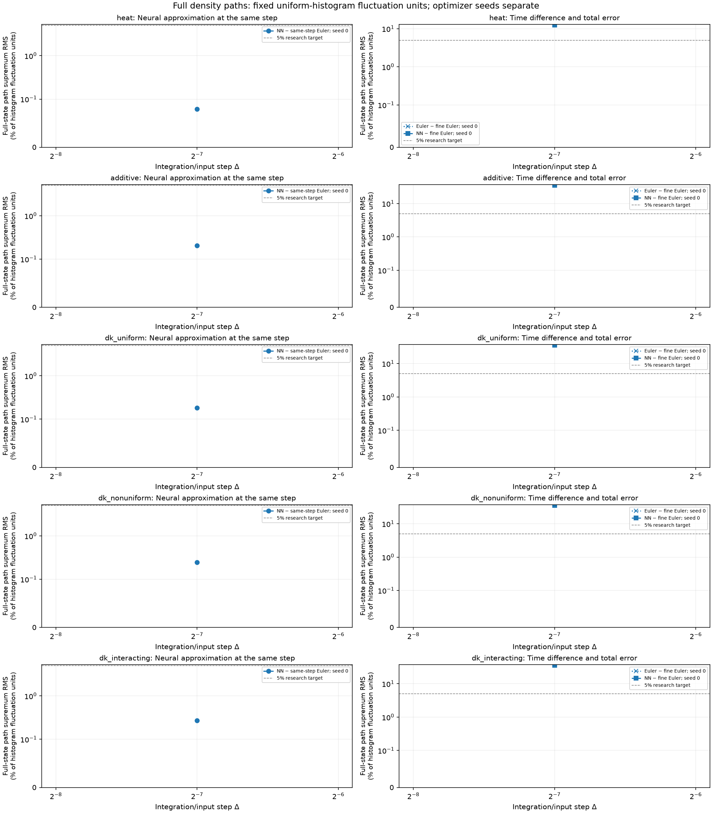
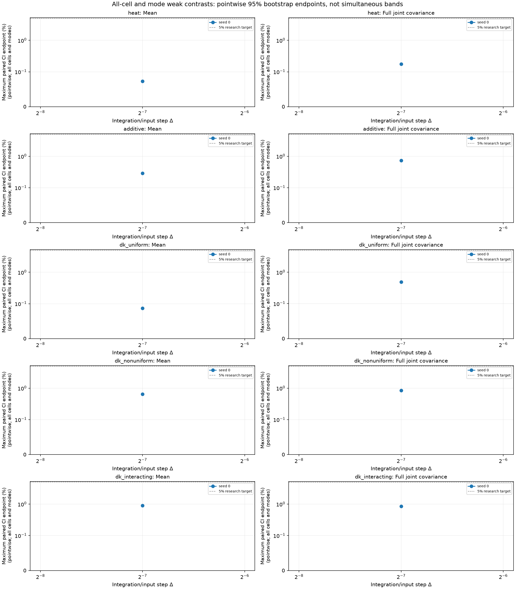

# Causal neural density-path experiments

Reported **5 configured fitted models**, with **5/5 same-step comparisons within the declared accuracy gate**.

The network generates full finite-volume density trajectories from initial cell masses and the physical Brownian path. Its weights remain fixed during each realization. All real spatial modes, including Nyquist, are retained; this is not a moments-only predictor.

The known finite-volume drift and face-noise mobility enter a causal Volterra/Picard ansatz. Training minimizes integrated and local left-endpoint Itô residuals. Optimizer/minibatch randomness is separate from the supplied physical forcing. The learned kernel depends on its input timestep; different resolutions are fitted separately.

The target has G=32, N=2048, D=1, T=0.0625; the fine diagnostic step is δ=0.000976562. DK paths stop at the first boundary crossing of their piecewise-linear numerical polygon and freeze. Every stopped path is retained, and an ensemble with any failed path produces no survivor average.

Same-step reference bias is zero only relative to the declared Euler numerical target. The Euler-to-fine-Euler difference is shown separately; it is not a bound on continuous-time boundary-hitting bias. **Continuous-time stopped-DK convergence and continuum-SPDE convergence remain uncertified.** No temporal order is fitted here.

Strong errors use all cells and the maximum over all stored times, normalized by the exact uniform IID histogram density-L2 fluctuation energy (1−1/G)/(N h). The 5% default is a research accuracy target. Weak gates include all-cell means/full joint same-time and two-time covariances, plus cell-integrated sine/cosine modes 1 and 2. Confidence intervals are pointwise paired whole-trajectory bootstrap intervals, not simultaneous bands or certificates of each marginal-law Monte Carlo precision. Optimizer seeds stay separate; no best seed is selected.

| Case | Δ | Seed | Strong RMS (%) | 95% interval (%) | Max mean CI (%) | Max joint-cov CI (%) | Euler/fine RMS (%) | NN/fine RMS (%) | Stops NN/Euler | Invalid NN/Euler | Same-step gate |
|---|---:|---:|---:|---|---:|---:|---:|---:|---:|---:|---|
| heat | 0.0078125 | 0 | 0.07908 | [0.07446, 0.08478] | 0.07316 | 0.1747 | 12.55 | 12.54 | 0/0 | 0/0 | resolved_within_tolerance |
| additive | 0.0078125 | 0 | 0.2061 | [0.1974, 0.2175] | 0.2889 | 0.7301 | 35.58 | 35.59 | 0/0 | 0/0 | resolved_within_tolerance |
| dk_uniform | 0.0078125 | 0 | 0.1829 | [0.1734, 0.1917] | 0.08733 | 0.4918 | 35.55 | 35.55 | 0/0 | 0/0 | resolved_within_tolerance |
| dk_nonuniform | 0.0078125 | 0 | 0.2465 | [0.2391, 0.2545] | 0.6427 | 0.8505 | 35.95 | 35.95 | 0/0 | 0/0 | resolved_within_tolerance |
| dk_interacting | 0.0078125 | 0 | 0.2691 | [0.2615, 0.2766] | 0.8957 | 0.8467 | 35.7 | 35.7 | 0/0 | 0/0 | resolved_within_tolerance |

Zero observed stops does not certify a zero stopping probability. Finite-mesh realized quadratic variation is descriptive; noise-normalization checks use uncensored active-at-start proposals, including exit proposals, rather than fractional absorbed increments.

Recorded training cost: **17.7628 s** across distinct models. Recorded evaluation cost: **2.31226 s**. These sums do not replace separate data-generation, initialization or latency/throughput measurements.

Source hash: `a37ebd4fa82c8c590922417004d47150b1ea71d75be635a316b670506053223a`. Configuration hash: `ac392518dcf71e7478021b060da4cf8e45cb37b6f71f0c401583e64995f04276`. Checkpoint content hashes and locked-final provenance are retained in the JSON and CSV.
