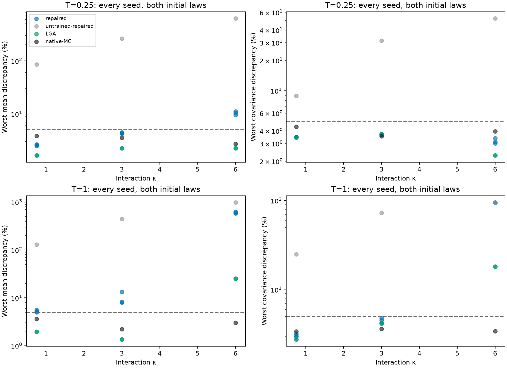
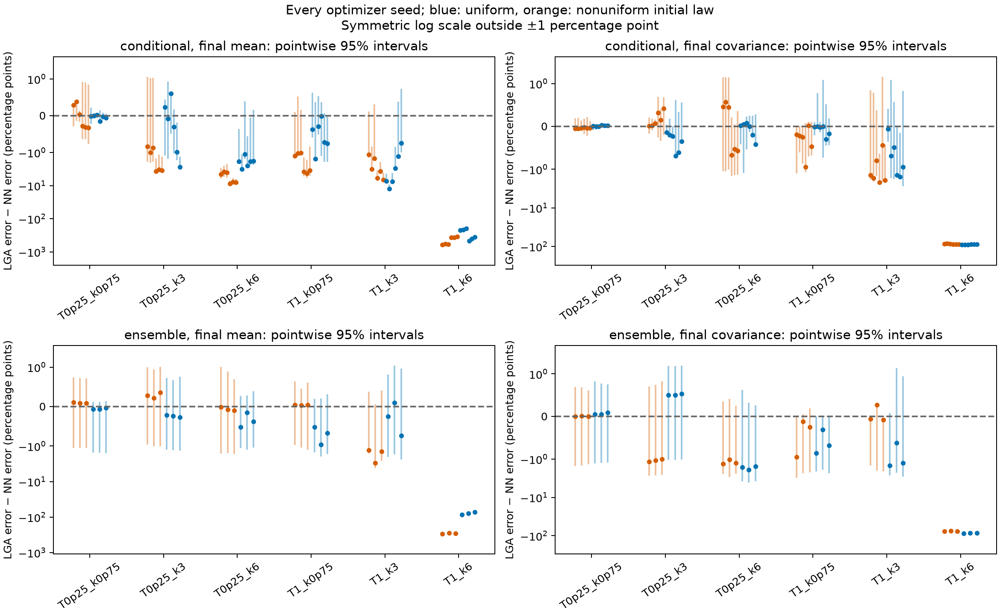
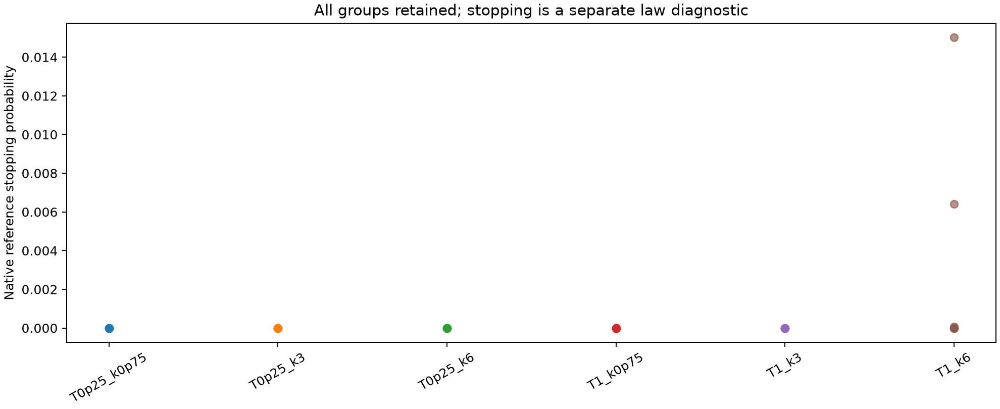
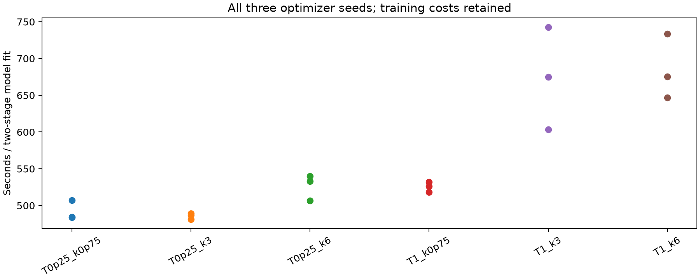
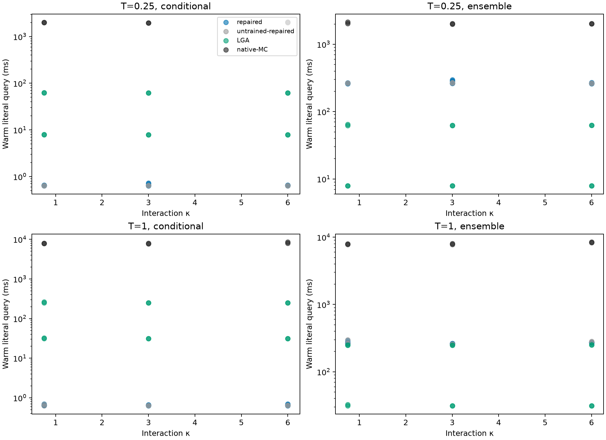
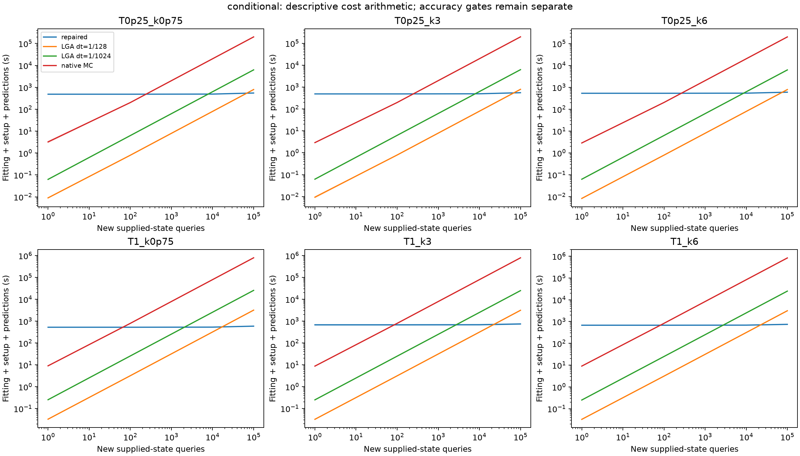
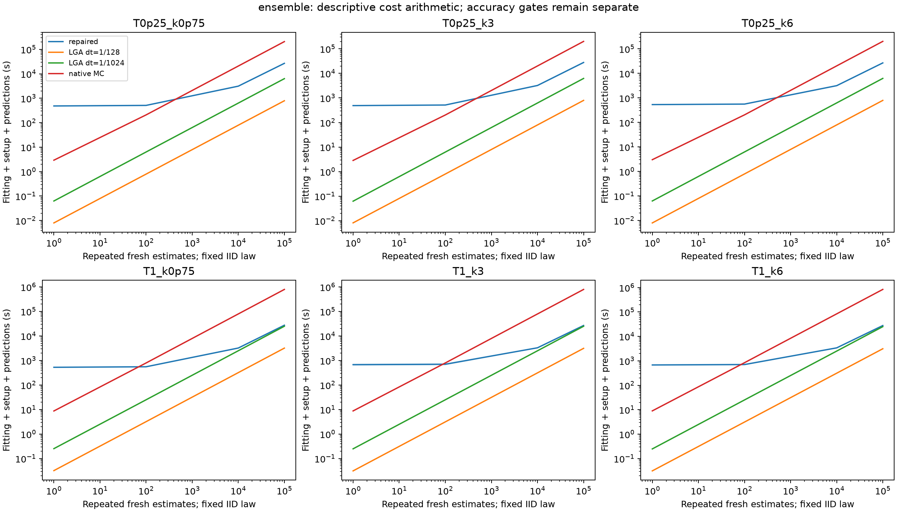

# Longer horizons and stronger interactions: repaired statistics NN versus Gaussian

This fixed-design study retains every declared optimizer seed. Native Monte Carlo is the reference; the Gaussian comparator is an unstopped linear-noise approximation. The NN predicts only the supported four means and same-time 4×4 covariances at three horizons. It does not predict stopping probabilities or sample paths.

## Main findings

Of 216 fixed group/horizon/statistic comparisons, **0 favor the NN for all three optimizer seeds** with positive pointwise 95% lower contrast bounds; 57 favor the fine Gaussian approximation for all seeds. The remaining comparisons are unresolved or inconsistent across seeds. These counts retain both initial laws and conditional/independent-ensemble tasks; they do not constitute a simultaneous grid-wide inference.

In the longest, strongest case (T1_k6), the repaired NN's worst mean discrepancy is 5.85–6.3 reference standard deviations, versus 0.252 for the fine Gaussian approximation. The worst normalized covariance discrepancies are 94.5–95.2% versus 18.2%. Stronger interaction exposes limitations of both methods; this NN formulation and fixed fitting allocation do not turn that difficulty into an accuracy advantage. The validation and controlled boundary audit below diagnose a substantial fitting problem. All three unsuccessful fits remain in the study.

## Design and interpretation

The fixed grid is G=32, N=2048, D=1, a₂=0.1, κ∈(0.75, 3.0, 6.0), T∈(0.25, 1.0). The mode-1 uniform-state growth rate changes sign at κ=2. Thus the grid separates a longer stable regime from two unstable interaction strengths. Both IID histogram laws—uniform and exp(0.2 cos x)—remain. The mixed bank contains terminal sine/cosine mode 3 and killed sine/cosine mode-1 time integrals divided by each problem's fixed final horizon. Queries are at T/4,T/2,T. Results across T concern these declared time-average units, not an unchanged unnormalized running weight.

There are 256 training and 128 validation paths per initial law and regime, with 16 state/horizon rows per trajectory. Each mean and covariance stage receives 1000 AdamW and 30 LBFGS outer steps. The selected mean is frozen during covariance fitting. All 18 models use width 32 and 16 deterministic heat-anchor quadrature nodes. No final-reference outcome selects a fit, seed, allocation or regime. This is fixed-problem fitting, not generalization to unseen physical parameters.

Each of 36 reference groups has 16,384 independent paths: 589,824 reference families overall. The base step is 0.000244141, with coupled refinement factors (1, 2, 4) on 1,024 families/group. A separately drawn 16,384-path native Monte Carlo deployment at 2⁻¹⁰ is also evaluated. Every stopped path remains in the estimates. Terminal values freeze at the first Euler-polygon crossing of ρ*=0.01/(2π); running integrals cease there.

## Independent accuracy

| Regime | Method | Worst mean (% SD) | Worst covariance (%) | Covariance + sampling (%) |
| --- | --- | --- | --- | --- |
| T0p25_k0p75 | repaired | 2.5–2.66 | 3.47–3.47 | 6.05–6.05 |
| T0p25_k0p75 | untrained-repaired | 85.2 | 8.9 | 12.2 |
| T0p25_k0p75 | LGA_dt7 | 1.65 | 3.43 | 6.01 |
| T0p25_k0p75 | LGA_dt10 | 1.65 | 3.43 | 6.01 |
| T0p25_k0p75 | native-MC | 3.86 | 4.38 | 8.5 |
| T0p25_k3 | repaired | 4.23–4.48 | 3.67–3.72 | 6.4–6.47 |
| T0p25_k3 | untrained-repaired | 262 | 31.4 | 34.6 |
| T0p25_k3 | LGA_dt7 | 2.26 | 3.72 | 6.45 |
| T0p25_k3 | LGA_dt10 | 2.26 | 3.72 | 6.45 |
| T0p25_k3 | native-MC | 3.57 | 3.54 | 7.79 |
| T0p25_k6 | repaired | 9.58–11.1 | 3.01–3.38 | 6.54–6.91 |
| T0p25_k6 | untrained-repaired | 627 | 52.2 | 55.1 |
| T0p25_k6 | LGA_dt7 | 2.27 | 2.28 | 5.5 |
| T0p25_k6 | LGA_dt10 | 2.27 | 2.28 | 5.5 |
| T0p25_k6 | native-MC | 2.74 | 3.96 | 8.12 |
| T1_k0p75 | repaired | 4.98–5.54 | 2.98–3.18 | 5.8–6.06 |
| T1_k0p75 | untrained-repaired | 130 | 25 | 27.8 |
| T1_k0p75 | LGA_dt7 | 1.96 | 2.77 | 5.58 |
| T1_k0p75 | LGA_dt10 | 1.96 | 2.77 | 5.58 |
| T1_k0p75 | native-MC | 3.62 | 3.41 | 7.95 |
| T1_k3 | repaired | 7.94–13.3 | 4.17–4.8 | 7.37–7.64 |
| T1_k3 | untrained-repaired | 443 | 72.9 | 75.6 |
| T1_k3 | LGA_dt7 | 1.35 | 4.22 | 7.02 |
| T1_k3 | LGA_dt10 | 1.35 | 4.22 | 7.02 |
| T1_k3 | native-MC | 2.22 | 3.62 | 7.38 |
| T1_k6 | repaired | 585–630 | 94.5–95.2 | 96.9–97.5 |
| T1_k6 | untrained-repaired | 985 | 94.6 | 97 |
| T1_k6 | LGA_dt7 | 25.2 | 18.2 | 21 |
| T1_k6 | LGA_dt10 | 25.2 | 18.2 | 21 |
| T1_k6 | native-MC | 3.01 | 3.41 | 7.14 |

Each per-model maximum covers both initial laws, all supplied histogram anchors/ensemble queries and all three horizons. Ranges preserve optimizer seeds; the LGA steps remain separate. Errors use reference standard deviations and their products, not relative errors of possibly zero means. Individual outputs, covariance entries and simplex support-bound diagnostics remain in components.csv and covariances.csv. The untrained heat control runs this architecture's implementation; its runtime is not presented as an optimized standalone analytic solver.

Positive contrasts mean the repaired NN is closer than the fine LGA. Primary NN ensemble predictions use a separately preregistered independent initial-histogram integration pool, with an independent initial-pool bootstrap. Conditional predictions use the supplied histogram. The bootstrap resamples complete trajectory families and uses the same reference resample for both methods. The intervals are pointwise per seed, group and horizon; searching the grid does not create a family-wise certificate. A resolved error contrast is distinct from meeting the absolute 5% accuracy target. Every seed is reported, including failures and unresolved comparisons.

seed_consistency.csv separately identifies fixed profile/role/horizon comparisons where all optimizer seeds favor the same method. An isolated positive cell remains exploratory; even consistency across seeds is not a simultaneous certificate over the searched physical grid.

The original NN ensemble comparison sharing initial histograms with the native reference is retained in paired_initial_accuracy.csv and paired_initial_contrasts.csv as a lower-noise approximation-bias diagnostic. Primary deployment tables and payback gates use independent initialization. Both the original and supplemental records remain checksum-indexed; the supplement was frozen before any reference outcomes or independent integration histograms were drawn.

## Stopping and reference uncertainty

The Gaussian baseline does not implement absorbing dynamics. If stopping is appreciable, a discrepancy can reflect that law mismatch as well as nonlinear closure error. The NN enforces frozen boundary values but its near-boundary approximation is still learned. Native refinement differences do not enclose continuous boundary-hitting bias. Zero observed stops would not establish rare-event accuracy.

near_boundary.csv retains path-minimum quantiles and boundary-strip frequencies even for paths that do not stop. gaussian_law_diagnostics.csv retains deterministic mean minima, covariance positivity and symmetry checks. These diagnostics help distinguish interior nonlinear closure errors from stopping effects.

Reference refinement, standalone initial-law integration noise, independent native-deployment sampling and method-discrepancy intervals are saved separately. The strict deployment gate asks for 5% normalized error and each sampling/refinement contribution below 1.25%; passing a finite-reference diagnostic would still not be a continuous-DK theorem. See reference_refinement.csv, sampling.csv and amortization.csv.

Final-time stopping counts in T1_k6:

| Initial law / query | Stopped / paths | Probability (%) | Wilson 95% interval (%) |
| --- | --- | --- | --- |
| nonuniform__conditional__0 | 105 / 16,384 | 0.6409 | 0.5297–0.7752 |
| nonuniform__conditional__1 | 1 / 16,384 | 0.006104 | 0.001077–0.03457 |
| nonuniform__ensemble__0 | 246 / 16,384 | 1.501 | 1.326–1.699 |
| uniform__conditional__0 | 0 / 16,384 | 0 | 0–0.02344 |
| uniform__conditional__1 | 0 / 16,384 | 0 | 0–0.02344 |
| uniform__ensemble__0 | 0 / 16,384 | 0 | 0–0.02344 |

No stopping was observed in the other 5 regimes.

Uniform initial-law groups in the strongest case also have no observed stops, while their NN mean predictions already exceed the accuracy target. Stopping therefore does not by itself explain the NN failure.

The largest mean defect in T1_k6 concerns `killed-integral-cos1-over-T` in `nonuniform__conditional__0` at t=1: prediction 0.147521, reference 0.294701. The complete per-output breakdown is in components.csv.

## Why the difficult fits plateau

A complete post-fit validation replay was recorded before native reference generation. These are normalized generator-residual RMS values, not percentages or prediction-error estimates:

| Regime | Mean residual RMS, all seeds | Covariance residual RMS, all seeds |
| --- | --- | --- |
| T0p25_k0p75 | 0.00949–0.0111 | 0.00133–0.00162 |
| T0p25_k3 | 0.0435–0.0455 | 0.00843–0.00896 |
| T0p25_k6 | 0.134–0.143 | 0.0292–0.0308 |
| T1_k0p75 | 0.0681–0.0824 | 0.0184–0.0222 |
| T1_k3 | 0.315–0.36 | 0.123–0.178 |
| T1_k6 | 203–203 | 269–289 |

In T1_k6, 88 of the 4,096 validation rows have a minimum mass between five and ten times the stopping threshold. They contribute 97.3–97.6% of the mean objective and 88.2–92.1% of the covariance objective. Late evolved states and small remaining horizons dominate. The interior fit is also imperfect: on rows more than 25 threshold masses from zero, the mean/covariance RMS ranges are 15.8–17.2 / 4.16–12.5. See validation_loss_concentration.csv and the matched initial/mean-selected/final phase replay.

The controlled boundary audit identifies an exact small-time inconsistency in the current ansatz. For an interior state with boundary gate g<1, an integral mean starts as g·τ·q+O(τ²), although its required initial slope is q. Terminal covariance starts as g·τ·Γ+O(τ²), although its required slope is the native quadratic variation Γ. The declared higher-order learned corrections cannot change those leading terms. At g=0.5 the generator-residual defects agree with (g−1)q and (g−1)Γ to below 2×10⁻¹⁴ in internal units, including an arbitrary nonzero correction control. The inverse-time loss weighting magnifies the resulting short-horizon residuals. This is an asymptotic corner inconsistency, not a quantitative attribution of every finite-horizon prediction error; corrections can compensate away from zero. It diagnoses this fixed boundary ansatz, not neural moment solvers generally.

The active/absorbed replay found 0 rounded-boundary classification disagreements. The frozen selected mean is unchanged during covariance fitting. Thus neither a changed mean nor a demonstrated active-mask roundoff bug explains this run. No model was repaired or refitted after the reference results. A subsequent experiment should preserve the correct short-time slopes while enforcing the stopped boundary values, then repeat independent validation.

## Fitting, inference and total prediction cost

All 18 fits recorded **10166.4 model fitting seconds**. Per-fit wall durations were recorded in three concurrent, single-thread seed workers. Concurrent worker times are not summed and presented as elapsed time. Study cost includes all seeds; a fresh fixed-model deployment pays one model fit and its full shared training/validation data generation. No hyperparameter search cost is invented.

Seed workers recorded 9430.5 CPU seconds. The longest recorded worker execution was 3437.8 seconds; the UTC start/finish span was 4576.4 seconds. State-pool generation recorded 2.8 seconds; native reference chunks recorded 2050.2 seconds. Those durations can overlap across workers. Reference construction is a study cost, separate from a model deployment or an independently drawn native-MC query. Tests, analysis and bootstrap costs are not invented when their execution times are unrecorded.

| Regime | Method | Conditional warm ms | Initial-ensemble warm ms | Fit seconds/model |
| --- | --- | --- | --- | --- |
| T0p25_k0p75 | repaired | 0.633–0.653 | 259–267 | 484–507 |
| T0p25_k0p75 | LGA_dt7 | 7.86–7.99 | 7.91–7.94 | 0 |
| T0p25_k0p75 | LGA_dt10 | 62.5–62.8 | 62.2–64.9 | 0 |
| T0p25_k0p75 | native-MC | 1.98e+03–2.02e+03 | 2.03e+03–2.13e+03 | 0 |
| T0p25_k3 | repaired | 0.635–0.729 | 261–296 | 481–489 |
| T0p25_k3 | LGA_dt7 | 7.88–7.91 | 7.95–7.95 | 0 |
| T0p25_k3 | LGA_dt10 | 62.3–62.4 | 62.1–62.4 | 0 |
| T0p25_k3 | native-MC | 1.96e+03–1.97e+03 | 2e+03–2.02e+03 | 0 |
| T0p25_k6 | repaired | 0.637–0.654 | 261–271 | 507–540 |
| T0p25_k6 | LGA_dt7 | 7.88–7.9 | 7.9–7.93 | 0 |
| T0p25_k6 | LGA_dt10 | 62.3–62.5 | 62.4–62.6 | 0 |
| T0p25_k6 | native-MC | 1.99e+03–2.04e+03 | 2.02e+03–2.03e+03 | 0 |
| T1_k0p75 | repaired | 0.634–0.696 | 260–294 | 518–532 |
| T1_k0p75 | LGA_dt7 | 31.2–32.6 | 31.2–32.6 | 0 |
| T1_k0p75 | LGA_dt10 | 249–263 | 248–250 | 0 |
| T1_k0p75 | native-MC | 7.8e+03–8.03e+03 | 7.8e+03–8e+03 | 0 |
| T1_k3 | repaired | 0.626–0.659 | 260–264 | 603–742 |
| T1_k3 | LGA_dt7 | 31.2–31.3 | 31.3–31.3 | 0 |
| T1_k3 | LGA_dt10 | 248–249 | 248–250 | 0 |
| T1_k3 | native-MC | 7.74e+03–8.02e+03 | 7.82e+03–8.03e+03 | 0 |
| T1_k6 | repaired | 0.629–0.704 | 269–276 | 647–734 |
| T1_k6 | LGA_dt7 | 31.2–31.3 | 31.2–31.2 | 0 |
| T1_k6 | LGA_dt10 | 248–249 | 249–252 | 0 |
| T1_k6 | native-MC | 8e+03–8.52e+03 | 8.28e+03–8.46e+03 | 0 |

All final timing uses one CPU thread after fitting/reference/accuracy workers have exited. A conditional head receives one supplied histogram; an ensemble head actually draws and integrates 16,384 histograms. Gaussian calls propagate the literal three-query moments, with analytic IID initial covariance for ensemble queries. Native Monte Carlo calls actually draw forcing, solve 16,384 stopped paths, reduce the requested bank and aggregate moments. No ensemble runtime is extrapolated from a small batch. Batched NN throughput for 64/256 supplied states remains in costs.csv; batched LGA throughput is not measured.

Costs separately retain fitting/data, model restoration, compilation/setup, first prediction and warm calls. The first B=1 head call creates the known-horizon cache. Larger batches and ensemble calls follow it; their cold totals conservatively charge the measured B=1 first-query probe once. The probe is a complete discarded prediction, not a claim to pure cache-preparation timing. total_costs.csv shows 1,100,10,000 and 100,000 calls at fixed physics, bank and horizons. Conditional calls can receive new supplied states; accuracy was assessed on only two declared anchors per initial law, which does not certify arbitrary unseen histograms. Ensemble curves only repeat fresh estimates of the same declared IID law; they do not establish generalization to new initial laws. Identical repeated inputs or deterministic ensemble answers could be memoized by any method.

The strict finite-reference gates produce **0 qualified payback rows**. Descriptive arithmetic payback and measured warm savings remain in amortization.csv even when the accuracy gate fails; they are not advertised as equal-accuracy wins. Choosing a method requires matching the task, accuracy and uncertainty as well as query volume. A fast inaccurate approximation is not a successful solver, and fitting amortization is not established by a warm-latency comparison alone.

The compact evidence archive retains every JSON result, CSV, figure, audit and exact code snapshot. Full weights, trajectory/outcome HDF5 and numeric arrays stay in local run directories with checksums. The package and previous study artifacts are preserved.
