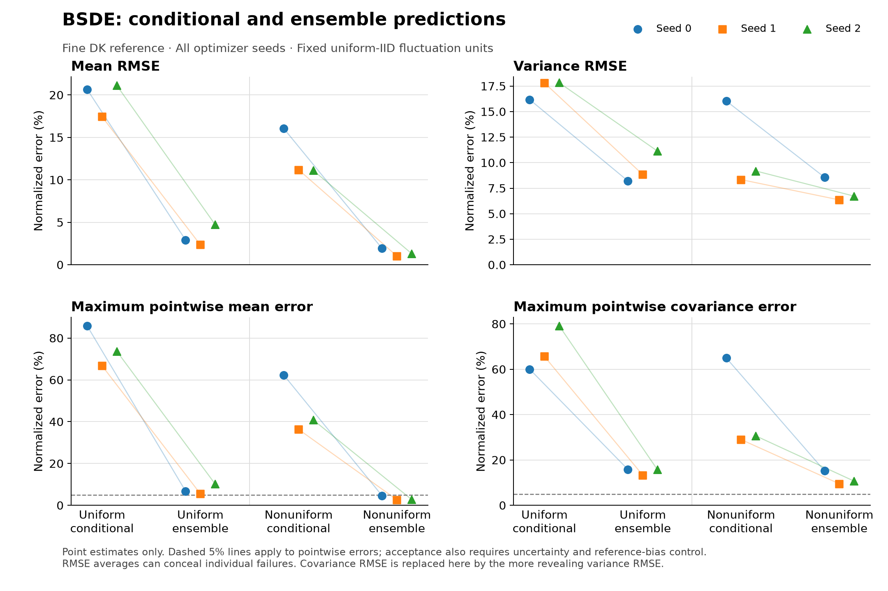
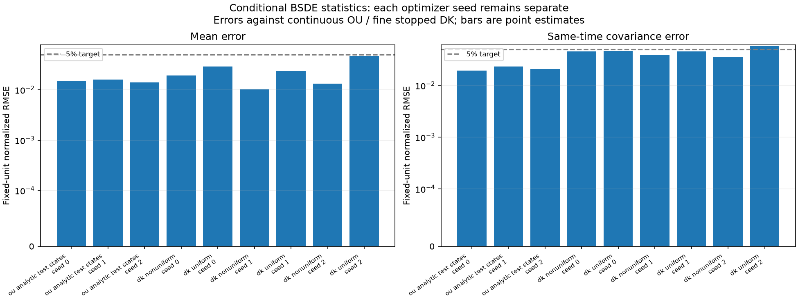
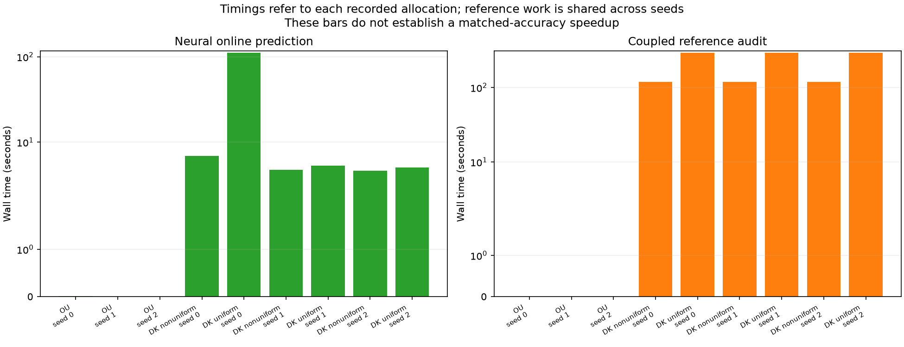

# Conditional BSDE first batch — 24 October 2026

**Status: COMPLETE.** All six configured OU/DK fits, all six model evaluations, and all 39 derived comparison rows completed. Primary elapsed time was **3161.6944 seconds (52.6949 minutes)**. Numerical source and configuration stayed frozen. Strict artifact validation confirmed the complete allocation and checkpoint/source/configuration hashes before extraction.

This experiment tests whether a neural Deep BSDE formulation can learn conditional observable means and same-time covariances for a stopped, spatially discrete Dean–Kawasaki system. **The current networks do not reliably learn the conditional statistical solution:** DK conditional mean RMSEs are **11.11–21.13%** in fixed fluctuation units, while ensemble means average down to **1.03–4.75%**. Full ensemble covariance RMSEs of **3.55–5.75%** conceal larger variance-only errors of **6.35–11.13%**. Many same-step pointwise confidence intervals lie wholly outside the 5% target. Overall DK accuracy gates remain unresolved. This is a negative conditional-generalization result for this allocation and architecture, not a convergence-rate or speedup result.

## Target and fixed protocol

The DK target uses native finite-volume masses on the periodic torus [0, 2π), G=32, N=2048, D=1, and zero interaction. Initial particles are IID uniform or follow density proportional to exp(0.2 cos x), then are histogrammed into cells. The target freezes at the first Euler-polygon crossing of density 0.01/(2π). Every frozen path remains in the statistics; no clipping or renormalization is applied.

The four physical observations integrate sqrt(2) cosine/sine modes 1 and 2 exactly against reconstructed cell densities. The neural value network predicts conditional statistics given the complete initial mass vector and horizon. Ensemble-start predictions subsequently integrate over the IID histogram law and include both conditional covariance and covariance of conditional means. Only same-time four-by-four covariance blocks are predicted, not a joint temporal law or density trajectories.

| Setting | Declared scientific allocation |
|---|---|
| Horizon / queries | T=1; times 1/4, 1/2, 1 |
| Forward Euler step | 2^-7; checkpoints are specific to this Euler law |
| Main DK reference step | 2^-13 |
| Reference refinement | 32 coupled families per initial profile at 2^-13, 2^-14, 2^-15 |
| Training, per problem | 128 initial anchors × 16 continuations = 2048 paths |
| Validation, per problem | 32 different anchors × 32 continuations = 1024 paths |
| DK profile balance | 64 training and 16 validation anchors per initial law |
| OU analytic test | 256 independent initial four-dimensional states |
| Conditional DK test | Eight fixed anchors per profile × 2048 independent continuations |
| Ensemble DK test | 8192 independent initial histograms per profile, matched to forward references |
| Optimizer seeds | 0, 1, 2, reported separately |
| Networks | Separate value and martingale-integrand MLPs; three hidden layers, width 64, SiLU, float64 |
| Optimization | AdamW lr 1e-3, weight decay 1e-5; batch 32; at most 100 epochs; patience 10; gradient clip 100 |
| Bootstrap | 200 whole-family resamples; pointwise 95% intervals |
| Execution | CPU, one PyTorch thread, eight-hour resumable invocation budget |

A fixed seed controls independent RNG streams for initialization, continuations, train/validation/test allocation, and optimizer shuffling. All prefixes and coupled refinements of one continuation remain within its family. The 16 or 32 children of one training or validation anchor do not count as additional independent initial states.

Reported percentages are **errors in fixed fluctuation units**, not relative errors of physical moments. Mean differences are multiplied by sqrt(N) and divided by the analytic uniform-histogram observable scale; covariance differences use N scaling and the corresponding product scale. An observable with zero expectation still has a well-defined normalization. For N=2048, a normalized mean error of 0.20 corresponds to an observable mean difference of roughly 0.0044, not a 20% error in the density profile.

## Numerical calibration and reference integrity

The Brownian quadratic-payoff calibration passed: the first-order predictable martingale residual has expected MSE **0.015625**, measured MSE **0.0154675358**, and the discrete pathwise identity agrees within **1.93e-14**. Its nonzero value is expected from stochastic-integral discretization.

Independent OU matrix-exponential moments and Euler covariance recursions agree with closed forms within **9.20e-13**. This auxiliary Gaussian calibration has exact conditional moments and no stopping. Its normalized four-coordinate OU rates are approximately 0.996791, 0.996791, 3.948859, 3.948859. The training Euler step itself produces maximum covariance-entry differences of approximately **1.57–1.78%** from continuous-time OU at the queried horizons; this discretization difference is kept separate from neural error.

| DK initial profile | Coupled reference families | Finest-refinement maximum absolute CI endpoint | Reference-bias status |
|---|---:|---:|---|
| Uniform | 32 | 0.15345% in fixed fluctuation units | Uncertified |
| Nonuniform | 32 | 0.16116% in fixed fluctuation units | Uncertified |

These are pointwise confidence endpoints for the finite 2^-14-versus-2^-15 contrast, not simultaneous confidence bands or bounds on remaining continuous-time bias. Their small size is useful diagnostic evidence but does not certify the main reference.

Separate posthoc integrity audits cover all four completed DK reference banks: **49,152 distinct continuation families** across conditional and ensemble banks, 768 cached chunks, and disjoint family IDs and forcing-seed keys. Coarse and fine resolutions share each family rather than providing independent replicates. Conditional children share 16 fixed initial anchors across the two profiles; they are not 32,768 independent draws from the full initial-histogram law.

No stopping occurred in these reference banks. Maximum recorded saved-state mass error was **5.44e-15**; the independent numerical calibration audit reached **5.55e-15**. For each 8192-path ensemble bank, zero events give a one-sided 95% upper probability bound of **0.03656%**. At each fixed conditional anchor, 2048 zero-event continuations give a **0.14617%** bound. Profiles, resolutions, and optimizer seeds must not be pooled to manufacture a tighter bound for a single target law. This run does not adequately validate boundary-sensitive behavior, and the moment network does not itself predict stopping times.

The reference-cache audit reads saved observable arrays and simulator metadata. Brownian increments and full cell-mass histories are not present in those caches: increment summation is covered by frozen implementation tests, while conservation/minimum-mass statements aggregate recorded simulator diagnostics. The audit validates reference-bank integrity, not neural accuracy.

## OU learning: small average errors hide local failures

All three OU checkpoints completed early stopping. The comparison below uses the analytic Euler target used for training, so these errors contain neither reference Monte Carlo noise nor continuous-time discretization bias.

| Optimizer seed | Epochs / best epoch | Validation objective | Mean RMSE (%) | Full covariance RMSE (%) | Maximum mean entry (%) | Maximum covariance entry (%) |
|---:|---|---:|---:|---:|---:|---:|
| 0 | 90 / 80 | 0.038009 | 1.4136 | 1.8112 | 23.4703 | 18.2252 |
| 1 | 87 / 77 | 0.038260 | 1.5164 | 2.0744 | 20.2651 | 23.0443 |
| 2 | 88 / 78 | 0.037941 | 1.3561 | 1.8877 | 10.7829 | 25.2606 |

The neural errors exceed the 5% pointwise target on **16, 26, and 19 of the 256 test anchors for at least one mean entry**, and on **111, 97, and 88 anchors for at least one covariance entry**, respectively. Covariance counts include both symmetric halves of each matrix. These are exact comparisons on a fixed test bank, not tests with estimated reference moments. Large errors often involve mode 2 and some large initial-state norms, but they are not confined to the single most extreme initial state.

The exact OU conditional covariance is independent of the initial state. Learned initial-state variation in this covariance is therefore an approximation/generalization error, not a physical effect. The aggregate RMSE averages many entries, including zero cross-covariances, and can hide substantial local or diagonal errors.

The posthoc OU probe derives the irreducible population objective for unrestricted predictable integrands linear in each Brownian increment. Its horizon-averaged floor is **0.0330827**. Validation losses near 0.038 are relatively close to this floor, but that does not imply uniformly accurate conditional values: the loss includes stochastic-integral representation error, and the finite training-anchor distribution differs from the test bank. The floor is a diagnostic identity, not a finite-sample acceptance threshold.

## DK conditional versus ensemble predictions

All values below compare with the fine 2^-13 reference and use the declared fixed fluctuation units. Conditional rows cover eight fixed initial histograms; ensemble rows use a separate bank of 8192 fresh histograms. Every optimizer seed remains separate.

| Seed | Initial profile | Conditional mean RMSE (%) | Conditional covariance RMSE (%) | Conditional variance RMSE (%) | Ensemble mean RMSE (%) | Ensemble covariance RMSE (%) | Ensemble variance RMSE (%) |
|---:|---|---:|---:|---:|---:|---:|---:|
| 0 | uniform | 20.6315 | 8.3657 | 16.1782 | 2.9202 | 4.5835 | 8.2040 |
| 0 | nonuniform | 16.0379 | 8.3441 | 16.0414 | 1.9145 | 4.5471 | 8.5671 |
| 1 | uniform | 17.4403 | 9.2451 | 17.8132 | 2.3601 | 4.5300 | 8.8350 |
| 1 | nonuniform | 11.1879 | 4.9118 | 8.3396 | 1.0285 | 3.8245 | 6.3535 |
| 2 | uniform | 21.1277 | 9.1370 | 17.8315 | 4.7467 | 5.7526 | 11.1319 |
| 2 | nonuniform | 11.1105 | 5.1522 | 9.1866 | 1.3204 | 3.5536 | 6.7246 |

For each fixed anchor, the primary conditional function is compared with 2048 independent stopped-DK continuations. The separate ensemble bank averages predictions across 8192 fresh histograms. Mean errors can cancel across different initial states, and total covariance mixes conditional variance with variation of conditional means. Good ensemble averages therefore do not establish an accurate conditional function. The descriptive error cancellation within the eight-anchor bank and the independent ensemble-bank result are kept separate in the assessment JSON.

Full covariance RMSE includes all 16 entries at each horizon, many of which are small off-diagonal covariances. Variance-only errors expose the larger diagonal discrepancies. For example, uniform seed 1 has total covariance RMSE 4.5300%, but variance RMSE 8.8350%; nonuniform seed 1 has corresponding errors 3.8245% and 6.3535%. Positive covariance does not resolve these errors.

The same-step neural comparison uses exact-coefficient Euler references at the training step 2^-7. Its normalized conditional mean RMSEs remain **10.98–21.25%**. Thus the conditional discrepancies are present against the training Euler law; refining only the forward step does not address this observed approximation/generalization failure. The shared coarse/fine ensemble mean differences are 0.02825% for uniform and 0.36440% for nonuniform starts; their full covariance differences are 0.51970% and 0.53595%, respectively. Signed neural/time contrasts add to the signed total contrast to numerical precision; the RMSE magnitudes do not add.

The table counts pointwise 95% intervals lying wholly outside the normalized [-5%, 5%] band for the **same-step neural error**, separating the training-law discrepancy from reference timestep bias.

| Seed | Profile | Conditional mean intervals outside band / 96 | Conditional covariance intervals outside band / 384 | Ensemble mean intervals outside band / 12 | Ensemble covariance intervals outside band / 48 |
|---:|---|---:|---:|---:|---:|
| 0 | uniform | 51 | 31 | 1 | 3 |
| 0 | nonuniform | 53 | 27 | 0 | 3 |
| 1 | uniform | 57 | 43 | 0 | 4 |
| 1 | nonuniform | 36 | 14 | 0 | 3 |
| 2 | uniform | 59 | 27 | 2 | 8 |
| 2 | nonuniform | 31 | 20 | 0 | 1 |

Covariance counts include both symmetric halves. These exploratory counts are not simultaneous tests or a multiplicity-adjusted familywise claim. Conditional intervals resample whole continuations within fixed initial anchors; ensemble intervals resample matched initial-histogram/forcing families. Optimizer-seed variability is not Monte Carlo uncertainty.

All overall DK gates remain **unresolved**. Individual normalized sampling halfwidths reach approximately **7.05%** for conditional comparisons and **3.25–3.49%** for ensemble comparisons, exceeding the 1.25% budget. Fine-reference bias is also uncertified. This limitation coexists with clear entrywise discrepancies against the same-step Euler law; an unresolved gate does not imply that all observed errors are compatible with 5%.

All learned conditional covariance checks passed. The smallest recorded predicted conditional eigenvalue among the DK ensemble-bank states was approximately **0.2430** in N-scaled physical observable covariance units. This is a geometric validity check, not an accuracy result.





The supplemental figure exposes conditional and variance errors that the primary ensemble overview alone can obscure. Neither figure supplies simultaneous confidence bands; all pointwise intervals and signed contrasts remain in the saved findings.

## Costs and interpretation

Training, online prediction, and the coupled reference audit answer different cost questions. Shared forward-pool generation took **1.5851 seconds for OU** and **7.8850 seconds for DK** and is not charged separately to each optimizer seed.

| Problem | Seed | Epochs / best epoch | Training (s) | Best validation objective | Checkpoint loading (s) |
|---|---:|---|---:|---:|---:|
| ou | 0 | 90 / 80 | 153.236 | 0.038009 | 0.0376 |
| ou | 1 | 87 / 77 | 191.418 | 0.038260 | 0.0377 |
| ou | 2 | 88 / 78 | 174.291 | 0.037941 | 0.0240 |
| dk | 0 | 80 / 70 | 336.388 | 0.091538 | 0.0439 |
| dk | 1 | 85 / 75 | 309.983 | 0.088135 | 0.3569 |
| dk | 2 | 89 / 79 | 327.350 | 0.093016 | 0.0331 |

The deployment query matters. Given a precomputed initial mass vector, the warmed value head predicts all three horizons with median **0.334–0.599 ms** per state; batches of 64 states take **0.703–1.072 ms** across the three seeds and two recorded case benchmarks. These are three-repetition conditional timings and exclude histogram generation and checkpoint loading. The training-only integrand network is not evaluated for prediction.

Ensemble-start prediction additionally draws and averages 8192 IID initial histograms. The recorded whole-bank costs were:

| Seed | Profile | Histogram initialization (s) | 8192-state value inference (s) | Online total (s) |
|---:|---|---:|---:|---:|
| 0 | uniform | 110.88248 | 0.29167 | 111.17415 |
| 0 | nonuniform | 6.76278 | 0.12866 | 6.89144 |
| 1 | uniform | 4.82933 | 0.48735 | 5.31668 |
| 1 | nonuniform | 4.71245 | 0.06560 | 4.77804 |
| 2 | uniform | 4.97812 | 0.06944 | 5.04756 |
| 2 | nonuniform | 4.56760 | 0.06345 | 4.63106 |

These measurements show considerable timing variability. The seed-0 uniform initialization took 110.88 seconds, whereas the other recorded initializations took 4.57–6.76 seconds. The first eight-anchor inference in that evaluation also took 2.97 seconds despite much shorter warmed repeats. The records do not establish the causes of these outliers; they should not be attributed to a physical difference between profiles or treated as stable deployment latency. Initialization dominates the reported ensemble online cost.

Shared coupled reference-generation costs are listed once per profile, not summed again across optimizer seeds. Each audit simulates both the main fine reference and the training-step Euler path on matched Brownian increments.

| Profile | Eight-anchor conditional reference bank (s) | 8192-family ensemble reference bank (s) |
|---|---:|---:|
| Uniform | 443.5884 | 294.1552 |
| Nonuniform | 432.7280 | 119.0731 |

The approximately 1289.54-second reference total is audit work, not a standalone Monte Carlo forecast at matched accuracy. Training costs, setup, reference precision, query allocation, and reuse across distinct initial states must all enter a useful speed comparison. The value head is inexpensive, but its conditional accuracy is currently inadequate; **no accuracy-matched speed advantage is established**.



## What this experiment can establish

The first batch tests one data allocation, one width, and one forward timestep. It cannot establish a learning-convergence or temporal-convergence rate. The target is the stopped, spatially discrete DK law at fixed G and N; no continuum or unregularized SPDE claim follows.

The completed OU fits already demonstrate that a low terminal objective and low average moment error do not ensure reliable conditional predictions throughout the test bank. All three DK fits show conditional generalization problems. The priority is conditional accuracy and structure, before interactions or a pathwise SPDE extension. More anchors are a plausible experiment, not a proven remedy.

A useful next preregistered study would compare a structural OU control—affine/separable mean propagation and covariance independent of initial state—with the current unconstrained MLP, then vary the number of independent initial anchors while keeping test banks, continuation allocation, width, and optimizer seeds fixed. Such a study would distinguish anchor coverage, architecture, objective statistics, and optimization effects. It should report failures as well as improvements and avoid tuning on the final test bank. Time refinement and additional SPDE forcing should follow demonstrated conditional accuracy.

The current statistics representation uses the same physical Brownian increments in the forward process and BSDE martingale. A later pathwise SPDE formulation may introduce independent physical and auxiliary Brownian motions only after their mathematical roles, regularization, and causality have been derived; that extension is not part of this batch.

## Provenance and reproduction

| Record | Value |
|---|---|
| Source commit at launch | `31ca641` — conditional BSDE implementation |
| Frozen package source hash | `7d24dcb7b6c80a1f6856ee08b379c8c46fb564188bc3c59eca1ce9debdcd61ef` |
| Configuration hash | `20e7fdae25f659c999ba443fc8ab99cfe01c8fbb9347cb5d7d59b9c9d045aaf3` |
| Master seed | 20261024 |
| Device / numerical precision / threads | CPU / float64 / one |
| Python / platform | 3.12.0 / macOS 15.0.1 arm64 |
| NumPy / SciPy / PyTorch | 2.5.4 / 1.18.1 / 2.14.1 |
| h5py / Matplotlib | 3.16.0 / 3.11.2 |

```bash
MPLCONFIGDIR=/private/tmp/nn-dk-mpl-cache .venv/bin/nn-dk bsde --preset bsde-first-batch --output runs/bsde-first-batch
```

Source and configuration must match to resume. The [implementation guide](../BSDE_STATISTICS.md) explains individual stages and the distinct model target. The final strict artifact extraction ran after manifest status `complete` and validated all six checkpoint byte hashes, metadata, individual/aggregate records, fixed training/reference allocations, and signed error decompositions without resimulation or refitting. The numerical package remains unchanged from the implementation tested by 161 tests; nine new artifact-analysis tests and Ruff pass separately. Raw HDF5 traces, reference caches, and checkpoints remain under ignored `runs/bsde-first-batch/`.

For compact archival, the findings summary omits raw anchor-by-horizon signed/interval arrays and full epoch histories; the OU probe omits raw test-state/error arrays. Each reduced file records the original full-file SHA256 and retained fields. Full arrays remain in the source run. The table and remaining diagnostics are byte-for-byte copies.

The [archived findings summary](artifacts/bsde_first_batch_2026-10-24/findings_summary.json), [39-row table](artifacts/bsde_first_batch_2026-10-24/findings_table.csv), figures, [OU probe](artifacts/bsde_first_batch_2026-10-24/ou_generalization_probe.json), [DK assessment](artifacts/bsde_first_batch_2026-10-24/dk_error_assessment.json), and reference-bank audits preserve optimizer seeds and limitations. An [archive manifest](artifacts/bsde_first_batch_2026-10-24/archive_manifest.json) hashes every archived file. The strict summary validates immutable JSON/checkpoint bytes and the current numerical source; the separate reference audits inspect completed NPZ banks rather than HDF5 training traces.

To reproduce artifact analysis after completing the configured run:

```bash
.venv/bin/python analysis/summarize_bsde_batch.py runs/bsde-first-batch
.venv/bin/python analysis/audit_bsde_references.py runs/bsde-first-batch --case all
.venv/bin/python analysis/probe_bsde_ou_generalization.py runs/bsde-first-batch
.venv/bin/python analysis/assess_bsde_dk_results.py runs/bsde-first-batch
.venv/bin/python analysis/plot_bsde_findings.py runs/bsde-first-batch
```
