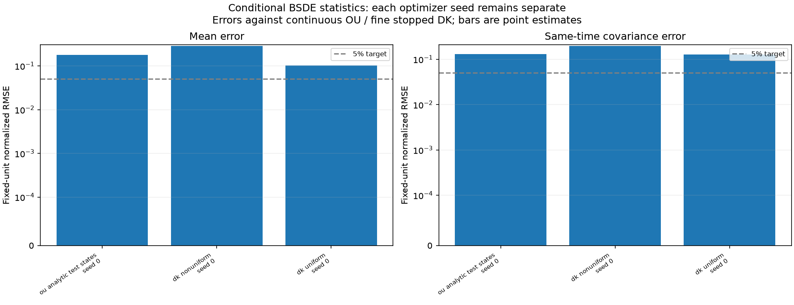
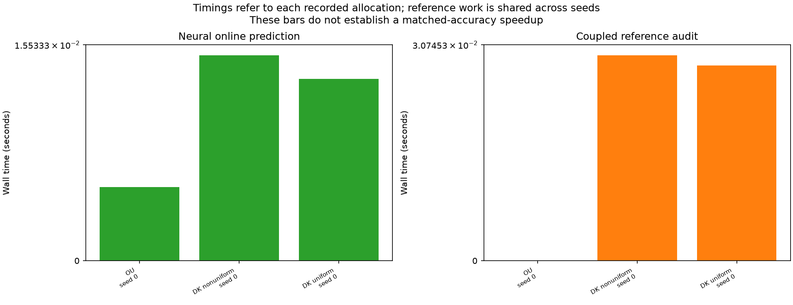

# Conditional BSDE smoke experiment — 24 October 2026

**Status: COMPLETE — software acceptance only.** The saved workflow completed numerical calibration, both neural fits, conditional and ensemble evaluation, and report generation. Recorded run elapsed time is **2.4033 seconds** on CPU with one PyTorch thread. This tiny three-epoch experiment does **not** meet the 5% statistical-error target and does not establish convergence or a speed advantage.

The implementation learns conditional observable expectations and same-time covariances through a Deep BSDE terminal-matching objective. Known forward coefficients generate training traces. At prediction time, the value network evaluates statistics without simulating future trajectories. The [implementation guide](../BSDE_STATISTICS.md) describes the mathematical target, noise convention, and staged scientific study.

## Exact smoke allocation

| Setting | Executed allocation |
|---|---|
| DK state and physics | 32 native finite-volume masses; N=2048, D=1, zero interaction |
| Initial laws | IID uniform histograms and IID histograms from density proportional to exp(0.2 cos x) |
| Horizon and query times | T=1/8; queries at 1/32, 1/16, 1/8 |
| Forward and main reference steps | 2^-7 and 2^-10 |
| Reference audit | Two coupled families per profile, at 2^-10, 2^-11, 2^-12 |
| Training, per neural problem | 16 independent initial anchors × 2 continuations = 32 paths |
| Validation, per neural problem | Eight separate anchors × 2 continuations = 16 paths |
| DK profile balance | Eight training and four validation anchors per initial profile |
| Conditional DK reference, per profile | Two held-out anchors × 16 continuations = 32 paths |
| Ensemble DK reference, per profile | 32 independent initial histograms with matched forward paths |
| OU analytic test | 16 held-out four-dimensional initial states |
| Optimizer seeds | Seed 0 only |
| Networks | Separate value/integrand MLPs; three hidden layers, width 16, SiLU, float64 |
| Optimization | Three epochs; AdamW lr 1e-3, weight decay 1e-5, path batch 8, patience 3, gradient clip 100 |
| Bootstrap | Eight whole-family resamples; diagnostic pointwise 95% intervals |
| Invocation budget | 600 seconds; no allocation was reduced during execution |

The Brownian analytic check separately uses 4096 independent paths. These are numerical calibration samples, not additional DK test families. Repeated horizons and coupled reference resolutions are retained within their original family.

## Calibration and observed errors

Numerical calibration passed. For the Brownian quadratic payoff, the exact first-order martingale residual has expected MSE **0.001953125**; its measured value was **0.0019383327**. The pathwise discrete identity agreed within **6.94e-16**. Independent OU matrix-exponential and Euler-recursion calculations agreed with closed forms within **6.67e-16**. A nonzero BSDE terminal residual can arise from discretizing the martingale integral even when the initial statistical value is correct.

The table reports errors in fixed analytic fluctuation units. Mean differences are multiplied by sqrt(N); covariance differences use N scaling. Percentages are normalized errors, not relative errors of individual quantities that may vanish.

| Prediction against continuous OU / fine DK reference | Mean RMSE (%) | Same-time covariance RMSE (%) | Accuracy gate |
|---|---:|---:|---|
| OU, conditional analytic test states | 18.0345 | 12.9584 | Unresolved |
| DK uniform, ensemble-start statistics | 10.3166 | 12.8510 | Unresolved |
| DK nonuniform, ensemble-start statistics | 28.9144 | 19.8592 | Unresolved |

The corresponding mean/covariance errors against the same-step Euler law were **18.2431% / 13.3703%** for OU, **10.4261% / 13.0708%** for uniform DK, and **29.0519% / 19.8031%** for nonuniform DK. These undertrained networks are not scientifically accurate solutions. The smoke run verifies that substantial discrepancies are reported rather than hidden behind a passed software check.

For OU, the analytically known Euler-versus-continuous mean/covariance RMSEs were **0.2158% / 0.4135%**. Coupled DK coarse/fine ensemble differences were **0.14496% / 0.49363%** for uniform starts and **0.26006% / 0.39169%** for nonuniform starts. Their aggregate RMSEs do not add to the neural component: the decomposition concerns signed statistical contrasts. Finite reference differences do not certify remaining stopped-SDE bias.



The 5% target and 1.25% uncertainty budgets remain unresolved for DK. Eight bootstrap resamples and these small test pools are suitable only for exercising the reporting pipeline. No sampling or generalization claim should be inferred from their intervals. Conditional intervals resample continuations within a fixed anchor; ensemble intervals resample matched initial-histogram/forcing families. Optimizer-seed variability is not measured by this single-seed smoke.

## Noise, stopping, and cost checks

The physical forward trace and BSDE martingale use the **same Brownian increments**. This stochastic representation has no independent auxiliary forcing. Initialization, continuation, validation, test, and optimizer streams are separately keyed. The integrand receives pre-step state and information known at initialization; proposals, crossing fractions, and future stopping times are excluded.

The DK state freezes at the first boundary crossing of its Euler polygon, at density threshold 0.01/(2π). On a crossing step, the martingale retains the full Brownian increment with its active-at-start mask. Subsequent contributions vanish. Every stopped path remains in all statistics; states are neither clipped nor renormalized.

No stopping occurred in either 32-path ensemble reference. The one-sided 95% zero-event upper bound is **8.94% per profile**, so this does not test rare stopping behavior adequately. Maximum saved-state mass error across conditional and ensemble references was **5.55e-16**. All predicted conditional covariance matrices were positive semidefinite. Neither conservation nor covariance positivity certifies predictive accuracy.

| Measured cost | OU | DK |
|---|---:|---:|
| Shared forward pool generation (s) | 0.04029 | 0.07407 |
| Training (s) | 0.86650 | 0.07033 |
| First epoch (s) | 0.07413 | 0.02010 |
| Checkpoint loading (s) | 0.00568 | 0.00616 |

The JSON retains online histogram initialization, inference, single-query latency, batched throughput, and reference-audit timings. Shared costs repeated across optimizer seeds must not be summed. Small-run setup effects and unequal audit/query allocations prevent a meaningful speed comparison here.



## Separate timing probe at the scientific network width

A second run profiled **width 64, G=32, N=2048, T=1, forward step 2^-7, path batch 32**, using 64 training anchors × two continuations and 16 validation anchors × two continuations. It ran **one epoch** and is a performance diagnostic, separate from both the short smoke and the full scientific allocation.

The network has **51,214 parameters**: 11,342 in the value network and 39,872 in the training-only integrand network. The measured epoch, including validation, took **0.42390 seconds**. Whole-fit time was **1.63007 seconds**; the complete profile, including pool generation/loading and inference measurements, took **4.06704 seconds**.

For predictions at all three scientific horizons 1/4, 1/2, 1:

| Precomputed initial states | Median complete conditional inference | Time per initial state |
|---:|---:|---:|
| One | 0.51438 ms | 0.51438 ms |
| 64 | 1.53692 ms | 24.014 µs |

Each timing uses three measured repetitions following warm-up. It includes value-network evaluation and covariance validation, and excludes initial histogram generation and checkpoint loading. The query is conditioned on a complete initial mass vector; ensemble-start prediction also requires integration over initial histograms. These timings demonstrate inexpensive execution of the prediction interface, **not** accurate statistics, a speed advantage at matched accuracy, or a forecast of scientific-batch training cost.

The probe uses the same package source hash as the smoke but a different configuration hash, `3a7d8cc2af8d12ad10e8a6036be7bd690102ea846f5f4f72a5178b1f95a1b2f2`. Its [archived timing record](artifacts/bsde_smoke_2026-10-24/profile.json) and [profiling script](../../analysis/profile_bsde_batch.py) preserve the protocol. Full traces and its one-epoch checkpoint remain under `runs/bsde-batch-profile/`.

## Provenance and reproduction

| Record | Value |
|---|---|
| Configuration hash | `45a380cbc39812d8a61986bb46d0fecd5dddd4de2b20c1f8b883e2d33046a9be` |
| Frozen package source hash | `7d24dcb7b6c80a1f6856ee08b379c8c46fb564188bc3c59eca1ce9debdcd61ef` |
| Master seed / optimizer seed | 20261024 / 0 |
| Python / platform | 3.12.0 / macOS 15.0.1 arm64 |
| NumPy / SciPy / PyTorch | 2.5.4 / 1.18.1 / 2.14.1 |
| h5py / Matplotlib | 3.16.0 / 3.11.2 |

From the repository root, at the recorded source revision:

```bash
MPLCONFIGDIR=/private/tmp/nn-dk-mpl-cache .venv/bin/nn-dk bsde --preset bsde-smoke --output runs/bsde-smoke
```

An identical command reuses completed work. Source/configuration mismatches require a new output directory. A separate `--stage report` rebuilds the report from completed, compatible artifacts.

Compact [results and provenance](artifacts/bsde_smoke_2026-10-24/findings_summary.json), the two figures, and an [archive manifest](artifacts/bsde_smoke_2026-10-24/archive_manifest.json) are preserved beside this note. Full training traces, reference caches, checkpoints, and generated reports remain under ignored `runs/bsde-smoke/`. No scientific first-batch or timestep-refinement allocation was executed by this smoke run.
