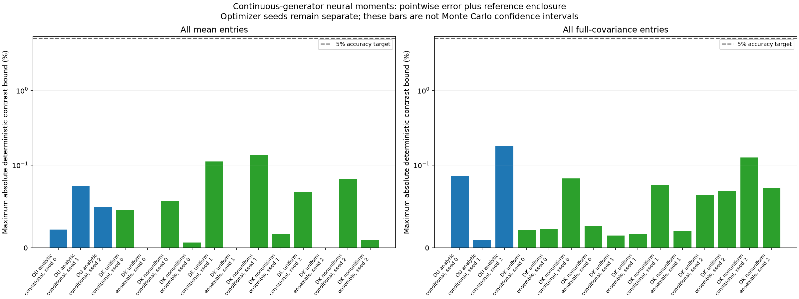

# Structured neural moment solver — 25 October 2026

**The unchanged 5% moment-accuracy target was met.** All 15 final comparisons passed across three optimizer seeds. Including deterministic reference error, the worst normalized mean bound was **0.13723%** and the worst full-covariance bound was **0.17964%** (the latter in the OU control). Within DK alone, the covariance maximum was **0.12574%**. The largest reference contribution was **0.06277%**, below the **1.25%** budget.

The initial scientific invocation recorded **219.50 seconds**, including **86.19 seconds** of training for six models. An identical completed-run replay took **18.43 seconds**, reusing cached work and preserving every locked artifact. Both figures concern this local CPU run. There is no matched-accuracy speed comparison with classical methods.

## What this experiment establishes

The tested neural solver predicts conditional means and full same-time covariance for low Fourier observables of the continuous stopped native DK system. It does not sample density paths. The test uses 64 fresh DK histograms and 1024 fresh OU states, plus deterministic integration of the two known IID initial laws. Every final state comes from the prescribed laws; new profiles/physics and population-generalization guarantees were not tested.

The architecture builds linear/equivariant interior moment dependence on initial masses into its head, and learns time functions by deterministic known-generator residuals. No future moment forecasts are provided to the network. This changes both the architecture and objective from the earlier trajectory BSDE study, so the experiment does not isolate those two changes. The noninteracting interior equations close at degree two, and a classical moment calculation remains a direct alternative. The next useful scientific test is interaction, which breaks this closure.

All six fits completed their declared Adam/LBFGS budgets but did **not** reach the internal raw residual tolerance `1e-6`; raw validation maxima range from 0.00370 to 0.02119. This is an independently verified accuracy result, not a claim of optimization convergence. No temporal/capacity convergence rate is inferred.

## Reference and stopping audit

The independent native polynomial reference uses Poisson uniformization and a separately enclosed positive exponential martingale for continuous first hitting. It includes numerical geometry, profile integration and stopping corrections. It does not replace the stopped target with a globally unstopped density process. The [derivation](../GENERATOR_REFERENCE_CERTIFICATE.md) and [read-only mathematical audit](../GENERATOR_REFERENCE_AUDIT.md) record the assumptions.

| Reference | Upper bound on stopping by T=1 | Maximum normalized covariance reference bound |
|---|---:|---:|
| Uniform conditional test bank | 4.072e-11 | 0.00010035% |
| Uniform IID ensemble | 2.754e-11 | 0.00006794% |
| Nonuniform conditional test bank | 2.554e-8 | 0.06276611% |
| Nonuniform IID ensemble | 1.679e-9 | 0.00412664% |

These are analytic probability upper bounds, not observed stopping frequencies. Pure numerical error bounds were at most `1.19e-12` for physical means and `3.07e-9` for N-scaled physical covariance. Deterministic references have no Monte Carlo sampling error; bounds are not bootstrap confidence intervals.

## Completion and reproduction audit

The independent artifact audit verified all 59 stable file hashes, six checkpoint/metadata locks, 15 development comparisons and 15 final comparisons, source/configuration/preregistration identity, input content hashes, and zero exact development/final row overlap. Fit timestamps precede the final-input bank. All final pointwise mean and full-covariance enclosures were recomputed against the unchanged 5%/1.25% gates.

Fresh restoration of all six saved models reproduced every final signed mean/full-covariance error array **bitwise**, with maximum difference zero. Source remained at commit **`49a6528`**, package hash `b7bbbff59cbd838096862e50d8f520e077eed5137dcadb912f1031fbfe72e9be`; configuration hash `f70f6d4252dd82cd2c26ded0545ced96b26e1602715ced816b61aa53a1b968da`. Verification: **378 pytest tests passed and Ruff passed**.

The [compact archive](artifacts/generator_accuracy_2026-10-25/README.md) preserves the complete compressed report, inputs, references, configuration, environment and checksums. All six complete checkpoints remain in the local raw run. See the [method/reproduction guide](../GENERATOR_MOMENTS.md). The full generated results follow.

---

# Continuous-generator neural conditional moments

Completed **6 fitted models** and **15 final comparisons**. Every declared comparison passed: **True**. Optimizer seeds remain separate; no best seed is selected.

The native target is the continuous stopped finite-volume DK system at G=32, N=2048, D=1, T=1, with density threshold 0.00159155. Initial laws are IID histograms from uniform and exp(0.2 cos x) profiles. The OU control is continuous and unstopped. This fixed-grid study does not establish a continuum SPDE limit.

A three-hidden-layer SiLU network learns the time propagators and covariance kernels by continuous-generator residual collocation. Known physics supplies the residual operator, not dynamic forecast labels. State dependence uses the declared linear/equivariant interior moment family. Initially stopped conditional states are exact; the difference from future-stopped dynamics needs the separately recorded reference certificate. Analytic references and known IID multinomial initialization are disclosed separately from the learned time map. This is not the previous trajectory-BSDE training objective.

Final conditional DK tests use **32 fresh anchors per profile** at times 0.25, 0.5, 1.0. The known IID ensemble law is integrated deterministically rather than estimated with a finite initial-histogram ensemble. Conditional means and all entries of same-time 4×4 covariance matrices are checked; density paths and cross-time joint covariances are outside the output contract. Fresh histograms are from the same profile laws, not unseen physics.

## Accuracy and deterministic uncertainty

| Problem/profile | Scope | Seed | Mean RMSE (%) | Variance RMSE (%) | Covariance RMSE (%) | Max mean bound (%) | Max covariance bound (%) | Max reference bound (%) | Certificate valid | Gate |
|---|---|---:|---:|---:|---:|---:|---:|---:|---|---|
| ou analytic | conditional | 0 | 0.0045066 | 0.049356 | 0.024678 | 0.022019 | 0.086849 | 2.8752e-12 | True | resolved_within_tolerance |
| ou analytic | conditional | 1 | 0.01065 | 0.004606 | 0.002303 | 0.074787 | 0.009914 | 2.8752e-12 | True | resolved_within_tolerance |
| ou analytic | conditional | 2 | 0.0070632 | 0.081782 | 0.040891 | 0.049178 | 0.17964 | 2.8752e-12 | True | resolved_within_tolerance |
| dk uniform | conditional | 0 | 0.0086805 | 0.017989 | 0.0090023 | 0.045858 | 0.021893 | 0.00010035 | True | resolved_within_tolerance |
| dk uniform | ensemble | 0 | 9.2084e-14 | 0.01941 | 0.0097048 | 3.577e-07 | 0.0224 | 6.7938e-05 | True | resolved_within_tolerance |
| dk nonuniform | conditional | 0 | 0.0097459 | 0.017989 | 0.0091433 | 0.056684 | 0.083943 | 0.062766 | True | resolved_within_tolerance |
| dk nonuniform | ensemble | 0 | 0.0028424 | 0.019407 | 0.0098152 | 0.0064709 | 0.026106 | 0.0041266 | True | resolved_within_tolerance |
| dk uniform | conditional | 1 | 0.01897 | 0.010744 | 0.0053778 | 0.11105 | 0.015103 | 0.00010035 | True | resolved_within_tolerance |
| dk uniform | ensemble | 1 | 9.2083e-14 | 0.012562 | 0.0062812 | 3.577e-07 | 0.01713 | 6.7938e-05 | True | resolved_within_tolerance |
| dk nonuniform | conditional | 1 | 0.021934 | 0.010744 | 0.0054921 | 0.13723 | 0.076415 | 0.062766 | True | resolved_within_tolerance |
| dk nonuniform | ensemble | 1 | 0.0080227 | 0.012558 | 0.0064149 | 0.016461 | 0.020113 | 0.0041266 | True | resolved_within_tolerance |
| dk uniform | conditional | 2 | 0.013064 | 0.030941 | 0.015473 | 0.067459 | 0.064015 | 0.00010035 | True | resolved_within_tolerance |
| dk uniform | ensemble | 2 | 9.2085e-14 | 0.033576 | 0.016788 | 3.577e-07 | 0.068577 | 6.7938e-05 | True | resolved_within_tolerance |
| dk nonuniform | conditional | 2 | 0.014458 | 0.030941 | 0.015524 | 0.083371 | 0.12573 | 0.062766 | True | resolved_within_tolerance |
| dk nonuniform | ensemble | 2 | 0.0035497 | 0.033576 | 0.016854 | 0.0095088 | 0.07229 | 0.0041266 | True | resolved_within_tolerance |

Passing requires every normalized mean and full-covariance contrast enclosure to lie in [-5%, 5%] and each reference error bound to be at most 1.25%. Sampling uncertainty is zero because references are deterministic. A reference packet passes only with a valid certificate and finite nonnegative numerical/stopping bounds. Small RMSE, a small collocation residual or invalid bounds cannot certify accuracy.

Means use sqrt(N) fluctuation scaling and covariances use N scaling, divided by fixed uniform-IID observable scales. Percentages are errors in these units, not relative density errors. The supplied intervals are deterministic enclosures, not bootstrap 95% intervals or population-generalization confidence statements. The JSON retains the full bounds, certificate assumptions and every seed.

## Cost and reproduction

| Problem | Seed | Distinct-fit training (s) |
|---|---:|---:|
| ou | 0 | 14.316 |
| ou | 1 | 13.204 |
| ou | 2 | 13.006 |
| dk | 0 | 15.239 |
| dk | 1 | 15.321 |
| dk | 2 | 15.104 |

Total recorded training time for distinct models: **86.191 seconds**. Comparison-specific evaluation times and checkpoint identities remain in the CSV/JSON. Shared reference construction is not charged again to every profile or seed. Value inference requires no forward particle/DK trajectories. These timings do not by themselves establish a matched-accuracy speedup.

Configuration hash: `f70f6d4252dd82cd2c26ded0545ced96b26e1602715ced816b61aa53a1b968da`. Source hash: `b7bbbff59cbd838096862e50d8f520e077eed5137dcadb912f1031fbfe72e9be`. Fresh test master seed: `2026102601`. Raw run directory: `/Users/xiaohao/Projects/Finance/Covariance/NN-DK/runs/generator-accuracy-2026-10-25`.

The final fit lock and all development/final split metadata are retained in the manifest. An optimizer cap means completion of its allocated work, not proof of optimization convergence. Accuracy is judged by the final declared moment comparisons, independently of that flag.
