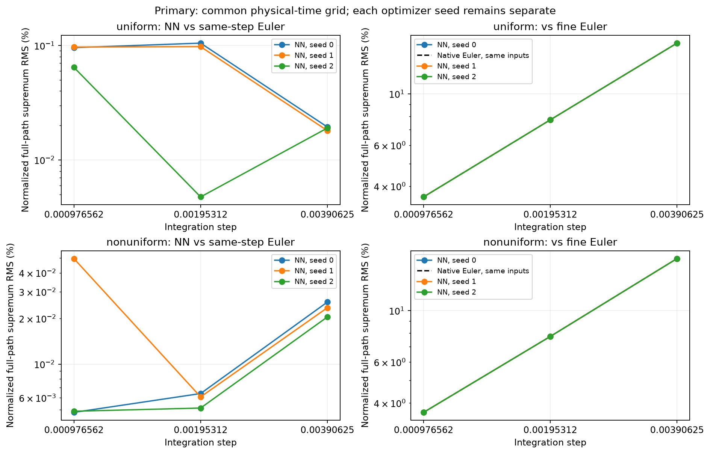
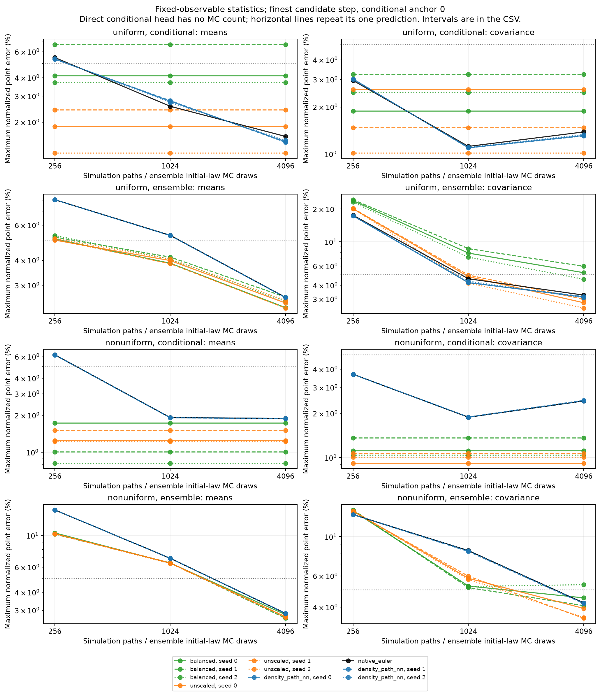
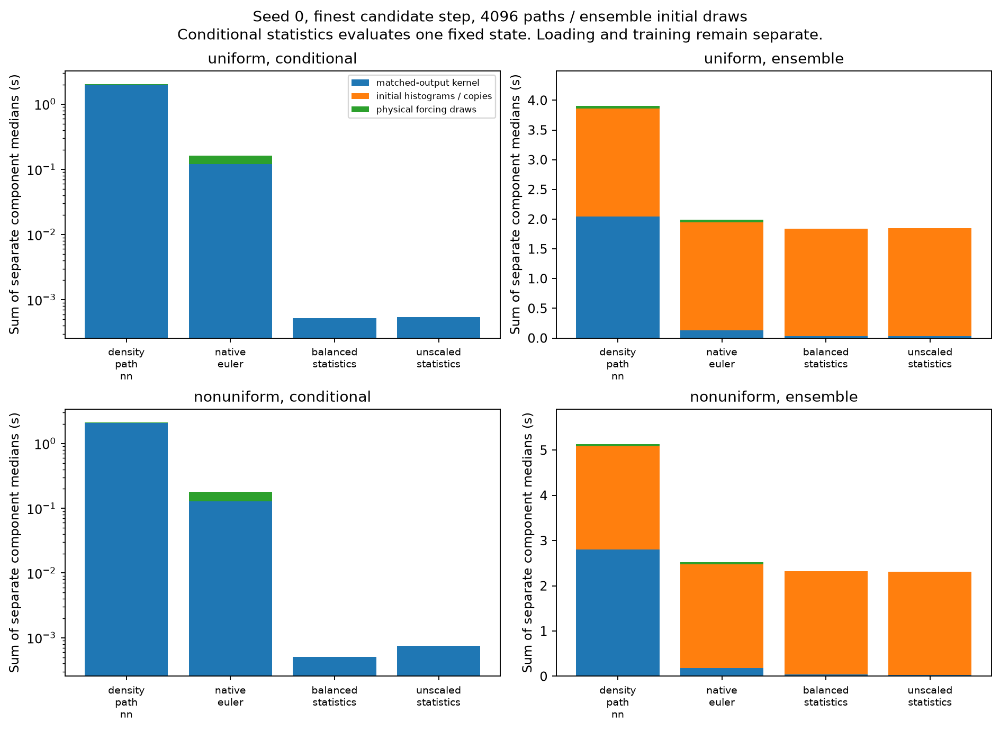

# Interacting refinement and task-specific solver comparison

The follow-up completed all **24 fits**, the independent reference experiment,
**276 matched-task accuracy comparisons**, and **72 warm timing workloads**.
The strongest current use case is amortized prediction of the four declared
conditional moments. The present density-path network accurately approximates
Euler but offers no forward-cost advantage in this small 1D setting. Averaging
over random initial histograms substantially changes the cost comparison.

These findings concern G=32, N=2048, D=1, T=1/16,
`V(x)=-0.75 cos(x)+0.1 cos(2x)`, and uniform or `exp(0.2 cos(x))` initial laws.
The interaction and mobility are known physical coefficients. The path network
generates native cell-mass realizations; the statistics network predicts four
fixed cell-integrated Fourier means and full same-time 4x4 covariance.

## Fixed design and checks

The committed [study configuration](../../configs/studies/interacting_followup_2026-10-25.json)
fixes three optimizer seeds, both initial laws and every sample allocation.
Path training used 64 trajectories per law, validation 32 and test 256, with
300 Adam and 30 LBFGS steps at each of three separately fitted time steps.

The unscaled and balanced statistics candidates used **byte-identical** state,
horizon and trajectory-family pools: 128 training paths and 64 validation paths
per initial law, four state snapshots and four residual horizons per snapshot.
Both used width 32, 1,000 AdamW steps and 30 LBFGS steps. Initial model weights
and shuffle streams match between loss candidates within each optimizer seed.
Balanced scales were frozen from initial training residuals only. No scale
safeguard was triggered and no future payoff labels entered either training.

All 24 checkpoints finished and restored before any new final reference opened.
Each law has two held-out initial histograms with 4,096 independent continuations
each, plus 8,192 ensemble reference paths: **32,768 reference paths** in total.
Independent neural initial-law integration uses 8,192 additional histograms per
law. The reference step is 2^-12, with coupled refinements at 2^-13 and 2^-14 on
256 families per conditional anchor and ensemble. Path refinement uses a
separate coupled 2^-13 fine reference. Stopped paths are always retained.

Candidate Monte Carlo counts are nested at 256, 1,024 and 4,096. Path NN and
native Euler share candidate initial states and Brownian noise, independently
of reference noise. Statistics candidates share the same anchors and initial
integration draws. All optimizer seeds remain separate. Warm timing uses the
prespecified seed 0 after all scientific jobs have exited.

**796 tests passed**, with Ruff passing. Independent audits verified split and
RNG separation, artifact hashes, all candidate input hashes, literal Brownian
aggregation and every path/native moment row. Numerical failures never produce
survivor-only estimates.

## Time refinement works; neural approximation is secondary

Primary strong errors use every cell and the maximum over the **same physical
time grid**, 0, 2^-8, ..., T. This avoids comparing maxima over different grids.
The normalization is the exact uniform IID histogram fluctuation energy.
Ranges span all three optimizer seeds and both initial profiles; they are not
pooled statistical estimates.

| Fitted step | NN / fine Euler strong RMS |
|---|---:|
| 2^-8 | 16.51–16.73% |
| 2^-9 | 7.719–7.734% |
| 2^-10 | 3.597–3.647% |

All **18/18 same-step Euler gates passed**. NN/same-step error was at most
0.105%; native Euler's error against the fine reference nearly coincides with
the neural error. Paired differences between their finest-level strong-error
metrics have intervals containing zero. This supports the diagnosis that time
discretization, rather than the learned Euler-map approximation, dominates.

The finest comparison is below 5% against this fine numerical reference. It
does not certify continuous stopped-DK error: reference and stopping bias have
not been enclosed. No temporal convergence order or continuum limit is claimed.



## Loss balancing is not automatically better

| Candidate | Mean validation residual RMS | Covariance validation residual RMS |
|---|---:|---:|
| Unscaled | 0.200–0.213 | 0.103–0.121 |
| Initial-training-RMS balanced | 0.404–0.495 | 0.0269–0.0314 |

Balancing reduces the covariance residual about 3.4–4.1 times relative to the
unscaled fit, while increasing the mean residual about 2.0–2.3 times. Normalized
objectives use different scales and should not be compared numerically.

The independent conditional predictions favor the unscaled candidate:

| Candidate | Mean point error | Covariance point error | Largest pointwise 95% mean / covariance interval endpoint |
|---|---:|---:|---:|
| Unscaled | 1.22–2.42% | 0.73–2.58% | 4.12% / 4.18% |
| Balanced | 0.82–6.69% | 1.04–3.23% | 8.11% / 4.73% |

Each range retains all 12 profile/anchor/optimizer-seed comparisons. Each
individual error is a maximum over the three physical query times and all
corresponding mean or covariance entries. Percentages use sqrt(N)-scaled mean
differences or N-scaled covariance differences, divided by fixed observable
standard deviations; they are not relative errors of possibly zero means.

The balanced covariance ranges overlap the unscaled ranges. There is no clear
held-out benefit from reducing that residual further in this experiment, while
the worse mean bound is visible. This supports keeping the unscaled model as
the present statistical baseline rather than choosing by residual size alone.
It does not prove one objective is universally better.

All unscaled conditional pointwise interval endpoints lie below 5% relative
to finite Euler. These are **pointwise intervals**, not a simultaneous guarantee
over states, seeds or observables. The 1.25% uncertainty budget and continuous
reference-bias requirement remain unresolved. Only four held-out initial
histograms were tested; broad initial-state generalization remains to be checked.

At 4,096 initial-integration samples, ensemble covariance point errors are
2.47–3.93% for unscaled and 4.07–5.96% for balanced. Their interval endpoints
reach about 8.7% and 10.7%, respectively. Initial-law integration and reference
Monte Carlo uncertainty prevent a 5% ensemble-accuracy conclusion.



## Which solver is useful for which task?

All timed methods return the **same moment bank**: four means and full same-time
covariance at three times. The following prepared-input timings use 4,096
candidate paths or initial samples. Conditional statistics-head predictions are
direct deterministic queries and do not require 4,096 future trajectories.

| Task | Current evidence | Practical implication |
|---|---|---|
| Repeated conditional means/covariance from a given histogram | Statistics NN 0.36–0.76 ms; Euler MC 31.5–146 ms | The clearest neural use case is a reusable fixed-physics, fixed-observable statistical map. |
| Statistics averaged over random initial histograms | NN kernel 27–37 ms; Euler kernel 32–265 ms; common initialization 1.81–2.29 s | Prepared-input gains largely disappear with this initializer. Ensemble accuracy is still unresolved. |
| Obtaining the moment bank through NN-generated paths | About 0.51–2.07 s for conditional tasks, roughly 14–16.5 times Euler cost | The current path implementation offers no runtime advantage for these statistics. |
| Full realizations, new observables, cross-time or path-dependent quantities | Native Euler and path NN provide samples; this statistics head does not | Keep a path sampler for such tasks. Their new task accuracies require separate validation. |

Adding separately measured initialization and physical-noise component medians
gives about 42–197 ms for conditional Euler, while the head needs no Brownian
draws. For ensemble tasks, the corresponding component sums are about 1.84–2.32 s
for the statistics NN and 1.93–2.60 s for Euler: only about **1–12%** difference.
These sums are estimates from component medians, not directly measured
end-to-end latency distributions.

The benchmark measures matched **moment outputs**. Native Euler saves only
queried states; the NN path API internally constructs a full trajectory. These
numbers are not a full-trajectory-export benchmark. A separate earlier T=1
experiment did compare full paths and found the then-current NN implementation
about 6.4–7.6 times slower for the interacting case; it has its own source freeze.
Neither result is an architecture-independent limit on neural solvers.

Warm model restoration, raw timing samples and implementation batch sizes are
saved separately. Path NN inference uses chunks of 64; native Euler is vectorized
over its ensemble. Statistics training cost about **128–136 seconds per fit**
under three concurrent workers. The supervised scientific batch took **642.1 s**
of coordinator wall time; later comparison and timing runs are separate.
Training and data-generation costs must be amortized over repeated queries.
No accuracy-certified break-even count is reported.



## Next confirmatory comparison

The pilot supports a task-specific comparison rather than a single winner:

1. Keep the unscaled statistics model as the baseline. Expand the fixed held-out
   initial-state bank before making claims about thousands of conditional queries.
2. Use one shared, efficient multinomial cell-histogram initializer for all
   methods. For a uniform profile this is the exact IID histogram law; for a
   nonuniform profile, audit the cell-probability integration error separately.
   Rebenchmark ensemble cost after removing the current microscopic-sampling
   bottleneck.
3. Preregister candidate path counts and independent reference allocations for
   1%, 5% and 10% normalized error targets. Compare cost only when uncertainty
   and numerical reference error resolve the requested target. Preserve every
   seed and report unresolved cases.
4. Compare repeated conditional queries, initial-law moments, full trajectory
   export and new/path-dependent observables as distinct workloads. Include
   training, restoration, initialization, forcing, reduction and storage where
   the workload requires them. Plot total cost versus number of queries.
5. Keep native Euler as the practical path baseline at this resolution. Further
   work on the NN path architecture should address its temporal-convolution
   cost and inherited finite-step bias before claiming computational advantage.

No new physics, particle count, spatial grid, longer horizon, rare-event
stopping probability or continuum-SPDE claim is established by this follow-up.

## Reproduction and evidence

Package source freeze **3aa3b8b**, hash
`7737c53f50a112f64a781d6a4ca1c59180160e0d860c93a02c0478b1a0051832`.
Comparison helper freeze **058f991**. The fixed study, helper hashes, global
24-fit lock, seed-worker exits and per-method uncertainty remain in the
[evidence archive](artifacts/interacting_followup_2026-10-25/README.md).
Large JSON snapshots use lossless gzip with original and compressed hashes.
Full restorable checkpoints and HDF5 banks remain in
`runs/interacting-followup-2026-10-25/`.

```bash
uv run python analysis/run_interacting_followup.py \
  --config configs/studies/interacting_followup_2026-10-25.json \
  --output runs/interacting-followup-2026-10-25 --stage all
uv run python analysis/compare_interacting_solvers.py \
  --path-runs runs/interacting-followup-2026-10-25/paths \
  --moment-run runs/interacting-followup-2026-10-25/balanced \
  --additional-moment-runs runs/interacting-followup-2026-10-25/unscaled \
  --output runs/interacting-followup-2026-10-25/comparison \
  --counts 256 1024 4096 --seed 2026102513 --bootstrap 200
# Run after competing CPU work has stopped:
uv run python analysis/compare_interacting_solvers.py \
  --output runs/interacting-followup-2026-10-25/comparison --timing-only
uv run python analysis/report_interacting_followup.py \
  --run runs/interacting-followup-2026-10-25
```

Reproduce historical checkpoints at their recorded package freeze. The tested
follow-up keeps the package source unchanged while adding report/archive helpers.
