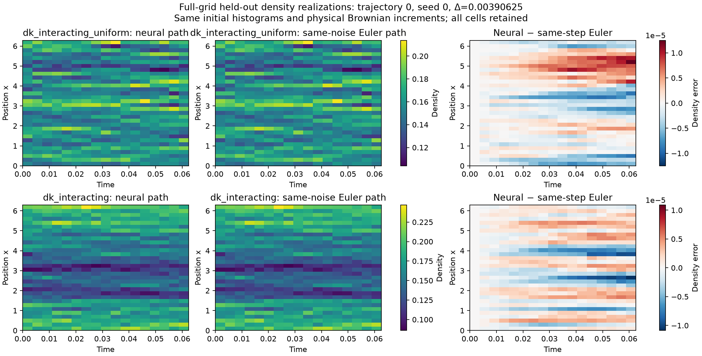
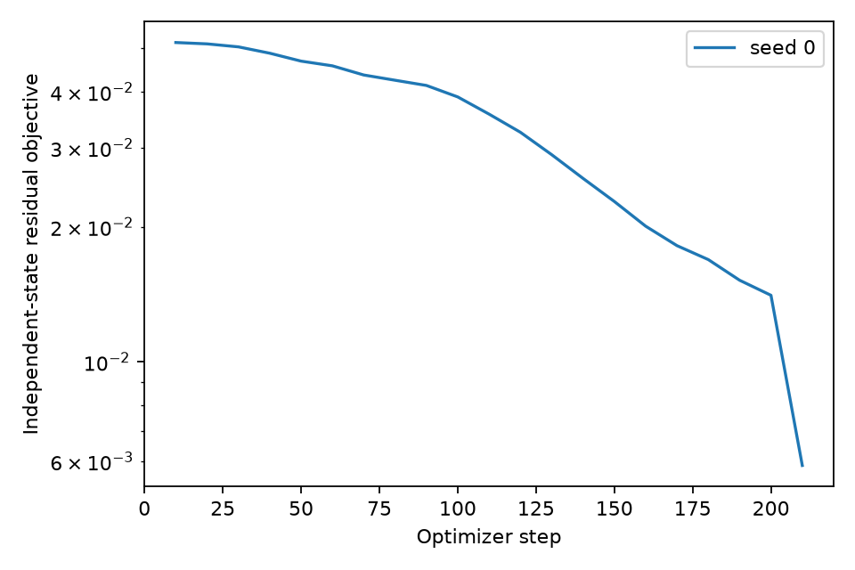

# Interacting neural density-path and statistics solvers

Both solvers now support the interacting native finite-volume system. A short
CPU experiment completed for uniform and `exp(0.2 cos(x))` initial laws, using
G=32, N=2048, D=1, T=1/16, kappa=0.75 and a2=0.1. This is a local execution
and accuracy check, not a continuous-DK convergence result.

The implementation is on `codex/interacting-solvers`, in the attached managed
worktree. The original T=1 batch keeps its original source while it runs.
Package source freeze: **69d5685**, SHA-256
`c2718aa7eb7e6c221ef3453439b99649b0e2b114b559a8a248556b57c8b0304f`.
The later documentation/test update leaves this package hash unchanged.

## What changed

The causal density-path solver retains the known interaction in its Itô
residual and Picard blocks. New presets compare both initial laws and allow
configurable interaction strengths. The learned response kernel generates all
32 cell masses from the initial histogram and physical face Brownian noise.

The statistics solver required a new model. Interactions prevent closure of the
earlier time-only moment family. The new three-layer width-32 SiLU network uses
all 31 mass-zero coordinates and remaining horizon. It learns conditional means
and full same-time 4x4 covariance by exact backward-generator residuals. All
physical face directions enter the Itô contractions. No future moment labels,
stochastic trace estimator or extra physical forcing enter training. The
[method guide](../INTERACTING_SOLVERS.md) gives the equations and interfaces.

Both models keep the known physical coefficients. This experiment does not
identify an unknown interaction or mobility. The statistics model predicts
selected moments; the separate density-path model produces realizations.

## Density-path results

The path run used step 2^-8, reference step 2^-11, 32 training/16 validation
paths per case, 64 independent test paths per case and optimizer seed 0. Heat
and additive-noise controls accompanied the interacting cases. Each fit used
200 Adam and 20 LBFGS outer steps. All fits locked before final references.

Errors below are full-field pathwise-supremum RMS in fixed fluctuation units.
Neural and numerical paths share the initial histogram and physical noise.

| Initial law | NN / same-step Euler | Pointwise 95% upper endpoint | NN / fine Euler | Euler / fine Euler |
|---|---:|---:|---:|---:|
| Uniform | 0.03723% | 0.03967% | 15.81060% | 15.81093% |
| exp(0.2 cos x) | 0.02504% | 0.02675% | 15.75907% | 15.75928% |

All **4/4 same-step strong/weak gates passed**, including the controls. The
interacting same-step covariance point errors were 0.2796% and 0.0798% over
the complete cell and mode diagnostics. This supports accurate approximation
of the selected finite-step Euler map.

Time discretization dominates the comparison with fine Euler. Low modes alone
would conceal this: NN/fine covariance point differences were 0.494%/0.381%
for modes 1–2, versus 17.64%/20.67% for full cell covariances. Small observable
errors therefore do not establish full-field convergence.

Maximum mass error was 2.22e-16. No invalid paths or exits occurred. All stopped
and raw proposed paths restored byte-exactly from saved checkpoints/noise.
Causality and independent trajectory-family splits passed. An independent
NumPy backend reproduced the interacting strong metrics; a fine-reference
replay differed by at most 4.2e-17. Zero exits in these short ensembles does
not establish rare-event stopping accuracy.



The display selects trajectory 0 and the first declared optimizer seed before
reading values. It shows neural and same-step Euler densities and their error,
not an ensemble-averaged density.

## Statistics results

One conditional-moment network covers both initial laws. Training used 32
independent paths per law, validation 16 per law, four state snapshots and four
independent residual horizons per snapshot: 1,024 training and 512 validation
collocation samples. Samples derived from one path stay in one split.

Each law has two held-out initial histogram anchors with 128 continuations
each, plus 512 ensemble reference paths. Independent integration of the neural
initial law uses 512 additional histograms per law and full total covariance.
All 1,536 reference paths were retained; none failed or stopped. Final paths
were opened only after the declared fit completed and its hashes locked.

The 200 AdamW plus 10 LBFGS steps reduced independent validation objective
from **0.0516644 to 0.00587024**, a factor of **8.80**. Mean residual RMS fell
from **3.63345 to 1.18685**; covariance residual RMS increased from **0.15540
to 0.30686**. The combined loss is dominated by the mean residual, so a lower
combined objective does not imply every moment equation improved.

The following are maximum absolute point estimates over all three query times
(T/4, T/2, T) and all entries. Means use sqrt(N) differences divided by fixed
uniform-particle observable standard deviations. Covariances are N-scaled and
divided by the corresponding fixed standard-deviation products. Percentages
are normalized fluctuation errors, not relative errors of possibly zero means.

| Initial law | Scope | Mean error | Covariance error | Max reference sampling halfwidth | Max initial MC halfwidth |
|---|---|---:|---:|---:|---:|
| Uniform | Conditional anchor 0 | 9.607% | 6.635% | 10.425% | 0 |
| Uniform | Conditional anchor 1 | 13.941% | 9.079% | 11.282% | 0 |
| Uniform | Ensemble | 10.763% | 17.560% | 15.838% | 13.722% |
| exp(0.2 cos x) | Conditional anchor 0 | 4.660% | 4.971% | 10.307% | 0 |
| exp(0.2 cos x) | Conditional anchor 1 | 5.737% | 7.894% | 14.123% | 0 |
| exp(0.2 cos x) | Ensemble | 7.007% | 7.926% | 13.350% | 11.588% |

Intervals bootstrap whole independent trajectory families. Sampling uncertainty
is larger than the requested 5% target and 1.25% uncertainty budget. These
point estimates do not resolve whether the neural moments meet 5% accuracy.
The intervals are pointwise; maxima do not form simultaneous confidence bands.

For 64 coupled refinement families per anchor and ensemble, the maximum mean/
covariance differences were **0.0961%/0.1594%** from 2^-10 to 2^-11 and
**0.0501%/0.1203%** from 2^-11 to 2^-12. Brownian increments were literal sums
of the finest increments. Stopping-CDF differences were zero with no observed
events. These are numerical sensitivity measurements, not continuous-time
reference-bias bounds or an estimated convergence order. The earlier
noninteracting stopping certificate is not applicable.



## Cost, verification and next experiment

The path run recorded 45.56 seconds total, with 13.92/13.95 seconds fitting the
two interacting models. Its evaluation times of 0.85/0.60 seconds include
bootstrap and diagnostics. The statistics run recorded 34.38 seconds total,
17.90 seconds fitting and 7.37 seconds generating reference-bank components.
These runs overlapped on the same CPU and other jobs were active.

Statistics inference over 512 initial histograms took about 0.012/0.0064
seconds, but initial-sample generation was lumped into bank generation.
Reference generation also includes conditional paths and refinement. These
components do not provide a fair end-to-end speed ratio. No neural speed
advantage is claimed.

**752 tests passed**, and Ruff passed. Tests include dense-Hessian verification
of the generator jets, conservation, force signs, boundary interpolation,
PSD covariance, autonomous inputs, whole-family splits, independent RNG,
checkpoint continuation, immutable caches and rejection of incomplete fits.
Independent post-run audits checked artifact hashes and restored predictions.

Next, refine the density-path time grid at fixed G,N while retaining both
interacting laws and the same noise coupling. For statistics, first balance the
mean/covariance residual contributions using fresh validation and inspect each
component separately. Then freeze that design and enlarge independent reference
and initial-integration pools with multiple optimizer seeds. Avoid tuning on
this already inspected final smoke bank. The committed T=1 pilot presets are
resumable starting configurations, not accuracy guarantees.

Continuous stopped-DK convergence, accurate rare stopping probabilities,
cross-time statistics from the moment model, and a continuum SPDE limit remain
unestablished.

## Reproduction and evidence

From the recorded source freeze, run:

```bash
uv run nn-dk path-solver --preset path-interacting-smoke \
  --output runs/path-interacting-smoke-2026-10-25
uv run nn-dk interacting-moments --preset interacting-moments-smoke \
  --output runs/interacting-moments-smoke-2026-10-25
```

The local runs were executed with the existing Python 3.12 environment and
`PYTHONPATH` pointing to the isolated worktree; no environment reinstallation
or source change in the original checkout was made. Re-running completed runs
verifies locked numerical artifacts and returns their saved results. The legacy
path runner refreshes elapsed manifest/report metadata; the archive snapshot
was refreshed after this replay check. Numerical artifacts remained unchanged.

[Compact evidence and full-file inventories](artifacts/interacting_smoke_2026-10-25/README.md)
retain configuration hashes, reference uncertainty, checkpoint metadata and
plots. Full restorable checkpoints and HDF5 banks remain under the two named
local `runs/` directories. Config hashes are
`41b74ce33f978291f31d1bc892a9f220ede31b48d02e7529d986225b0f55747b`
(paths) and
`526e93e96b504c7c49e8be5575c55743c5b1866b807643372015e932dbdb8c01`
(statistics).
