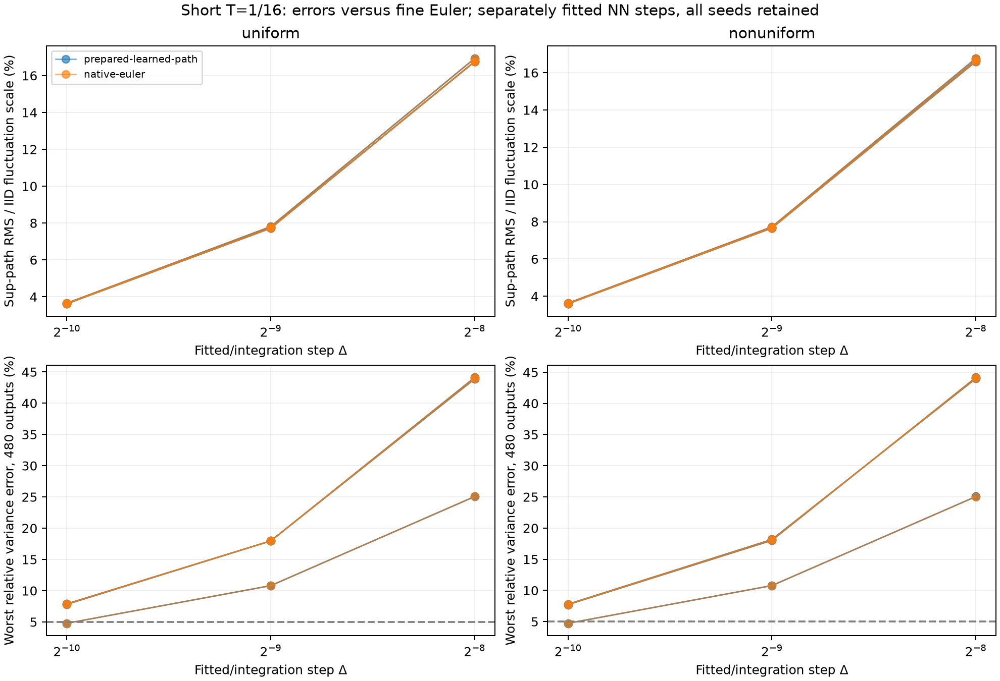
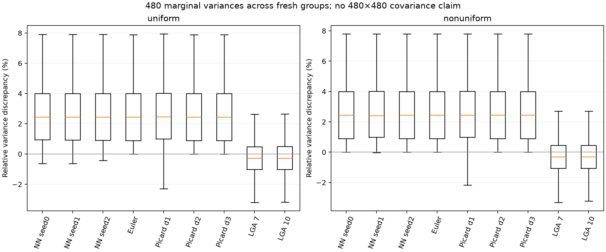
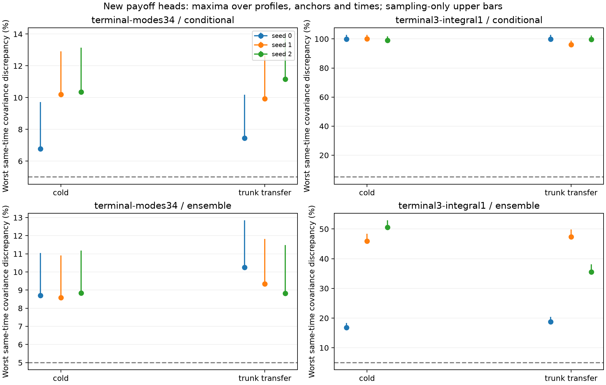
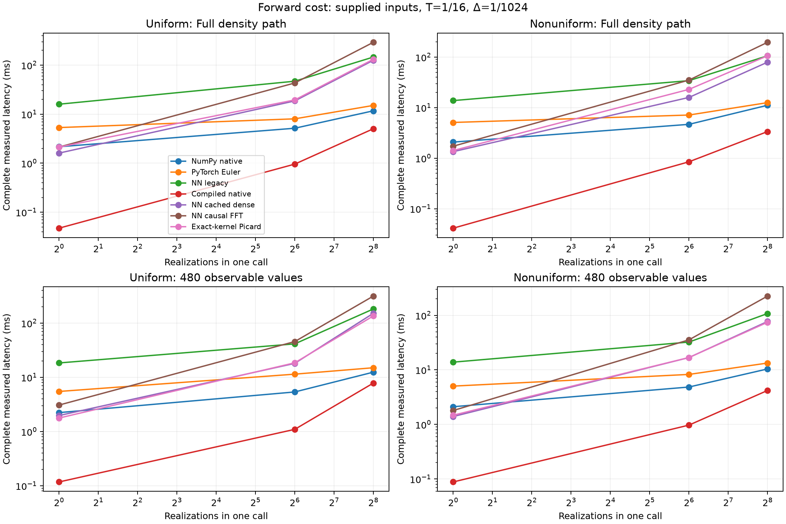
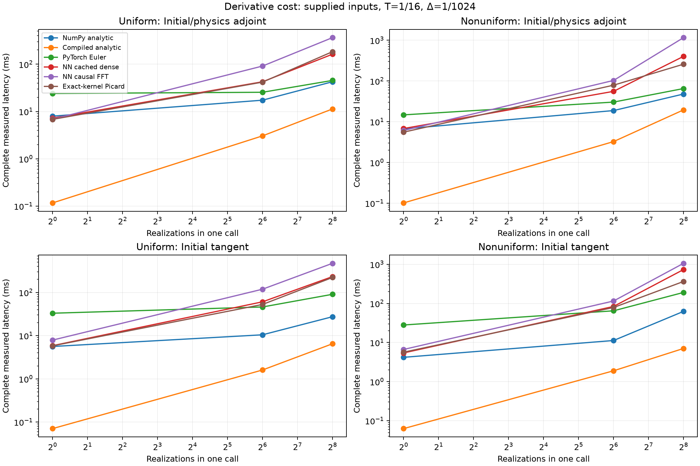
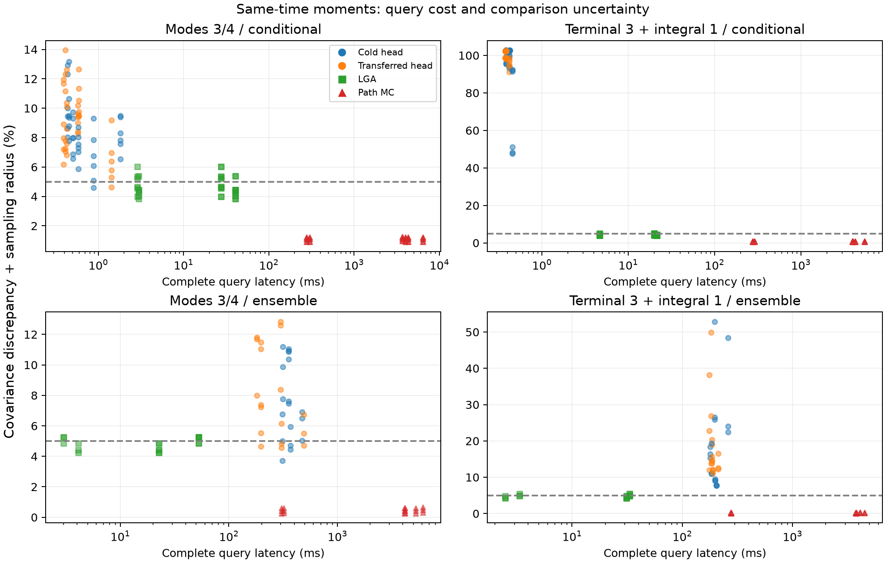
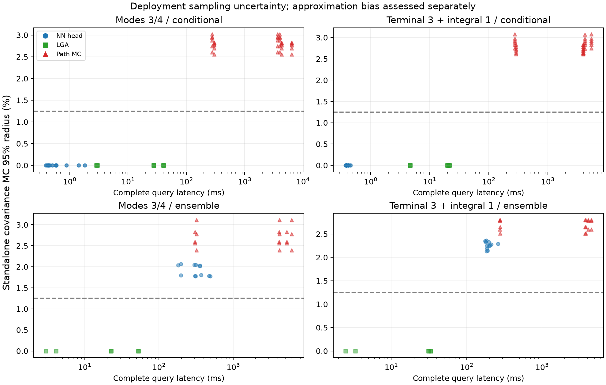

# Broader interacting DK task comparison — 27 October 2026

The study was preregistered and fitted on 26 October; the independent reference, accuracy evaluation and report were completed on 27 October.

**The broader comparison does not establish a computational advantage for the neural SPDE path solver. It also shows that the earlier statistics-network advantage does not extend automatically to new statistical tasks.** The newly fitted high-mode heads miss the 5% point-error target, and the mixed terminal/integral heads fail much more severely under this training budget. Classical native paths are the current choice for general stochastic tasks; the no-training linear-Gaussian approximation is the inexpensive statistical control in this short, weak-noise regime, subject to its approximation and uncertainty limits.

At Δ=1/1024 and one realization, the prepared learned path runtime takes **32.7–34×** the compiled native Euler latency.

Fresh statistical heads have normalized mean point errors **0.344–665%** and same-time covariance point errors **1.23–100%** across all declared groups, times, seeds and initializations. These ranges are descriptive; the sampling and coupled-reference diagnostics below control their interpretation.

A full density-path model supplies realizations, new observables, joint-time covariances and pathwise derivatives. The fixed payoff heads supply their declared same-time means and 4×4 covariances. Capability alone is not a measured runtime or accuracy advantage.

| Task | Current practical choice in this experiment | Evidence and limitation |
|---|---|---|
| Full density realizations and new observables | Compiled native Euler, with step refinement as required | No fitting; supports the same complete paths and new payoffs; lower measured latency at every tested path batch. |
| Repeated conditional moments of a fixed bank | LGA as a fast approximation; native MC when the stopped nonlinear law must be retained | New NN heads are cheaper per inference, but their current errors fail acceptance; no accuracy-qualified training crossover is established. |
| Mixed terminal values and killed path integrals | Native path MC; LGA as a separately validated approximation | The new integral heads fail despite cold and trunk-transfer fits; the existing path model handles the new bank without retraining. Native paths have that same flexibility at lower cost. |
| Initial-ensemble statistics | LGA when its approximation is adequate | It uses analytic IID covariance. NN-head histogram integration costs 175–488 ms and retains integration uncertainty; future-noise MC is slower still. |
| 480 marginal queries and nonlinear path functionals | Classical solver plus an appropriate numerical refinement audit | The finest NN and same-step Euler share noticeable high-mode and nonlinear-mean bias; a good full-state path error does not establish the 5% target for every payoff. |
| Conservative sensitivities and discrete adjoints | Compiled native JVP/adjoint | Lower measured cost, no training; fixed-parameter NN physics AD is not inverse-problem validation. |
| Rare stopping events or a continuum DK claim | Unresolved | No reference exits were observed, and the experiment fixes G=32 and T=1/16. |

## What was compared

The target is the stopped native finite-volume DK system with G=32, N=2048, D=1 and V(x)=−0.75 cos(x)+0.1 cos(2x). Initial histograms are IID multinomial draws from uniform or exp(0.2 cos(x)) profiles. The scientific comparison uses T=1/16, 16,384 independent families per group, four fresh conditional histograms and two initial-law ensemble groups. Every stopped trajectory is retained. Observation weights integrate physical Fourier functions exactly against cellwise densities.

The reference step is 2⁻¹³, with literally coupled 2⁻¹⁴/2⁻¹⁵ audits on 1,024 families per group. Whole-family bootstrap intervals are simultaneous within each reported bank. Numerical reference differences and sampling uncertainty are separate; continuous hitting-boundary and continuum-DK bias remain unresolved.

Historical path operators have width 16 and 64 training paths per profile. New payoff heads have width 32 and 128 paths per profile, sharing one literal current-state/horizon pool across both new banks, all optimizer seeds and cold/trunk-transfer starts. Thus this is a deployed/adaptation comparison, not an equal-data, equal-capacity sample-efficiency experiment.

Trunk-transfer starts retain prior optimization and data exposure from the historical statistics task; their new output head is reset. Cold and transferred fits share the fresh pool, but their total historical training exposure differs and is costed separately.

The density-path ansatz learns its causal Volterra response kernel while retaining the known interaction force and density-dependent physical face-noise mobility. Each integration resolution has a separately fitted checkpoint. The refinement ladder does not establish time convergence of a single frozen network. The statistical heads learn full-native-state conditional moment functions from the known-generator residual, with exact deterministic noise-trace calculations and no future-payoff training labels.

## Accuracy and uncertainty

The finest learned paths have normalized strong sup-path point errors **3.6–3.65%** relative to the finite reference, on all cells and the common physical-time grid.

The strong-error quantity is $\{N(1-1/G)^{-1}\,\mathbb E[\sup_{t\in\mathcal T}\|m_\theta(t)-m_{\rm ref}(t)\|_2^2]\}^{1/2}$ on the stored common grid $\mathcal T$, and is displayed as a percentage. Its denominator is the uniform-IID histogram fluctuation scale; it is not a relative density error or a normalization by the reference path magnitude. The time-RMS variant replaces the supremum with the mean over stored times.

The no-training linear-Gaussian approximation has same-time normalized covariance point discrepancies **1.07–3.2%**. Its law is an unstopped Gaussian linearization; agreement here does not establish stopped-DK equivalence.

| New payoff bank / initialization | Seed 0: worst mean / covariance (%) | Seed 1 (%) | Seed 2 (%) |
|---|---:|---:|---:|
| terminal-modes34 / cold | 7.6 / 8.7 | 5.23 / 10.2 | 9.9 / 10.4 |
| terminal-modes34 / trunk-transfer | 8.18 / 10.3 | 7.08 / 9.93 | 6.98 / 11.2 |
| terminal3-integral1 / cold | 336 / 100 | 665 / 100 | 545 / 99 |
| terminal3-integral1 / trunk-transfer | 203 / 100 | 216 / 96 | 194 / 99.7 |

Each cell reports that optimizer seed's worst mean and covariance point error over both profiles, all fresh conditional/ensemble groups and the three query times. Mean percentages use the reference outcome standard deviation; covariance percentages use products of reference standard deviations. Thus a 665% mean error is about 6.65 reference standard deviations, not a 665% relative error in a possibly small mean. The failed heads remain in the result set; no seed or initialization was selected or refitted after the independent evaluation.

A read-only audit of the six failed mixed-bank fits found no identified source-sign, basis, time-factor or public-output normalization defect. An independent exact free-heat solution satisfies the implemented interior mean residual to 6.22×10⁻¹⁴, and the public N-scaled pure-integral covariance matches the required τ³qAqᵀ/3 leading term to 8.93×10⁻¹⁶ relative error. These controls validate those particular equations and units; they do not prove the entire learned solution correct.

All six mixed-bank fits selected their final permitted step, 1030. Their unbalanced summed residual objective reduced the raw mean residual RMS from 37.87 to 1.68–3.40 while increasing the raw covariance residual RMS from 0.338 to 0.848–1.176. The ansatz hard-codes the leading τ³ covariance but leaves the correct initial integral-mean derivative to be learned. This is a candidate optimization/ansatz limitation of the trained configuration and budget, rather than a demonstrated unique cause or evidence that statistical learning is intrinsically inferior. The frozen histories, conditional variance collapse and analytic checks are preserved in audit/integral_head_diagnostic.json; no post-test refitting was performed.

For the finest learned path fits, worst 480-bank variance discrepancies range **4.73–7.9%**, while worst nonlinear-bank normalized mean discrepancies range **4.81–18.7%**. The same-step native/Picard controls exhibit essentially the same temporal bias. Strong path accuracy and accurate low-mode covariance do not imply acceptance for these more sensitive functionals.

The 480-output bank reports marginal means and variances only. Full joint-time covariance is assessed separately for each 12-dimensional B/C bank (four observables at three times). The statistical heads do not predict these joint-time matrices, scalar distributions, full density realizations or stopping probabilities.

| Coupled 2⁻¹³ → 2⁻¹⁵ audit | Mean point (%) | Covariance/variance point (%) | Mean sampling radius (%) | Covariance sampling radius (%) |
|---|---:|---:|---:|---:|
| terminal-modes34 / same_time | 0.00294–0.057 | 0.0141–0.134 | 0.0102–0.0198 | 0.0184–0.0401 |
| terminal-modes34 / joint_time_12 | 0.00898–0.057 | 0.0694–0.134 | 0.0142–0.0206 | 0.0304–0.0431 |
| terminal3-integral1 / same_time | 0.00182–0.0327 | 0.0089–0.09 | 0.00797–0.0329 | 0.0157–0.0652 |
| terminal3-integral1 / joint_time_12 | 0.00296–0.0327 | 0.0264–0.09 | 0.0126–0.0329 | 0.0261–0.0652 |
| many480 / means_and_variances | 0.0399–0.472 | 0.525–0.799 | 0.055–0.0584 | 0.121–0.13 |
| nonlinear3 / nonlinear_path_tasks | 0.502–1.94 | 0.0315–0.29 | 0.011–0.0298 | 0.0242–0.0561 |

The table gives ranges over all declared profiles, groups and times, normalized using each audit's finer reference. Coupled differences assess finite-step sensitivity and do not enclose the remaining continuous-time boundary bias. All three pairwise refinement comparisons remain in reference_refinement.csv.

| Fixed 17-node nonlinear tasks | Mean point (% SD) | Covariance point (%) | Comparison covariance sampling radius (%) |
|---|---:|---:|---:|
| path_dt10_seed0 | 4.83–18.5 | 0.245–2.65 | 0.0275–0.11 |
| path_dt10_seed1 | 4.81–18.5 | 0.416–2.64 | 0.0281–0.11 |
| path_dt10_seed2 | 4.83–18.7 | 0.25–2.66 | 0.0275–0.109 |
| native_euler_dt10 | 4.83–19 | 0.246–2.68 | 0.0275–0.109 |
| classical_picard_depth1 | 4.79–19 | 0.325–2.49 | 0.0897–0.213 |
| classical_picard_depth2 | 4.83–19 | 0.247–2.65 | 0.0275–0.106 |
| classical_picard_depth3 | 4.83–19 | 0.246–2.68 | 0.0275–0.109 |
| linear_gaussian_rk4_7 | 1.55–3.44 | 0.789–2.71 | 3.4–3.59 |
| linear_gaussian_rk4_10 | 0.969–3.14 | 0.911–2.59 | 3.33–4.24 |

These nonlinear functionals are terminal normalized cos(3x), a density-energy integral and a smooth maximum on the fixed common polygon. Scalar Wasserstein/KS diagnostics are retained separately; their empirical values are not population distribution certificates. Gaussian nonlinear outcomes use independent samples of an unstopped approximate law.

## Cost and the role of learning

Complete path timings include stopping; many-observable timings include the readout. Initial histogram generation, physical Brownian generation, tensor conversion, checkpoint restoration and kernel preparation are recorded separately. The optional serial C++ controls use FP64 without fast-math, with source/compiler/flag/library fingerprints and cold compilation cost. They supply full forward paths, conservative initial JVPs and the complete discrete adjoint. Exact-kernel Picard controls isolate improvements caused by cached/parallel algebra from improvements requiring trained weights.

The inference benchmarks use 1 CPU thread on macOS-15.0.1-arm64-arm-64bit, with PyTorch 2.14.1 and NumPy 2.5.4. This is the measured macOS ARM64 CPU setting, not a GPU or hardware-independent comparison. Thread environment settings and load averages at the start and end are retained in the timing JSON. New fitting costs were collected under the separately recorded three-worker schedule.

| Supplied-input task, one realization, 64 steps | Compiled native (ms) | Learned path (ms) | Exact-kernel Picard (ms) |
|---|---:|---:|---:|
| Full density path | 0.0412–0.0473 | 1.35–1.61 | 1.42–2.13 |
| 480 new Fourier/time values | 0.0883–0.118 | 1.4–1.97 | 1.48–1.77 |
| Complete discrete initial/physics adjoint | 0.102–0.117 | 6.82–7.24 | 5.55–6.83 |
| Conservative initial JVP | 0.0629–0.0706 | 5.42–5.86 | 5.66–5.81 |

Entries are ranges of measured medians across the two profiles. These supplied-input tasks retain their exact output allocation; the derivative rows do not represent an inverse-parameter validation. Batched throughput and latency spread remain in costs.csv and the plots.

Initial sensitivities are projected onto mass-zero directions. Physical-parameter AD of a neural checkpoint trained only at fixed D, κ and a₂ is a diagnostic derivative of that parametrization. Finite-difference agreement validates the derivative implementation; it does not validate parameter generalization or an inverse-problem solver.

Sensitivity timing objectives use terminal cos(3x), the density-energy trapezoid and the smooth maximum on every solver integration node. The nonlinear accuracy bank uses the fixed 17-node common polygon. Derivative comparisons are literal NN/native comparisons within one step size; their costs are not attached to that distinct 17-node nonlinear accuracy task or used to claim a temporal derivative convergence rate.

Optional T=1 timings concern a different, finite-Euler experiment and its original depth-four checkpoint. They do not extend the short-horizon fine-reference accuracy conclusions to T=1.

| Optional T=1 complete-path timing | Batch | Measured median (ms) |
|---|---:|---:|
| numpy_native_euler | 1 | 4.052 |
| compiled_native_euler | 1 | 0.05512 |
| learned_dense_cached_depth4 | 1 | 3.15 |
| learned_causal_block_fft_depth4 | 1 | 3.101 |
| exact_kernel_dense_cached_depth4 | 1 | 3.165 |
| numpy_native_euler | 64 | 9.471 |
| compiled_native_euler | 64 | 1.645 |
| learned_dense_cached_depth4 | 64 | 56.92 |
| learned_causal_block_fft_depth4 | 64 | 114.3 |
| exact_kernel_dense_cached_depth4 | 64 | 40.68 |
| numpy_native_euler | 256 | 24.8 |
| compiled_native_euler | 256 | 6.841 |
| learned_dense_cached_depth4 | 256 | 215.4 |
| learned_causal_block_fft_depth4 | 256 | 569.2 |
| exact_kernel_dense_cached_depth4 | 256 | 227.2 |

## Matched statistical queries and amortization

This comparison uses literal same-time four-mean/4×4-covariance queries. Conditional heads use one supplied histogram. Path moment queries actually simulate all 16,384 realizations in chunks of 64, apply the exact bank and aggregate means/N-covariances; they are not extrapolated B≤256 throughput. Fresh initial-histogram and Brownian generation are separate components of the path costs. Ensemble statistics-head costs include a fresh 16,384-histogram multinomial pool, inference and total-covariance aggregation; Gaussian ensemble initialization uses analytic IID covariance.

| One four-observable bank at three horizons; same-time covariance only | Fresh fitting per model (s) | Conditional online (ms) | Initial-ensemble online (ms) |
|---|---:|---:|---:|
| Statistics head, all cold/transfer seeds | 257–460 | 0.377–1.81 | 175–488 |
| Unstopped LGA, maximum step 1/128 | 0 | 2.87–4.67 | 2.48–4.11 |
| Unstopped LGA, fine 1/1024 audit | 0 | 20.1–40.4 | 22.7–52.9 |
| Native Euler, 16,384-path MC | 0 | 275–300 | 275–318 |
| Learned path, 16,384-path MC | historical; see training.csv | 3.69e+03–6.42e+03 | 3.74e+03–6.13e+03 |
| Exact-kernel Picard, 16,384-path MC | 0 | 3.98e+03–5.48e+03 | 3.81e+03–5.23e+03 |

Each call returns means and same-time 4×4 covariance matrices for one declared four-observable bank at all three horizons. It does not return the full joint 12×12 covariance or jointly predict both banks. Ranges retain every declared profile, alternative bank, optimizer seed and initialization. The coarse Gaussian row uses only the three query knots with maximum step 1/128; its 1/1024 row is a separate fine ODE audit, whose N-scaled covariance differs by at most 0.00312% in reference products. Neither ODE refinement resolves linearization or stopping bias. Fitting elapsed times were recorded under concurrent workers; online timings were collected after external workers finished. These rows are descriptive costs at fixed allocations, not equal-accuracy cost certifications. Prior trunk/path fitting, cold restoration, fresh pool generation and input generation are separate in the CSVs and total-cost accounting below.

A tight paired path/reference interval measures a method-discrepancy estimate under shared physical noise. It is not the standalone variability of a deployed 16,384-path Monte Carlo estimate. The latter is recomputed from complete candidate-family bootstrap estimates and reported in deployed_sampling.csv and the separate plot. Conditional heads have zero inference Monte Carlo noise; initial-ensemble heads still have initial-law integration variability. Adding bias, paired sampling, standalone sampling and reference-audit quantities does not automatically give a rigorous independent coverage statement.

A newly declared bank can reuse stored full-path samples without retraining the path model, but a fresh-path query still pays simulation and Monte Carlo uncertainty. A new statistical head pays fitting and optional historical trunk costs before cheap repeated conditional queries. A numerical break-even count is meaningful only for the same supported query after matched finite-reference error and uncertainty gates; unresolved comparisons are left without a winner or crossover count.

Classical full-path samplers also support newly declared payoffs without refitting. Reusing realizations establishes the flexibility of the path representation. A benefit attributable to learning requires a measured accuracy–cost improvement over the compiled native and exact-kernel controls.

## Training, stopping and evidence

The twelve new fits used three independent optimizer workers. Recorded worker wall times are 1489.8–1505.7 s; aggregate worker CPU time is 3114.3 s. Summing worker wall times (4486 s) is not the elapsed concurrent batch duration. Per-model fitting times, historical pretraining costs and checkpoint hashes remain in training.csv and the locked metadata.

| Offline fitting component | Models in this comparison | Recorded fitting seconds per model |
|---|---:|---:|
| Historical density-path fits, all three steps | 18 | 16.123–80.512 |
| Historical density-path fits, step 1/1024 | 6 | 67.215–80.512 |
| Historical statistics trunks | 3 | 127.96–131.67 |
| Fresh payoff heads, cold and transferred | 12 | 256.74–459.55 |
| Transferred head including its prior trunk fit | 6 | 384.71–543.71 |

The shared fresh training/validation state pools took 1.199 s to generate and are charged once when constructing a new deployment. A transferred head constructed from scratch pays both its historical trunk fit and its fresh head fit; counting only the latter describes adaptation from an already available trunk. Historical data-generation costs were not fully recorded and are excluded explicitly, so the sums including historical fitting are known-component lower bounds. The table gives the experiment's full model inventory; using one trained model does not require charging all optimizer seeds to every future prediction.

Stopping probabilities use exact binomial intervals; zero observed exits is not a zero-probability claim. Gaussian negative-density and below-boundary sample fractions concern its 17 stored common-grid nodes, with binomial sampling intervals in gaussian_law_diagnostics.csv. They are not between-node or continuous Gaussian hitting probabilities and do not establish stopped-DK equivalence. No trajectory or Gaussian sample is clipped or discarded to improve a comparison.

All three optimizer seeds remain separate in the CSVs and plots. No seed, step, initialization or sample count was chosen after reading final outcomes. The 5% normalized error and 1.25% component uncertainty levels are research targets, not blanket certification.

Total-cost arithmetic is in total_costs.csv for 1, 100, 10,000 and 100,000 repeated literal calls, with each call's measured batch allocation retained. It separates fresh fitting, prior trunk/path fitting, the shared fresh state-pool generation, restoration, kernel preparation, inference and recorded initial-state/Brownian generation. These are known-component sums: unrecorded historical data generation, research, hyperparameter search and uncontrolled process/OS startup are not assigned invented costs. Supplied-input path and derivative rows do not silently include unmeasured input-generation costs. A cost sum is not an accuracy-qualified winner; amortization.csv retains unresolved gates instead of reporting a numerical crossover.

Analysis-code provenance is separately archived and checksum verified. The completed macOS compiled-control timing used its exact historical wrapper and C++ binary. A subsequent compiler-driver path portability fix is explicitly bridged in audit/code_provenance.json; neither the timing evidence nor its source identity was rewritten.

CSV evidence: moments.csv, task_summary.csv, many480_summary.csv, many480_components.csv.gz, strong_paths.csv, stopping.csv, scalar_distributions.csv, initial_integration.csv, deployed_sampling.csv, reference_refinement.csv, gaussian_law_diagnostics.csv, costs.csv, total_costs.csv, preparation_costs.csv, training.csv, worker_costs.csv and amortization.csv. The report manifest records exact input and output hashes; original arrays/checkpoints remain referenced by their immutable experiment manifests.

The [compact evidence archive](artifacts/path_task_advantages_2026-10-27/README.md) preserves all figures, tables, individual result records, checkpoint metadata, diagnostics and analysis-code provenance. Its [inventory](artifacts/path_task_advantages_2026-10-27/archive_manifest.json) verifies the stored and restored bytes and indexes the full local raw data. Full restorable weights and trajectory banks remain in the original local run. The archived report is the exact generated version; this documentation copy changes only figure links and adds this evidence pointer. The [completion audit](path_task_advantages_2026-10-27_completion.json) records the completed requirements. Final software verification: **1,007 tests passed**, with the two recorded Torch/KS warnings; all seven figures were visually checked.
