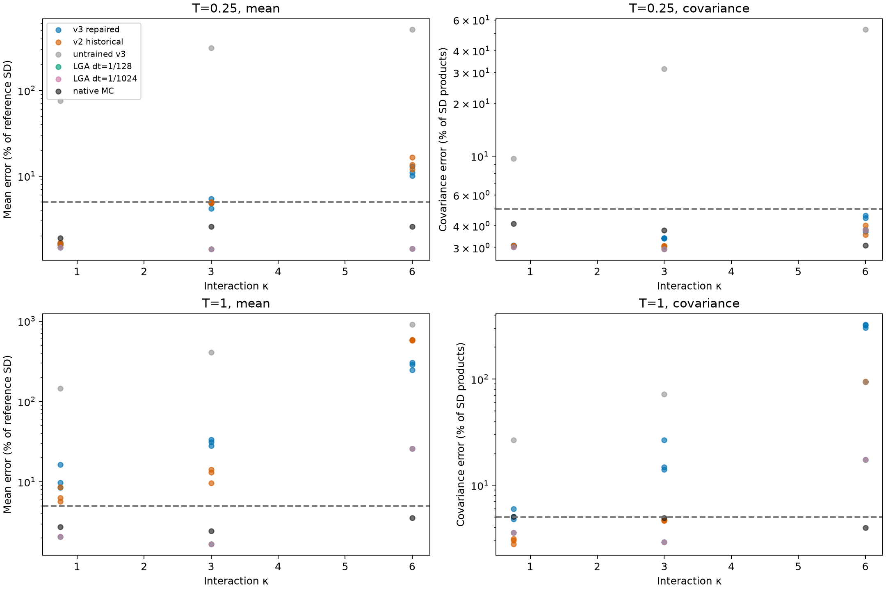
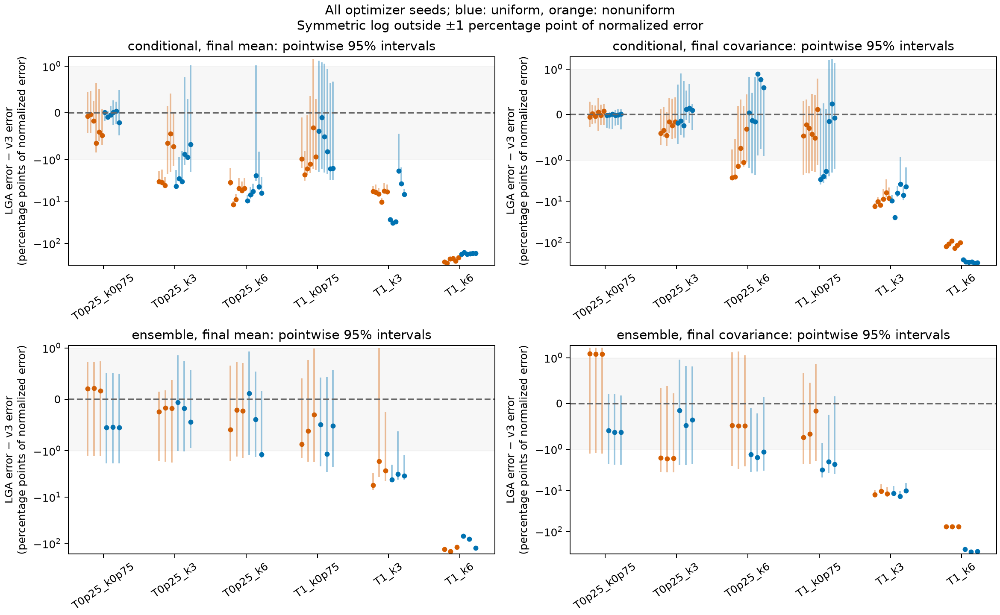
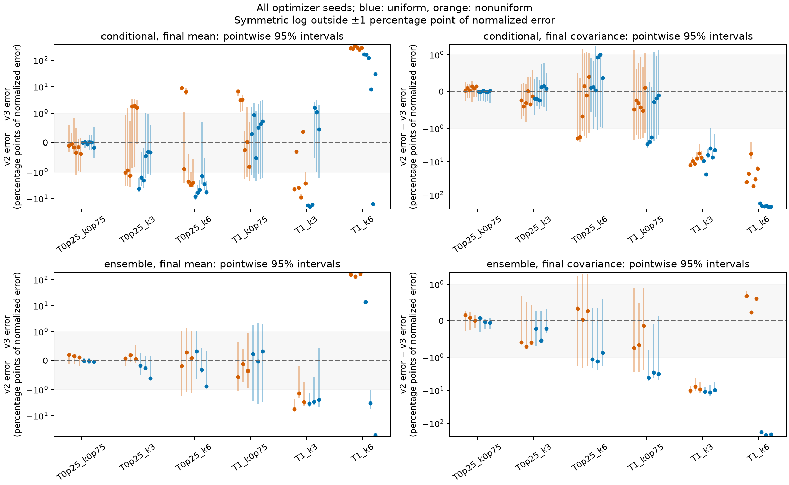
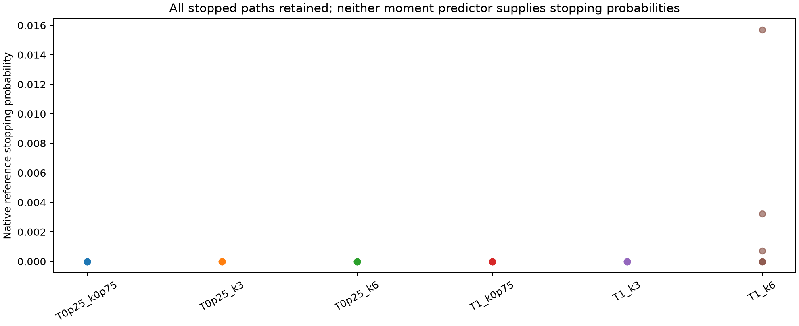
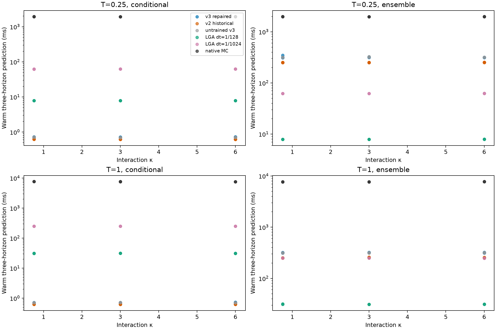
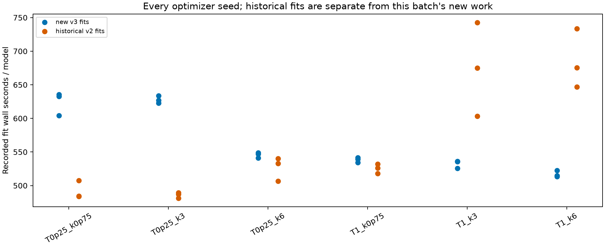
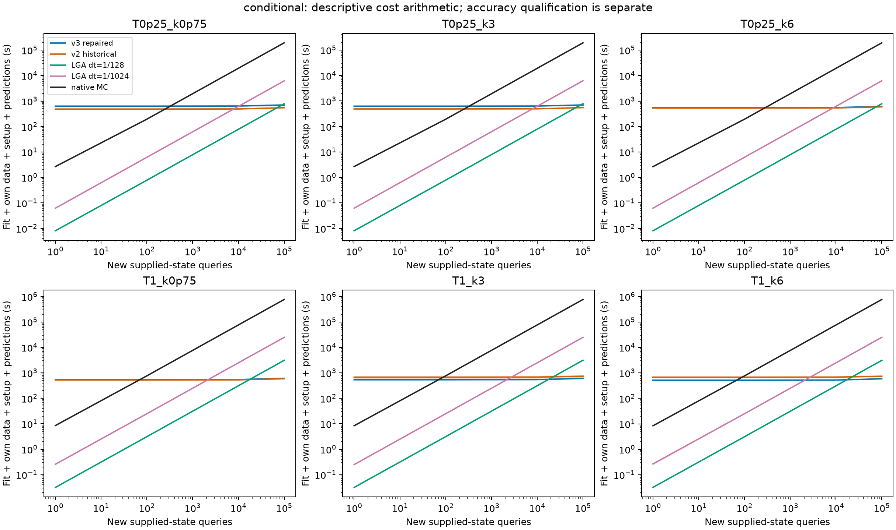
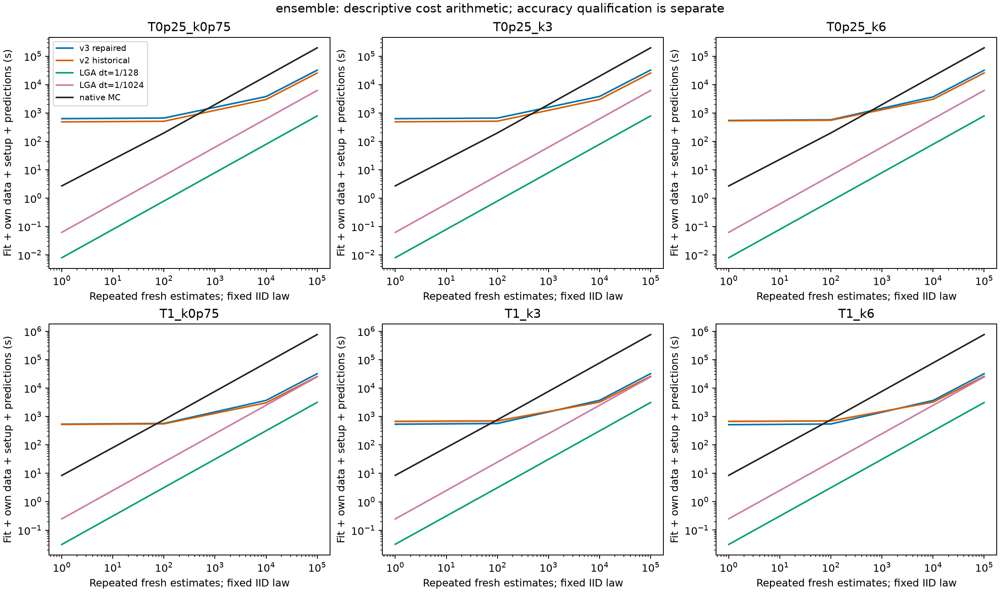

# Boundary-consistent statistics NN: fresh longer/stronger comparison

All **18 new v3 fits** and all **18 frozen v2 controls** are retained. The primary comparison has **360 estimates**; **444 records** are retained including paired-initial diagnostics.

Across 216 group/horizon/statistic comparisons, v3 is closer than fine LGA with resolved pointwise intervals for all three seeds in **0** comparisons; LGA is closer in **85**. Against matched-seed frozen v2, v3 wins consistently in **21**, and v2 in **49**. Other comparisons are unresolved or optimizer-dependent. These counts do not form a family-wise certificate.

## What the rerun establishes

The boundary and short-time consistency defects are repaired, but **this v3 fit does not improve overall statistical accuracy**. At T=1, κ=6, the worst mean error falls from 5.75–5.86 reference SD for v2 to 2.47–3.05 SD for v3. The Gaussian control is at 0.260 SD. Terminal covariance error worsens to 304–326% of reference SD products, while integral–integral covariance error remains 94.3–94.6%. V3 also performs worse in several milder long-horizon comparisons. Positive covariance and correct boundary slopes are insufficient for accurate finite-time moments.

The new network answers a supplied-histogram query in 0.701–0.738 ms, after 513–635 s of training per model. The cheaper Gaussian control takes 7.8–31.8 ms and requires no training. For fresh IID-law integration, v3 takes 312–349 ms versus 7.9–31.8 ms for that Gaussian control. No accuracy-qualified training-cost crossover is established. Some mild cases are limited by sampling and reference uncertainty; the large errors in the hardest cases are clear model failures.

The residual audit explains why accepting a smaller robust objective would be misleading. In the strongest case, 12 of 4,096 collocation rows at two to five stopping-mass thresholds contribute 98.2–98.9% of squared covariance residual and 62.7–69.4% of robust loss. With the selected mean held fixed, covariance-stage robust loss falls 4.3–7.4% on the matched diagnostic subset, while squared-residual RMS rises 2.0–4.2%. The [common-state residual diagnosis](../BSDE_STATISTICS.md#boundary-consistent-generator-formulation) retains the normalization and mean-source qualifications. These observations identify remaining fitting problems; changed learner pools prevent unique causal attribution to either repair component.

## Target and the repair

The target remains stopped native finite-volume DK at G=32, N=2048, D=1, a₂=0.1. Horizons (0.25, 1.0) and interactions (0.75, 3.0, 6.0) are fixed before fresh outcomes. Each initial law is IID uniform or exp(0.2 cos x). Conditional predictions use two fresh supplied histograms per law; ensemble predictions use a separate fresh IID histogram integration pool shared across neural heads. References, deployment MC, learner families and neural integration pools use disjoint declared streams.

The moving gate is a product of erf(d√(T/(w²τ))). It has linear boundary behavior at positive remaining time and becomes flat at zero time at every strict interior state. Exact native terminal drift and killed-integral initial slopes replace the fixed-gate slope defect. Every output's learned mean correction starts at τ²; covariance remains a PSD congruence without a fixed floor. Independent controls verify the zero-time equations, small-time covariance orders, dense derivatives, absorption and finite corner gradients.

Training uses full-horizon scales computed only from training states, with no inverse-time powers. The normalized residual z uses pseudo-Huber loss 2δ²(√(1+(z/δ)²)−1), δ=3. This retains quadratic behavior near zero and bounded influence for large residuals. Raw residuals, normalized RMS/MSE and robust losses are all reported, so a smaller robust criterion cannot hide large physical residuals. Mean selection precedes and remains frozen during covariance fitting.

The covariance residual of the initial checkpoint uses the untrained mean's source. The matched covariance-training comparison is selected_mean_covariance_initial → final_selected: both use the same selected, frozen mean. An initial → final covariance-loss difference also changes that source and is therefore not an isolated covariance-head improvement. Absent validation strata and undefined zero-denominator concentration fractions are left empty rather than reported as zero error.

The frozen v2 controls were trained on the earlier independent learner pools. Fresh common tests compare the fitted methods fairly, but prediction differences do not isolate the boundary/loss change from training-pool randomness. The analytic controls isolate consistency properties; no test outcome selected a seed or triggered refitting.

## Independent accuracy

Outputs are terminal sine/cosine mode 3 and killed sine/cosine mode 1 integrals divided by the case's fixed T. Every method returns four means and a same-time 4×4 covariance at T/4, T/2 and T. Mean error is divided by the reference standard deviation; covariance error by products of reference standard deviations. Covariances are stored N-scaled. Tables below take the maximum over times, conditional/ensemble groups and observable components; ranges retain optimizer seeds.

| Case | Method | Worst mean (% of reference SD) | Worst covariance (% of SD products) |
| --- | --- | --- | --- |
| T0p25_k0p75 | v3 | 1.61–1.64 | 3.08–3.09 |
| T0p25_k0p75 | v2 | 1.56–1.67 | 3.08–3.08 |
| T0p25_k0p75 | untrained v3 | 76.2 | 9.68 |
| T0p25_k0p75 | LGA dt7 | 1.47 | 3.02 |
| T0p25_k0p75 | LGA dt10 | 1.47 | 3.02 |
| T0p25_k0p75 | native MC | 1.88 | 4.12 |
| T0p25_k3 | v3 | 4.19–5.42 | 3.38–3.41 |
| T0p25_k3 | v2 | 4.82–4.99 | 3.03–3.07 |
| T0p25_k3 | untrained v3 | 315 | 31.5 |
| T0p25_k3 | LGA dt7 | 1.4 | 2.94 |
| T0p25_k3 | LGA dt10 | 1.4 | 2.94 |
| T0p25_k3 | native MC | 2.56 | 3.78 |
| T0p25_k6 | v3 | 10–12.9 | 3.72–4.57 |
| T0p25_k6 | v2 | 12–16.6 | 3.56–4.02 |
| T0p25_k6 | untrained v3 | 514 | 52.8 |
| T0p25_k6 | LGA dt7 | 1.42 | 3.79 |
| T0p25_k6 | LGA dt10 | 1.42 | 3.79 |
| T0p25_k6 | native MC | 2.57 | 3.1 |
| T1_k0p75 | v3 | 8.51–16.3 | 4.78–5.98 |
| T1_k0p75 | v2 | 5.73–8.58 | 2.78–3.13 |
| T1_k0p75 | untrained v3 | 145 | 26.6 |
| T1_k0p75 | LGA dt7 | 2.08 | 3.58 |
| T1_k0p75 | LGA dt10 | 2.08 | 3.58 |
| T1_k0p75 | native MC | 2.75 | 5.05 |
| T1_k3 | v3 | 28.1–33.6 | 14.1–26.6 |
| T1_k3 | v2 | 9.67–14.3 | 4.64–4.73 |
| T1_k3 | untrained v3 | 409 | 72.3 |
| T1_k3 | LGA dt7 | 1.68 | 2.92 |
| T1_k3 | LGA dt10 | 1.68 | 2.92 |
| T1_k3 | native MC | 2.45 | 4.92 |
| T1_k6 | v3 | 247–305 | 304–326 |
| T1_k6 | v2 | 575–586 | 94.5–95 |
| T1_k6 | untrained v3 | 903 | 94.6 |
| T1_k6 | LGA dt7 | 26 | 17.4 |
| T1_k6 | LGA dt10 | 26 | 17.4 |
| T1_k6 | native MC | 3.58 | 3.99 |

Whole-trajectory-family bootstrap intervals are pointwise per fixed fit/horizon. Independent initial-law estimates use product resampling: reference families and neural initial families are independent, with the same initial resample shared across both neural predictors in v3/v2 contrasts. The original paired-initial results remain separate diagnostics. No optimizer seeds are pooled. LGA is unstopped; neither neural head predicts stopping probabilities or a sampled law.

### Terminal and time-integral blocks

The following split uses each bank label's declared terminal/running weights, independently of output ordering. TT denotes terminal–terminal covariance, TI terminal–integral covariance, and II integral–integral covariance. Each number is the worst normalized error over both initial laws, conditional/ensemble groups and the three query times; ranges retain the optimizer seeds. Every family/seed block is retained in observable_blocks.csv.

| Case | Method | Terminal mode 3 (% ref SD) | Time integral mode 1 (% ref SD) |
| --- | --- | --- | --- |
| T0p25_k0p75 | v3 | 1.61–1.64 | 1.51–1.53 |
| T0p25_k0p75 | v2 | 1.56–1.67 | 1.4–1.41 |
| T0p25_k0p75 | LGA dt10 | 1.47 | 1.16 |
| T0p25_k3 | v3 | 4.19–5.42 | 3.31–4.17 |
| T0p25_k3 | v2 | 4.82–4.99 | 2.27–2.43 |
| T0p25_k3 | LGA dt10 | 1.4 | 1.39 |
| T0p25_k6 | v3 | 7.12–12.9 | 8.9–10.9 |
| T0p25_k6 | v2 | 12–16.6 | 5.52–9.35 |
| T0p25_k6 | LGA dt10 | 1.42 | 1.09 |
| T1_k0p75 | v3 | 3.06–5.68 | 8.51–16.3 |
| T1_k0p75 | v2 | 1.56–1.67 | 5.73–8.58 |
| T1_k0p75 | LGA dt10 | 1.34 | 2.08 |
| T1_k3 | v3 | 22.8–31.4 | 11.5–33.6 |
| T1_k3 | v2 | 3.35–3.49 | 9.67–14.3 |
| T1_k3 | LGA dt10 | 1.68 | 1.44 |
| T1_k6 | v3 | 152–182 | 247–305 |
| T1_k6 | v2 | 296–319 | 575–586 |
| T1_k6 | LGA dt10 | 26 | 7.08 |

| Case | Method | TT (% SD products) | TI (% SD products) | II (% SD products) |
| --- | --- | --- | --- | --- |
| T0p25_k0p75 | v3 | 3.08–3.09 | 1.59–1.6 | 2.72–2.73 |
| T0p25_k0p75 | v2 | 3.08–3.08 | 1.6–1.61 | 2.73–2.73 |
| T0p25_k0p75 | LGA dt10 | 3.02 | 1.6 | 2.78 |
| T0p25_k3 | v3 | 2.8–2.85 | 2.2–2.27 | 3.38–3.41 |
| T0p25_k3 | v2 | 2.93–2.96 | 2.17–2.21 | 3.03–3.07 |
| T0p25_k3 | LGA dt10 | 2.94 | 2.13 | 2.08 |
| T0p25_k6 | v3 | 3.31–4.57 | 2.2–2.75 | 3.42–4 |
| T0p25_k6 | v2 | 3.56–4.02 | 2.47–2.64 | 1.95–2.22 |
| T0p25_k6 | LGA dt10 | 3.79 | 1.66 | 1.85 |
| T1_k0p75 | v3 | 2.63–2.64 | 1.88–2.1 | 4.78–5.98 |
| T1_k0p75 | v2 | 2.64–2.64 | 2.33–2.35 | 2.78–3.13 |
| T1_k0p75 | LGA dt10 | 2.65 | 2.33 | 3.58 |
| T1_k3 | v3 | 12.5–14.8 | 7.56–11.6 | 11.8–26.6 |
| T1_k3 | v2 | 2.85–2.94 | 2.18–2.48 | 4.64–4.73 |
| T1_k3 | LGA dt10 | 2.92 | 2.02 | 2.05 |
| T1_k6 | v3 | 304–326 | 88.2–92 | 94.3–94.6 |
| T1_k6 | v2 | 92.1–92.8 | 91.2–92.7 | 94.5–95 |
| T1_k6 | LGA dt10 | 17.4 | 12.5 | 6.01 |

For T1_k6, the time-integral comparison is v3: integral mean 247–305% of reference SD, II covariance 94.3–94.6% of SD products; v2: integral mean 575–586% of reference SD, II covariance 94.5–95% of SD products; fine LGA: integral mean 7.08% of reference SD, II covariance 6.01% of SD products. These are worst group/time discrepancies in fluctuation units, rather than relative errors of possibly small means.

## Stopping and numerical uncertainty

The native reference uses 16,384 families/group at step 0.000244141; the first 1,024 families are coupled to two finer levels by summed Brownian increments. Every first-crossing Euler polygon is frozen, killed integrals cease there, and every stopped path remains in statistics. Reference refinement and sampling uncertainty are separate. Refinement differences do not prove continuous stopping-boundary bias is absent.

The 5% normalized-error target requires error plus uncertainty and reference refinement to resolve it; each sampling or reference contribution is targeted below 1.25%. Small point error alone does not pass these gates. All gate failures, standalone integration uncertainty and physical payoff bounds are retained in CSV tables.

## Training and inference costs

This batch adds **10,156.0 summed v3 fitting wall seconds**, plus **2.65 shared state-generation seconds**. The frozen v2 models retain **10,166.4 historical fitting seconds** and **2.77 historical state-generation seconds**. Historical costs are verified against archived manifest bytes and are not new work in this batch. A deployment cost nevertheless charges each chosen model's own fit and shared data pool once.

The new worker attempts record **9,818.0 process CPU seconds** and at most **3,396.2 seconds** for one worker's summed attempts. Three optimizer workers execute concurrently. Per-model training_seconds and summed worker wall durations are not total elapsed batch time; UTC start/finish timestamps and monotonic wall/CPU accounting are retained separately.

| Case | Method | Warm conditional (ms) | Warm IID estimate (ms) |
| --- | --- | --- | --- |
| T0p25_k0p75 | v3 | 0.701–0.729 | 312–349 |
| T0p25_k0p75 | v2 | 0.619–0.633 | 249–253 |
| T0p25_k0p75 | LGA dt7 | 7.81–7.82 | 7.88–7.9 |
| T0p25_k0p75 | LGA dt10 | 62–62.3 | 62.2–62.3 |
| T0p25_k0p75 | native MC | 1.94e+03–1.95e+03 | 1.96e+03–1.98e+03 |
| T0p25_k3 | v3 | 0.706–0.718 | 315–323 |
| T0p25_k3 | v2 | 0.621–0.632 | 249–252 |
| T0p25_k3 | LGA dt7 | 7.84–7.89 | 7.88–7.88 |
| T0p25_k3 | LGA dt10 | 62.2–62.4 | 62–62.3 |
| T0p25_k3 | native MC | 1.91e+03–1.92e+03 | 1.97e+03–1.97e+03 |
| T0p25_k6 | v3 | 0.71–0.738 | 314–319 |
| T0p25_k6 | v2 | 0.622–0.634 | 251–253 |
| T0p25_k6 | LGA dt7 | 7.85–7.88 | 7.89–7.94 |
| T0p25_k6 | LGA dt10 | 62.3–62.4 | 62.1–62.6 |
| T0p25_k6 | native MC | 1.93e+03–1.94e+03 | 1.97e+03–1.98e+03 |
| T1_k0p75 | v3 | 0.704–0.722 | 314–321 |
| T1_k0p75 | v2 | 0.625–0.638 | 249–253 |
| T1_k0p75 | LGA dt7 | 31.2–31.3 | 31.2–31.8 |
| T1_k0p75 | LGA dt10 | 249–249 | 249–250 |
| T1_k0p75 | native MC | 7.64e+03–7.66e+03 | 7.65e+03–7.7e+03 |
| T1_k3 | v3 | 0.706–0.723 | 318–323 |
| T1_k3 | v2 | 0.627–0.635 | 252–260 |
| T1_k3 | LGA dt7 | 31.2–31.3 | 31.3–31.3 |
| T1_k3 | LGA dt10 | 249–249 | 249–249 |
| T1_k3 | native MC | 7.63e+03–7.64e+03 | 7.65e+03–7.69e+03 |
| T1_k6 | v3 | 0.708–0.728 | 314–324 |
| T1_k6 | v2 | 0.623–0.649 | 249–257 |
| T1_k6 | LGA dt7 | 31–31.3 | 31.1–31.4 |
| T1_k6 | LGA dt10 | 249–250 | 247–250 |
| T1_k6 | native MC | 7.6e+03–7.63e+03 | 7.73e+03–7.79e+03 |

Conditional timings return the full three-time bank for one supplied histogram; batching 64/256 states is retained separately. Neural IID predictions include 16,384 fresh histogram draws and total-covariance integration. LGA integrates the IID covariance analytically. Native MC draws fresh physical noise and, for the ensemble task, fresh initials, runs the stopped solver, and computes moments. All final inference timings are measured after fitting, references, accuracy and audits exit.

Cold totals include one model fit, its full shared training/validation pool, strict restoration, required compiled-native setup, the literal first prediction and subsequent warm predictions. Larger neural batches/ensembles additionally pay the measured cold B1 cache-creation probe. Arithmetic payback is distinct from accuracy-qualified payback; **0** comparison/statistic rows meet the current finite-reference qualification. Repeated estimates of an identical fixed IID law may be memoized; their arithmetic curve is not a recommendation to recompute them.

## Evidence and limits

The strongest declared case is T1_k6. Detailed scalar means, variances, covariance entries, all optimizer seeds, stopping intervals, robust/raw validation strata and matched v3/v2 contrasts are retained in the adjacent CSVs. Checkpoint, source, configuration, reference, bootstrap and manifest hashes bind every result. Software acceptance and a reproducible negative outcome remain separate from an accuracy or speed claim. This experiment concerns the specified stopped finite-grid DK law and fixed observable bank; it is not continuum-DK convergence.

[Compact evidence archive](artifacts/payoff_boundary_regimes_2026-10-27/README.md).
