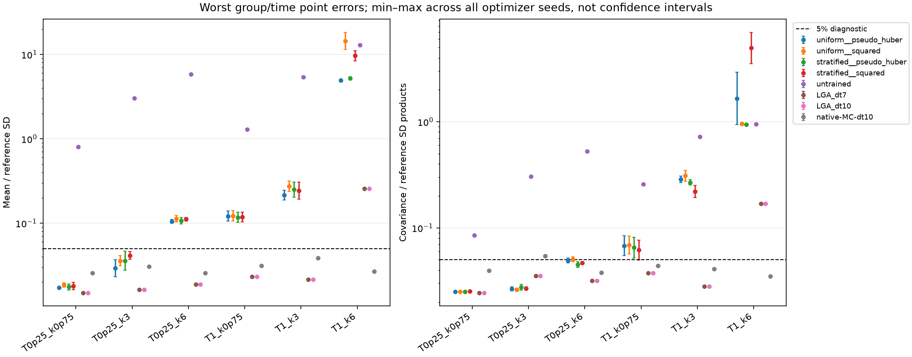

# Matched-pool proposal and loss comparison

All **72 fits**, all four crossed variants and all three optimizer seeds are retained. The primary comparison has **576 predictions**; **732 records** remain including paired-initial diagnostics.

## Fixed comparison

The architecture is the same moving-boundary/native-slope v3 model. Within each regime/seed, the four variants use byte-matched fresh natural-occupancy training/validation pools, initialization and training-only residual scales. Adam uses uniform or importance-corrected stratified proposals; full-pool LBFGS uses the natural row measure. All variants select by the complete natural-validation fixed-unit MSE. The two training losses are pseudo-Huber and squared residuals. No stress-augmented target measure is silently substituted.

The output bank is four terminal/killed-integral means and same-time 4×4 covariance at three horizons. Native stopped finite-volume references retain every stopped family; Gaussian is an unstopped approximation. Both Gaussian integration steps, independent native Monte Carlo and the untrained v3 control remain. Primary IID-law neural predictions integrate fresh histograms independently of reference histograms; shared-initial predictions are retained only as paired diagnostics.

## Independent accuracy

Each maximum below covers all physical query times, initial profiles and conditional/IID groups. Ranges retain all three seeds; they are not confidence intervals. Mean percentages use reference SD, covariances use products of reference SDs, and neither is relative error of a possibly zero mean.

| Regime | Method | Worst mean (% SD) | Worst covariance (% SD products) |
|---|---|---:|---:|
| T0p25_k0p75 | uniform__pseudo_huber | 1.663–1.769 | 2.441–2.553 |
| T0p25_k0p75 | uniform__squared | 1.739–1.972 | 2.445–2.555 |
| T0p25_k0p75 | stratified__pseudo_huber | 1.615–1.903 | 2.457–2.553 |
| T0p25_k0p75 | stratified__squared | 1.622–1.998 | 2.486–2.563 |
| T0p25_k0p75 | untrained | 80.44 | 8.49 |
| T0p25_k0p75 | LGA_dt7 | 1.493 | 2.449 |
| T0p25_k0p75 | LGA_dt10 | 1.493 | 2.449 |
| T0p25_k0p75 | native-MC-dt10 | 2.569 | 3.941 |
| T0p25_k3 | uniform__pseudo_huber | 2.324–3.712 | 2.557–2.79 |
| T0p25_k3 | uniform__squared | 3.123–4.13 | 2.544–2.701 |
| T0p25_k3 | stratified__pseudo_huber | 2.767–4.648 | 2.602–2.926 |
| T0p25_k3 | stratified__squared | 3.735–4.608 | 2.593–2.785 |
| T0p25_k3 | untrained | 302.4 | 30.51 |
| T0p25_k3 | LGA_dt7 | 1.62 | 3.536 |
| T0p25_k3 | LGA_dt10 | 1.62 | 3.536 |
| T0p25_k3 | native-MC-dt10 | 3.065 | 5.455 |
| T0p25_k6 | uniform__pseudo_huber | 9.971–11.09 | 4.681–5.185 |
| T0p25_k6 | uniform__squared | 10.4–12.35 | 4.812–5.333 |
| T0p25_k6 | stratified__pseudo_huber | 9.797–11.66 | 4.251–4.792 |
| T0p25_k6 | stratified__squared | 10.61–11.72 | 4.55–4.782 |
| T0p25_k6 | untrained | 581.5 | 52.71 |
| T0p25_k6 | LGA_dt7 | 1.877 | 3.189 |
| T0p25_k6 | LGA_dt10 | 1.877 | 3.189 |
| T0p25_k6 | native-MC-dt10 | 2.57 | 3.791 |
| T1_k0p75 | uniform__pseudo_huber | 10.57–13.96 | 5.474–8.44 |
| T1_k0p75 | uniform__squared | 10.57–14.14 | 5.664–8.379 |
| T1_k0p75 | stratified__pseudo_huber | 10.22–13.52 | 5.2–8.178 |
| T1_k0p75 | stratified__squared | 10.37–13.57 | 4.995–7.678 |
| T1_k0p75 | untrained | 129.7 | 25.74 |
| T1_k0p75 | LGA_dt7 | 2.321 | 3.77 |
| T1_k0p75 | LGA_dt10 | 2.321 | 3.77 |
| T1_k0p75 | native-MC-dt10 | 3.147 | 4.393 |
| T1_k3 | uniform__pseudo_huber | 18.91–24.68 | 26.67–30.81 |
| T1_k3 | uniform__squared | 23.79–31.53 | 27.38–34.95 |
| T1_k3 | stratified__pseudo_huber | 20.44–30.68 | 25.41–28.33 |
| T1_k3 | stratified__squared | 19.17–30.69 | 19.3–25.22 |
| T1_k3 | untrained | 536.9 | 71.95 |
| T1_k3 | LGA_dt7 | 2.161 | 2.816 |
| T1_k3 | LGA_dt10 | 2.161 | 2.816 |
| T1_k3 | native-MC-dt10 | 3.869 | 4.093 |
| T1_k6 | uniform__pseudo_huber | 484.4–507.9 | 94.23–292.3 |
| T1_k6 | uniform__squared | 1144–1832 | 94.47–96.39 |
| T1_k6 | stratified__pseudo_huber | 498.4–543.7 | 94.19–94.34 |
| T1_k6 | stratified__squared | 843.2–1108 | 353.5–696.7 |
| T1_k6 | untrained | 1300 | 94.56 |
| T1_k6 | LGA_dt7 | 25.56 | 16.85 |
| T1_k6 | LGA_dt10 | 25.56 | 16.85 |
| T1_k6 | native-MC-dt10 | 2.684 | 3.513 |

## Matched-seed proposal/loss contrasts

Positive contrasts mean the candidate error is smaller than uniform/pseudo-Huber at the same optimizer seed. All four variants share fresh reference resamples; independent initial-integration resamples are common across the neural predictors and independent of reference resamples. Every declared seed, group, time and statistic remains in crossed_contrasts.csv. Counts below require the same pointwise conclusion for all three seeds; they are not a simultaneous grid-wide confidence statement or permission to select a favorable seed.

| Regime | Candidate versus uniform/pseudo-Huber | Statistic | Candidate closer, all seeds | Baseline closer, all seeds | Comparisons |
|---|---|---|---:|---:|---:|
| T0p25_k0p75 | uniform__squared | mean | 0 | 0 | 18 |
| T0p25_k0p75 | uniform__squared | covariance | 0 | 0 | 18 |
| T0p25_k0p75 | stratified__pseudo_huber | mean | 0 | 0 | 18 |
| T0p25_k0p75 | stratified__pseudo_huber | covariance | 0 | 0 | 18 |
| T0p25_k0p75 | stratified__squared | mean | 0 | 0 | 18 |
| T0p25_k0p75 | stratified__squared | covariance | 0 | 0 | 18 |
| T0p25_k3 | uniform__squared | mean | 0 | 2 | 18 |
| T0p25_k3 | uniform__squared | covariance | 0 | 0 | 18 |
| T0p25_k3 | stratified__pseudo_huber | mean | 0 | 0 | 18 |
| T0p25_k3 | stratified__pseudo_huber | covariance | 0 | 0 | 18 |
| T0p25_k3 | stratified__squared | mean | 0 | 2 | 18 |
| T0p25_k3 | stratified__squared | covariance | 0 | 0 | 18 |
| T0p25_k6 | uniform__squared | mean | 0 | 0 | 18 |
| T0p25_k6 | uniform__squared | covariance | 0 | 0 | 18 |
| T0p25_k6 | stratified__pseudo_huber | mean | 1 | 0 | 18 |
| T0p25_k6 | stratified__pseudo_huber | covariance | 0 | 1 | 18 |
| T0p25_k6 | stratified__squared | mean | 1 | 0 | 18 |
| T0p25_k6 | stratified__squared | covariance | 0 | 1 | 18 |
| T1_k0p75 | uniform__squared | mean | 0 | 0 | 18 |
| T1_k0p75 | uniform__squared | covariance | 0 | 0 | 18 |
| T1_k0p75 | stratified__pseudo_huber | mean | 1 | 0 | 18 |
| T1_k0p75 | stratified__pseudo_huber | covariance | 0 | 0 | 18 |
| T1_k0p75 | stratified__squared | mean | 0 | 1 | 18 |
| T1_k0p75 | stratified__squared | covariance | 1 | 0 | 18 |
| T1_k3 | uniform__squared | mean | 1 | 6 | 18 |
| T1_k3 | uniform__squared | covariance | 0 | 0 | 18 |
| T1_k3 | stratified__pseudo_huber | mean | 1 | 4 | 18 |
| T1_k3 | stratified__pseudo_huber | covariance | 0 | 1 | 18 |
| T1_k3 | stratified__squared | mean | 2 | 0 | 18 |
| T1_k3 | stratified__squared | covariance | 1 | 0 | 18 |
| T1_k6 | uniform__squared | mean | 0 | 15 | 18 |
| T1_k6 | uniform__squared | covariance | 0 | 0 | 18 |
| T1_k6 | stratified__pseudo_huber | mean | 0 | 4 | 18 |
| T1_k6 | stratified__pseudo_huber | covariance | 3 | 0 | 18 |
| T1_k6 | stratified__squared | mean | 0 | 18 | 18 |
| T1_k6 | stratified__squared | covariance | 0 | 6 | 18 |

## Training objective and validation

natural_validation.csv reports both natural MSE/RMS and natural pseudo-Huber diagnostics in the same fixed training-derived units. A lower robust training objective is not evidence of lower fluctuation error. Covariance training freezes each variant's selected mean; different fitted variants can still have different mean-gradient sources. The crossed study compares complete fitted methods, not covariance heads with a uniquely fixed shared learned source.

## Fitting, preparation and inference costs

Recorded optimizer-loop time totals 43881.7 s. Recorded fit-invocation time totals 44641.1 s. Shared train/validation state-pool generation costs 2.60891 s within 8.79773 s of complete preparation. Full seed-worker invocations total 44672.6 s. The recorded preparation/training allocation adds full preparation and worker durations once. Native generation, model fits, shared pool conversion, preflight and restoration are nested components, never additional charges. Summed concurrent durations are not elapsed batch time; worker attempts retain CPU, monotonic durations and UTC endpoints separately.

Reference construction separately recorded 2285.34 s. It is a comparison-study expense and is not charged to a model deployment. Unrecorded analysis, test and bootstrap runtimes are not represented as measured costs.

Each fixed-model deployment pays its own fit, the full measured study preparation once, its seed/case pool conversion once, restoration and the measured cold first query. The 1/100/10,000/100,000-call curves add subsequent warm measured calls. For known-horizon ensemble/batched calls, the separately charged B=1 cold probe is a complete discarded prediction, not a pure cache-creation microbenchmark. Charging the full observed multi-regime input preparation is conservative for a standalone model; a minimal one-regime build has not been timed. In-study shared pools are not multiplied by the number of variants, optimizer seeds, profiles or timing rows.

Conditional predictions accept a supplied histogram. IID-law timings actually draw and integrate the declared complete histogram pool; Gaussian propagates initial covariance analytically and native MC draws physical forcing and simulates its complete declared ensemble. Initialization, prediction and aggregation components are reported where measured, without subtracting unrelated medians or extrapolating a small-batch timing into a large-ensemble result.

There are **0 accuracy-qualified finite-reference payback rows**. Descriptive arithmetic payback remains labelled separately when accuracy, standalone sampling or refinement gates fail. The 5% error and 1.25% uncertainty-component gates do not certify remaining continuous-time stopping bias. A lower warm latency or an unqualified arithmetic crossover is not an equal-accuracy neural advantage.

The result is specific to the declared finite-grid target, bank, fixed physics and tested initial states. Bootstrap intervals are pointwise; no continuum limit, rare-event accuracy, unseen-law generalization or universal neural improvement follows. All primary records, paired diagnostics, reference refinements, fitting failures/accuracy failures and unresolved gates are preserved.

## Final bounded-study follow-up — 30 October 2026

The full declared comparison and its compact archive have now passed the terminal computational checks. All 72 fits, 576 primary predictions, 156 paired-initial diagnostic records, 696 timing workloads and 156 restoration records remain. The primary independent-IID comparison is distinct from the paired-initial diagnostic.

The residual improvement is not an accuracy certificate. In the strongest case, stratified/squared covariance point discrepancies reach 3.54–6.97 reference-SD products despite lower selection-pool residual MSE. The missing closest-boundary validation stratum remains unobserved. These findings retain every optimizer seed and do not establish simultaneous confidence over the parameter/state grid.

Warm supplied-state prediction takes 0.72–0.84 ms and complete 16,384-IID integration takes 0.313–0.475 s across the fitted variants and seeds (medians of the declared repeated calls). Full fitting, preparation and restoration charges remain in the cost tables. None of the 2,160 emitted amortization rows has an accuracy-qualified payback; the 1,388 descriptive crossover rows do not pass that scientific qualification.

The [supervised correction follow-up](lna_payoff_correction_2026-10-30.md) belongs to a different, paid-supervision regime. Its retained zero-correction checkpoints must not be credited as learned-head improvements. The [composite completion record](readme_research_2026-10-30_completion.json) separates completed allocations from unresolved accuracy, refinement, stopping and continuum questions.
