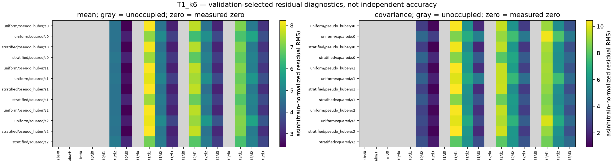

# Matched collocation residual supplement

All 72 declared models remain, with all three optimizer seeds and all four proposal/loss variants. The component table retains all four means and all sixteen covariance entries in solver-raw, physical-raw and stored training-normalized units.

These models were selected on this natural validation pool. These are descriptive selection-pool diagnostics, not independent accuracy measurements, field bias estimates, 95% significance tests or an error/continuum certificate. No new physical continuations, labels or final Monte Carlo data are used.

All nineteen boundary/time strata appear. Unoccupied bins have count zero and undefined metrics, not evidence of zero residual. Stratification only rebalances occupied states; it cannot create absent boundary, corner, absorbed or zero-time states. Empty strata therefore supply no evidence for those states. Distinct parent counts describe grouping; snapshots and remaining-time replicas are not independent families, and parent counts must not be summed across bins.

Natural-population MSE and pseudo-Huber contributions use row occupancy and all four/sixteen entries. Their sums reconstruct both canonical global validation losses; an unweighted average of occupied-bin losses would change the measure. Both common-unit MSE and pseudo-Huber loss are retained for every variant.

The physical-raw mean residual is the solver residual times bank scale/√N; physical covariance residual uses bank-scale outer product/N. Training-normalized terms use T times the solver term divided by its original stored stage scale; no new fit, inverse-time weighting, clipping or normalization is introduced.

Stored loss units are common across the crossed variants within each case/stage; magnitudes across different physical regimes are not independently measured fluctuation errors. Preparation and residual-extraction attempt costs are separate diagnostic overhead in audit_costs.csv.

Covariance source Γ(u), operator L C and time derivative are shown separately. Their RMS magnitudes do not add to the residual loss. Γ_common and rC_common substitute the matched-seed uniform/pseudo-Huber mean only as a counterfactual source diagnostic; other variants were not trained with that common mean.

The ten unique covariance entries are a plot convenience with diagonal multiplicity one and off-diagonal multiplicity two. All sixteen signed entries remain in the compressed CSV. `component_statistics.csv.gz` is streamed losslessly; raw per-row arrays, state banks and checkpoints remain local and checksum-indexed.

| Case | Validation rows | Distinct parents | Occupied / 19 |
| --- | ---: | ---: | ---: |
| T0p25_k0p75 | 4096 | 256 | 4 / 19 |
| T0p25_k3 | 4096 | 256 | 4 / 19 |
| T0p25_k6 | 4096 | 256 | 4 / 19 |
| T1_k0p75 | 4096 | 256 | 4 / 19 |
| T1_k3 | 4096 | 256 | 4 / 19 |
| T1_k6 | 4096 | 256 | 11 / 19 |

## Interpretation of the completed validation audit

The checksummed [model summaries](artifacts/payoff_collocation_residuals_2026-10-30/audit/report/model_summary.csv),
[stratum losses](artifacts/payoff_collocation_residuals_2026-10-30/audit/report/stratum_losses.csv.gz)
and [component table](artifacts/payoff_collocation_residuals_2026-10-30/audit/report/component_statistics.csv.gz)
retain all seeds. The following ranges summarize those selection-pool results;
they are not confidence intervals or independent payoff errors. The generated
report and its archived bytes are preserved separately.

At `T=1, κ=6`, stratified squared-loss fitting reduces natural mean residual MSE
by **36.1–73.7%** and covariance residual MSE by **86.2–94.6%**, compared with
uniform squared-loss fitting in the same seed. The ordering depends on regime
and loss; stratification does not lower both residuals in every comparison.
The strongest-case tradeoff in the original common training units is:

| Proposal / fitted loss | Mean MSE | Mean pseudo-Huber | Covariance MSE | Covariance pseudo-Huber |
| --- | ---: | ---: | ---: | ---: |
| Uniform / pseudo-Huber | 2,360–2,600 | 39.03–42.11 | 117,600–147,900 | 67.29–82.87 |
| Uniform / squared | 1,821–3,296 | 71.51–92.86 | 139,500–413,900 | 146.8–233.2 |
| Stratified / pseudo-Huber | 2,279–2,653 | 37.63–40.76 | 126,000–148,600 | 68.22–77.39 |
| Stratified / squared | 868.5–1,164 | 55.10–59.94 | 12,220–40,090 | 54.55–75.58 |

Only eleven validation rows occupy distance bin 1, or **0.2686%** of the pool.
They contribute **98.1–98.9%** of uniform/pseudo-Huber covariance MSE and
**98.6–98.9%** under stratified/pseudo-Huber fitting. Their share falls to
**85.2–89.2%** under stratified/squared fitting. No row occupies the closer
distance bin 0. These counts describe repeated validation states from grouped
parents, not eleven independent reference trajectories.

Replacing only the covariance source with the matched-seed uniform/pseudo-Huber
mean source raises the stratified/squared covariance MSE by **3.33–9.75 times**
in this case. The smaller original residual therefore depends substantially on
its own learned mean source. This substitution neither validates that source
nor tests training with a shared frozen mean. Independent mean/covariance
accuracy must be assessed from the separate final comparison.

## Independent accuracy follow-up

The subsequent [complete accuracy review](artifacts/readme_research_2026-10-30/collocation_accuracy/collocation_independent_accuracy_findings.md)
verifies all 576 primary predictions and retains 156 additional paired-initial
diagnostics. Its initial-law neural integration pools are independent of the
physical reference families. All four variants and all three seeds remain.
This follow-up uses the completed final data; the residual supplement above
continues to describe its original selection-pool evidence.

In the strongest case, the stratified/squared models' lower residual MSE
coexists with worst mean discrepancies of **8.43–11.1 reference SD** and
covariance discrepancies of **3.54–6.97 reference-SD products**. Fine Gaussian
gives **0.256 / 0.169**. All three seeds favor uniform/pseudo-Huber over
stratified/squared in all eighteen mean comparisons and six of eighteen
covariance comparisons; the remaining twelve covariance comparisons are
unresolved or depend on seed. These are pointwise comparisons, not simultaneous
inference. The full numerical report, isolated timings and cost comparison
remain pending.

## Final bounded-study follow-up — 30 October 2026

The pending report, timing and cost stages in the earlier accuracy-only
follow-up above are now complete.

The [complete collocation comparison](payoff_collocation_2026-10-30.md) and [supervised correction study](lna_payoff_correction_2026-10-30.md) now have verified full-allocation reports, timings and compact archives. This residual supplement remains a descriptive audit of natural validation/selection rows with shared parents; its empty strata remain unknown. It neither becomes independent accuracy evidence nor supplies a residual-based error bound because the subsequent studies finished.

The collocation study has no accuracy-qualified payback. All 18 supervised correction runs retained their initial zero heads, so their final accuracy reflects the nonlinear baseline rather than a selected learned correction. The [composite completion record](readme_research_2026-10-30_completion.json) records the completed bounded investigations and the failed or unresolved scientific gates. The generated residual report, archived payloads and original generation receipt remain unchanged.
