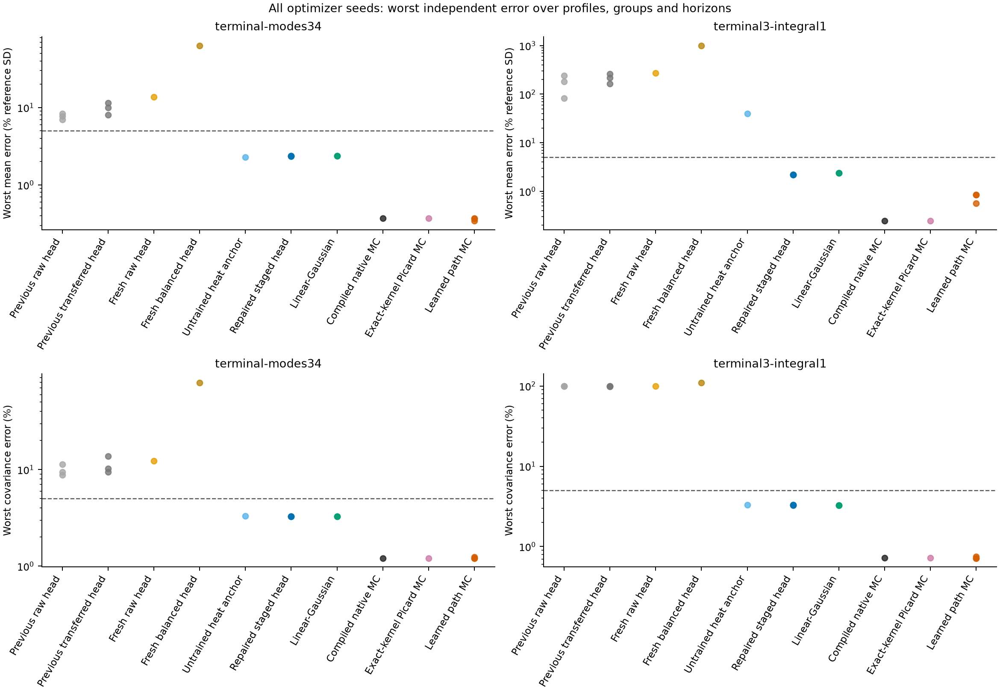
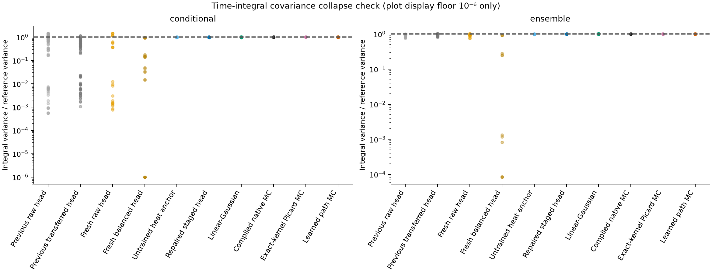
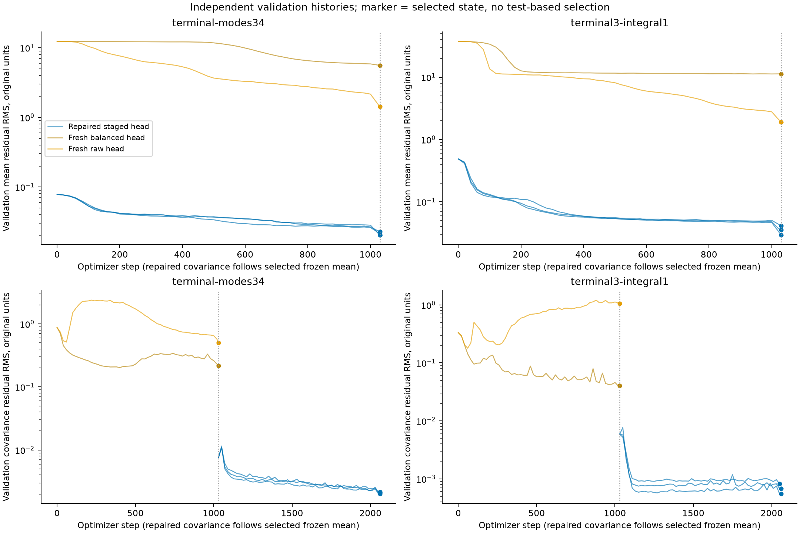
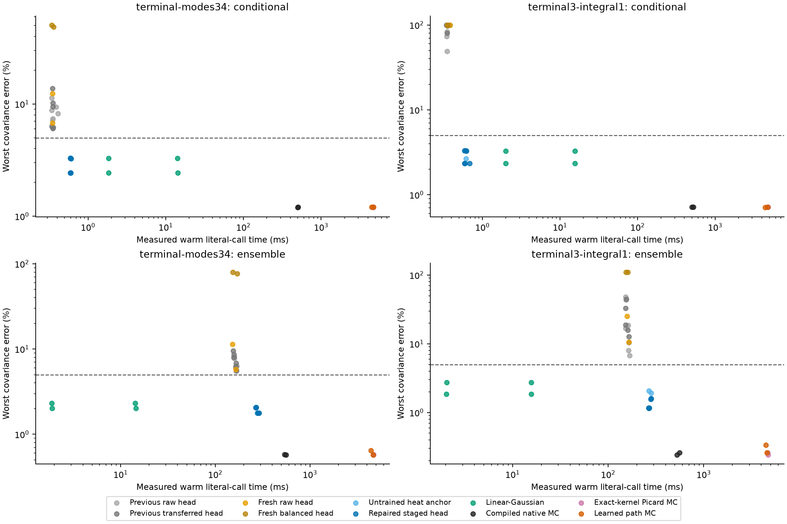
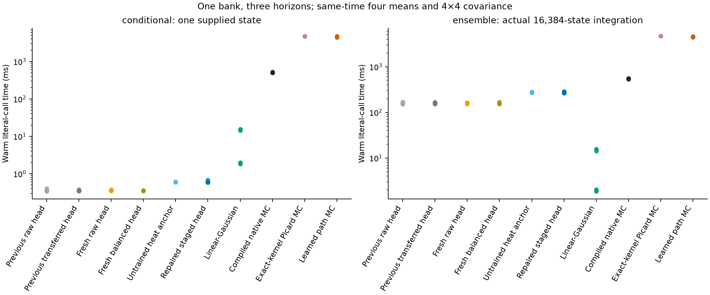
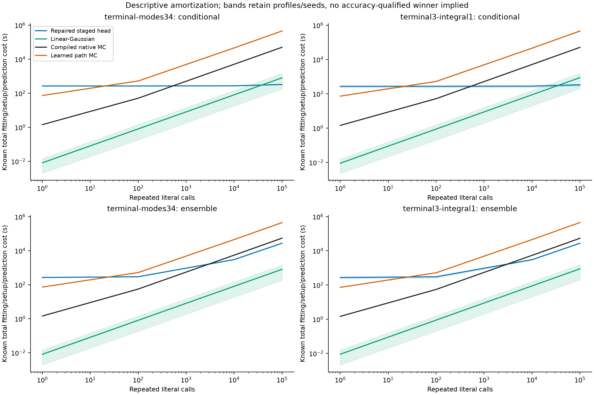
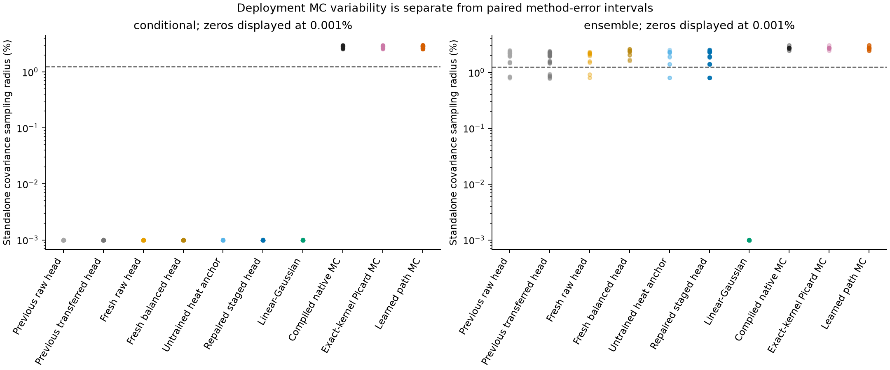

# Statistics neural solver: formulation repair and independent comparison

The repaired mixed terminal/time-integral head has worst mean and covariance point discrepancies of **2.21% of reference SD** and **3.31%**. The untrained heat anchor gives **39.4% / 3.31%**. All optimizer seeds, profiles, anchors and three physical horizons remain in these maxima.

The repaired point errors are below the 5% research target, but the worst covariance discrepancy plus its sampling diagnostic is **6.18%**. The independent sample allocation therefore does not certify the 5% target or an accuracy-qualified cost crossover.

The independent test uses 98,304 fresh reference trajectory families, disjoint from the learner pools, with 198 complete method records. No fitted variant or seed was selected, discarded or refitted using these outcomes. This report concerns the fixed-grid stopped native DK target and same-time moments only.

## Diagnosis and revised formulation

The previous audit found no source-sign or output-normalization defect in the integral equations. The old shared-network ansatz left the leading integral-mean derivative to be learned, and its unbalanced sum of mean/covariance residual losses allowed mean progress alongside worse covariance residuals. Those observations motivated the following preregistered intervention; they do not establish a unique failure cause.

The revised model inserts the exact discrete free-heat mean for terminal observables and running integrals. A deterministic eight-node Gaussian quadrature supplies a positive free-heat covariance anchor with the correct terminal/integral time orders. Separate mean and covariance networks learn corrections using the full interacting, stopped native generator residual. The mean is selected on independent validation and frozen before covariance fitting. Loss scales are fixed per output and covariance pair using training states only. The physical noise is handled by the exact generator trace over face directions; there is no stochastic variational trace noise and no covariance floor.

The anchor itself is an unstopped free-heat approximation, not the interacting stopped solution. Its untrained control is evaluated separately. Boundary gates and killed running sources remain in the learned formulation. The revised networks and staged optimizer allocation increase capacity and fitting budget; this experiment tests a combined formulation/training repair, not an equal-capacity attribution to one architectural change.

The pretest audit verifies the fresh learner families against prior learner and previously exposed test families, replays the addressed horizon/state streams, and verifies reference RNG-address separation before any final reference outcome is materialized. Its immutable audit is retained as report evidence.

The fresh v1 validation controls distinguish two failure mechanisms. With the raw joint loss, a time-integral covariance can shrink while its mean-derived quadratic-variation source remains close to the heat anchor. With balanced joint loss, the optimizer can also shrink that source by flattening the learned mean's state derivatives. Consequently, balancing the two losses alone need not repair the statistical task. Staging freezes the selected mean source during covariance fitting, while the analytic mean anchor protects the known integral leading term. These observed diagnostics support this mechanism for the tested fits; they do not identify a universal failure mode.

## Frozen experiment

G=32, N=2048, D=1, κ=0.75, a₂=0.1 and T=1/16. Initial histograms use IID multinomial draws from uniform and exp(0.2 cos x) laws. The stopping threshold is 0.01/(2π), with freezing at the first polygon crossing. Running integrals stop accumulating at that hit. All stopped realizations are retained; averaging survivors is forbidden.

The two four-output banks are terminal sine/cosine modes 3 and 4, and terminal mode 3 plus killed integrals of mode 1 divided by the fixed final horizon. Queries are at 1/64, 1/32 and 1/16. Native cellwise reconstruction uses exact Fourier cell integrals, with identical definitions for every solver.

Fresh training and validation share literal pools across all ten fits: 128 and 64 independent paths per profile, respectively, producing 4,096 and 2,048 collocation state/horizon rows. Four seed-zero v1 ablations retain raw and training-initial-RMS losses for both banks. Six repaired fits retain all three optimizer seeds. Each repaired stage has 1,000 AdamW steps plus 30 LBFGS steps; each v1 fit has one such allocation. All twelve historical heads, the two untrained repaired controls, three finest path seeds, compiled native Euler, exact-kernel Picard and two literal three-query Gaussian steps remain in the independent comparison.

## Independent accuracy

| Bank | Method | Per-model worst mean (% SD) | Worst covariance (%) |
| --- | --- | --- | --- |
| terminal-modes34 | Previous raw head | 7.01–8.3 | 8.78–11.3 |
| terminal-modes34 | Previous transferred head | 8.09–11.5 | 9.46–13.8 |
| terminal-modes34 | Fresh raw head | 13.7 | 12.4 |
| terminal-modes34 | Fresh balanced head | 63.4 | 79.6 |
| terminal-modes34 | Untrained heat anchor | 2.29 | 3.31 |
| terminal-modes34 | Repaired staged head | 2.34–2.38 | 3.27–3.27 |
| terminal-modes34 | Linear-Gaussian | 2.36–2.36 | 3.27–3.27 |
| terminal-modes34 | Compiled native MC | 0.368 | 1.21 |
| terminal-modes34 | Exact-kernel Picard MC | 0.369 | 1.21 |
| terminal-modes34 | Learned path MC | 0.342–0.369 | 1.21–1.25 |
| terminal3-integral1 | Previous raw head | 82.8–242 | 99.5–99.9 |
| terminal3-integral1 | Previous transferred head | 165–264 | 98–99.9 |
| terminal3-integral1 | Fresh raw head | 271 | 99.9 |
| terminal3-integral1 | Fresh balanced head | 1e+03 | 110 |
| terminal3-integral1 | Untrained heat anchor | 39.4 | 3.31 |
| terminal3-integral1 | Repaired staged head | 2.18–2.21 | 3.28–3.31 |
| terminal3-integral1 | Linear-Gaussian | 2.36–2.36 | 3.27–3.27 |
| terminal3-integral1 | Compiled native MC | 0.245 | 0.718 |
| terminal3-integral1 | Exact-kernel Picard MC | 0.245 | 0.718 |
| terminal3-integral1 | Learned path MC | 0.561–0.854 | 0.716–0.748 |

Ranges retain individual optimizer seeds and, for LGA, the two numerical steps. Every maximum covers both profiles, all fresh conditional/ensemble groups and all query times. Covariance errors are normalized by products of reference standard deviations. A large mean percentage measures reference standard deviations, not relative error in a possibly tiny mean. Individual means, variances and all covariance entries are saved in the CSVs.

The learned correction is needed for the mixed-bank integral means: the untrained anchor's worst mean discrepancy is about 39.4% of reference SD. For the terminal-only bank, the untrained anchor is already comparable to the repaired head and LGA. This experiment supports the integral repair; it does not show a general learned accuracy improvement for the high terminal modes.

The variance-ratio figure displays every integral output, horizon, profile, anchor and seed. Its plotting floor does not modify any prediction or CSV value. A ratio near one is distinct from a guarantee on the complete covariance matrix.

## Training behavior

The loss figure uses raw residual RMS in the original internal units, since normalized objectives differ between formulations. The repaired covariance stage begins after step 1,030 with the selected mean frozen; its checkpoint loader verifies equality of all mean-network tensors throughout covariance-stage states. Selected validation states are marked. The covariance curve starts from a reconstructed baseline with that selected mean and the still-initial covariance head. Its source Γ(u) differs from the source before mean fitting, so the saved original covariance validation is retained only as an explicitly obsolete-target diagnostic in validation_diagnostics.csv; it is not plotted as the covariance-stage baseline. A low residual by itself does not establish prediction accuracy.

| Fit family | Models | Parameters | Fit seconds/model | Prior trunk seconds |
| --- | --- | --- | --- | --- |
| Fresh raw head | 2 | 3.63e+03 | 106–128 | 0 |
| Fresh balanced head | 2 | 3.63e+03 | 101–126 | 0 |
| Repaired staged head | 6 | 7e+03 | 230–276 | 0 |
| Previous raw head | 6 | 3.63e+03 | 358–460 | 0 |
| Previous transferred head | 6 | 3.63e+03 | 257–416 | 128–132 |
| Learned path MC | 6 | 706 | 67.2–80.5 | 0 |

All ten fresh fits together recorded **2045.3 model fitting seconds**, including ablations and every optimizer seed. Fresh workers recorded **1998.3 CPU seconds** across attempts. Concurrent worker wall times are not summed and presented as batch elapsed time. Shared data generation is **1.154 seconds**, charged once in a fresh deployment. Historical transferred heads additionally pay their original trunk fit; historical data-generation costs are not fully available and remain explicitly unrecorded.

| Mixed-bank validation control | Seed | Sine-integral QV / heat | Sine-integral covariance / heat |
| --- | --- | --- | --- |
| repaired | 0 | 1.0172 | 1.0138 |
| repaired | 1 | 1.0173 | 1.0138 |
| repaired | 2 | 1.0172 | 1.0138 |
| v1-none | 0 | 0.99575 | 0.0090531 |
| v1-balanced | 0 | 0.00040694 | 0.018462 |

These ratios use validation states and the known heat anchor, not independent interacting truth. collapse_diagnostics.csv retains every output, including cosine integrals and terminal channels. validation_diagnostics.csv retains per-stage raw and normalized residuals; the audit JSON preserves the frozen-mean hashes. validation_components.csv preserves per-output and per-pair physical, internal and dimensionless residual diagnostics without pooling their scales.

## Inference and total cost

| Method | Conditional warm ms | Initial-ensemble warm ms | Restore/preparation ms |
| --- | --- | --- | --- |
| Previous raw head | 0.34–0.409 | 152–169 | 45.3–966 |
| Previous transferred head | 0.342–0.38 | 153–167 | 51.8–56.5 |
| Fresh raw head | 0.349–0.382 | 152–165 | 31–70.5 |
| Fresh balanced head | 0.34–0.36 | 153–170 | 30.3–33.4 |
| Untrained heat anchor | 0.586–0.611 | 268–282 | 2.59–3.29 |
| Repaired staged head | 0.586–0.683 | 265–289 | 48.1–56.8 |
| Linear-Gaussian, max step 1/128 | 1.83–2 | 1.87–2.04 | 0 |
| Linear-Gaussian, max step 1/1024 | 14.2–15.6 | 14.3–15.6 | 0 |
| Compiled native MC | 499–526 | 527–560 | 0.00133–0.00683 |
| Exact-kernel Picard MC | 4.65e+03–4.82e+03 | 4.67e+03–4.72e+03 | 10.4–18.6 |
| Learned path MC | 4.4e+03–4.77e+03 | 4.4e+03–4.64e+03 | 84.3–912 |

Each call returns one declared bank's four means and same-time 4×4 covariance matrices at three horizons. Conditional neural timings use one supplied histogram; batched 64/256-state throughput remains in costs.csv. Ensemble heads actually draw and integrate 16,384 fresh initial histograms. LGA uses analytic IID initial covariance and the literal three-query algorithm in both accuracy and timing; its two step sizes remain separate in the CSV. Path-based calls actually simulate 16,384 realizations, include fresh physical Brownian forcing and applicable initial histograms, apply exactly one bank and aggregate moments. Only path seed zero is timed; all path seeds remain in accuracy. No large-ensemble cost is extrapolated from a small batch.

Warm timing follows fitting and scientific evaluation, using one CPU thread. Restoration/constructor time and the first measured prediction at each allocation are recorded separately. Cache creation is charged to the first B=1 conditional call of each restored/constructed model; later B=64/B=256 and ensemble timings reuse its known-horizon cache. Their recorded first prediction is therefore first at that allocation, not a fully cold model. For repaired/untrained later-allocation total costs, the measured B=1 first-prediction probe is conservatively charged once as a cache-creation probe, with its output discarded. It is labelled a probe rather than pure preparation. Compilation and path-kernel preparation remain explicit. Uncontrolled Python/OS startup and unknown historical costs are not invented.

total_costs.csv gives 1, 100, 10,000 and 100,000 literal repeated calls: known fitting, prior trunk, shared-data, restoration/preparation, compilation, applicable B=1 cache-creation probe, one first prediction at the requested allocation and subsequent warm calls. This is a cost accounting table, not an accuracy-qualified winner. The separate full-study total includes all fresh ablations and seeds; deploying one fixed model does not require fitting the entire study inventory.

The declared finite-reference accuracy/uncertainty gates produce **0 resolved crossover rows**. All others retain an explicit unresolved or no-saving reason in amortization.csv. Approximate Gaussian law bias and continuous stopping bias remain separate even if a finite-reference diagnostic gate passes.

## Sampling, refinement and interpretation

Whole-family bootstrap intervals use 128 replicates and preserve all horizons/observables from each family. Paired path/reference intervals quantify uncertainty in a method-discrepancy estimate under shared physical noise. They are distinct from the standalone Monte Carlo variability of deploying 16,384 trajectories. Ensemble heads have initial-law integration MC variability; deterministic conditional heads do not. Both quantities and the reference's own sampling variability are saved separately.

The reference step is 2⁻¹³, with coupled 2⁻¹⁴ and 2⁻¹⁵ checks on 1,024 families per group. The report's refinement CSV uses the coupled base-versus-finest comparison. These finite-step differences do not enclose continuous boundary-hitting bias. The 5% normalized statistical error and 1.25% component uncertainty targets remain research targets, not automatic certifications from the fixed sample allocation.

Observed reference stops: **0 / 98,304**. Every stopped path is retained. Zero observed stops does not establish rare-boundary accuracy. The cheap LGA and free-heat controls are unstopped approximations, and agreement in this weak-noise short-horizon setting does not identify them with the stopped DK law.

For fixed supported conditional moments, compare the repaired head's accuracy with LGA and its fitting/setup amortization before choosing it. The repaired head has cheaper warm conditional calls here; the no-training coarse LGA is the inexpensive choice for occasional queries and initial-ensemble moments at comparable observed statistical errors, subject to its approximation bias. Native Monte Carlo gives smaller finite-reference point discrepancies for these banks at a larger online sampling cost. Initial-ensemble questions also pay initial-law integration for neural heads. Full paths, new observables, joint-time quantities, scalar laws and stopping probabilities remain tasks for path samplers; these heads do not claim those outputs. Classical full paths offer the same observable reuse as neural paths, so flexibility alone is not a learned computational advantage.

Every result, model sidecar, input and report output is checksum indexed in manifest.json. Full weights and raw trajectories remain in their local run directories. The compact documentation archive preserves the report, tables, individual JSON records, stage histories, exact analysis code and a full raw-artifact inventory.

The [compact evidence archive](artifacts/payoff_repair_2026-10-27/README.md) preserves report outputs and checksum-indexed evidence.
